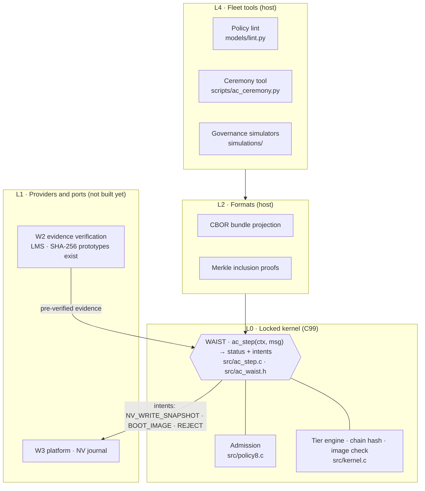
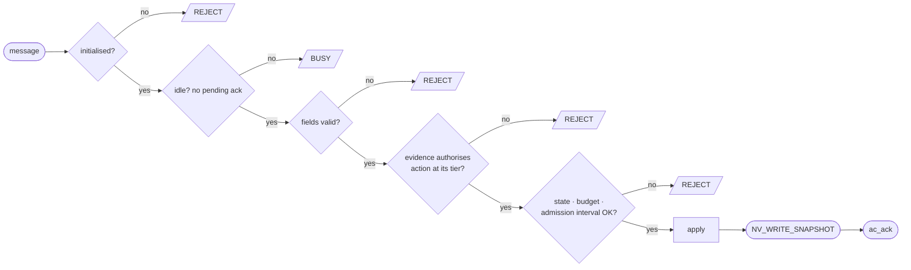
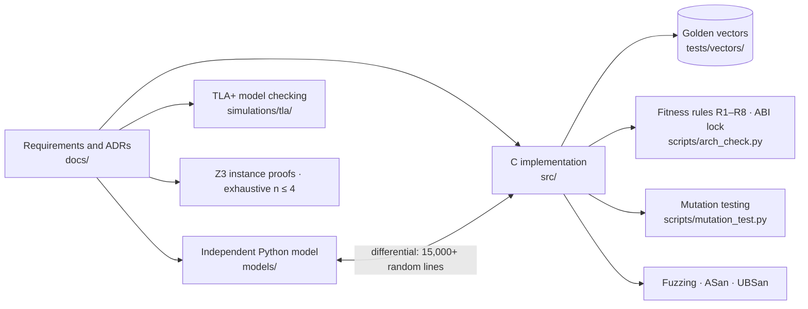

<div align="center">

# KRYPTARA

**A governed-change kernel for devices and artefacts that outlive their makers, their custodians and their cryptography.**

[](https://github.com/kiruthikpurpose/KRYPTARA/actions/workflows/ci.yml)
[](LICENSE)


[Architecture](#architecture) · [How it works](#how-it-works) · [Verification](#verification) · [Status](#honest-status) · [Quick start](#quick-start) · [Documentation](#documentation) · [Roadmap](#roadmap)

</div>

---

## What it is

Long-lived machines (pump controllers, protection relays, CA roots, satellites) must answer one question for decades:
**who may change what this machine trusts, on what evidence, and how does the machine know?**

KRYPTARA answers it with a small kernel that fits in a locked boot stage and is precise enough to prove things about:

| Primitive | Meaning |
|---|---|
| **Evidence atoms** | Up to eight things the device can check itself: a signature under a stored key hash, physical presence, publication in a witnessed log. |
| **Interval-admitted policy tables** | A policy is a monotone 256-bit truth table over the atoms. It is admitted only if it lies in the interval `[Lo, U]` that the declared fault structure allows: safe against the faults you name, live after the losses you name. |
| **Hash-chained authority record** | Every accepted change extends a genesis-bound chain, so history cannot be rewritten. |
| **Staged, haltable effects** | Changes are committed through one mutator and can be halted. A rejected message changes nothing. |

Post-quantum migration is one application of this kernel (retiring a broken assumption class while keeping authority safe and live). So are ownership transfer and CA-root governance (both modelled in this repository).

> **Scope note.** Only the governed-change kernel is verified. The wider "paradigm" in the project title is **Speculative** and unsupported by evidence. See [`docs/vision-and-scope.md`](docs/vision-and-scope.md).

## Architecture

The kernel is an hourglass: many providers and ports below, many tools above, one small frozen interface (the *waist*) in the middle.



The waist is a **pure function over an explicit context**: no I/O, allocation, clock, global state or recursion. That makes it portable, testable exhaustively, and a closed target for a Rust twin, formal proofs and independent re-implementations. Details: [ADR-041](docs/decisions/ADR-041-the-waist-is-a-pure-step-over-an-explicit-context.md), [target architecture](docs/architecture/target-architecture.md).

## How it works

### One step, fixed check order

Every message passes the same gate, in the same order. Nothing is modified before the final apply step, so a rejection leaves the context byte-identical.



### Who can authorise what


### The three results behind the design

1. **Interval theorem.** For a declared fault structure, the policies that are both safe and live are exactly the monotone tables between a computable lower bound `Lo` and upper bound `U`.
2. **Class-count law.** With `k` independent evidence classes, tolerating `t` compromised and `s` lost classes is possible if and only if `k ≥ t + s + 1`.
3. **Recovery is an attack path.** Any recovery route is also a route for an attacker; the law prices it.

Proofs and their machine checks: [`docs/theory/mathematical-foundations.md`](docs/theory/mathematical-foundations.md), [`docs/theory/proofs.md`](docs/theory/proofs.md).

## Verification

Every behaviour has four artefacts that must agree: prose, an independent model, the C code and golden vectors.



| Check | What it gives |
|---|---|
| `scripts/run_all_checks.sh` | 37 steps covering theory, C vs reference, fuzzing, protocols, PQC conformance, waist and architecture rules |
| `scripts/arch_check.py` | Rules R1–R8 (pure and closed kernel, strict build, no mutable globals, no recursion, stack bound, ABI lock) with a self-test that plants six violations |
| `scripts/mutation_test.py` | `policy8.c`: 46 of 46 detectable mutants killed. `ac_step.c`: 105 of 129 (81%), survivors open |
| `scripts/audit_docs.py` | Document audit: links, IDs, duplicate claims |

## Honest status

Every claim carries a class (Established · Derived · Proposed · Hypothesis · Speculative · Refuted) in the [evidence register](docs/research/evidence-register.md). **"Not run" is a valid state, and it is used.**

| Gate | State |
|---|---|
| Theory, C vs Python, projection, fail-closed API, fuzzing | Passing in this repository |
| Waist `ac_step` (C vs model, golden vectors, fitness rules) | Passing on the host |
| GATE-07 · admission size ≤ 1,024 B on Cortex-M0+ | **Fails as worded**: 1,196 B measured in CI |
| GATE-08 · TLA+ base model | Not passed (reduced models pass) |
| GATE-09/10 · silicon timing and torn writes | Not run, no silicon. A literature survey already fails GATE-10 as worded |
| GATE-11 · hash-family independence review | Not run |
| Rust twin · independent re-implementation · cryptographer review | Not run |

See [`docs/validation/validation-gates.md`](docs/validation/validation-gates.md) for the full table. Hazard rates in the governance simulations are illustrative, not measured. Novelty has not been patent-searched.

## Quick start

Requires `gcc` and `python3`. `arm-none-eabi-gcc` is optional (the size gate runs in CI).

```sh
git clone https://github.com/kiruthikpurpose/KRYPTARA.git && cd KRYPTARA
pip install -r requirements.txt            # requirements-dev.txt adds z3, cbor2 and PQC libraries
make help                                  # list targets
make check                                 # all 37 checks
make step                                  # waist: C vs model vs golden vectors
make arch                                  # architecture fitness rules and self-test
make audit                                 # documentation audit
```

## Repository map

```text
src/            C kernel: ac_step.c (waist), policy8.c (admission), kernel.c, ac_waist.h, waist-v1.abi
models/         Independent Python models, theory checks, differential checkers
tests/          C tests, fuzzing, red-team R2 harness, golden vectors (tests/vectors/)
simulations/    Governance and hazard simulations, TLA+ models
scripts/        Check runners, architecture and mutation tooling, ceremony tool
docs/           Theory, architecture, specifications, ADRs, validation, research
research-archive/  Historical material, provenance only
```

## Documentation

| Start with | |
|---|---|
| [`docs/vision-and-scope.md`](docs/vision-and-scope.md) | Identity, scope, what the name can defensibly mean |
| [`docs/architecture/target-architecture.md`](docs/architecture/target-architecture.md) | Where the code stands and the path forward |
| [`docs/theory/mathematical-foundations.md`](docs/theory/mathematical-foundations.md) | The three theorems |
| [`docs/research/evidence-register.md`](docs/research/evidence-register.md) | Every claim with its class and check |
| [`docs/specifications/requirements.md`](docs/specifications/requirements.md) | Requirements and traceability |
| [`docs/decisions/`](docs/decisions) | Architecture decision records |
| [`docs/index.md`](docs/index.md) | Everything else |

## Roadmap


Open decisions for the maintainer: the GATE-07 size budget, the lost-escrow-key conflict ([OQ-14](docs/research/open-questions.md)), and the meaning of "Yielding" in the project name ([OQ-01](docs/research/open-questions.md)).

## Contributing, security, citing

[CONTRIBUTING](CONTRIBUTING.md) · [Code of conduct](CODE_OF_CONDUCT.md) · [Governance](GOVERNANCE.md) · [Security policy](SECURITY.md) · [Support](SUPPORT.md) · [Changelog](CHANGELOG.md) · [Cite this work](CITATION.cff)

## Licence

Copyright 2026 Kiruthik M R. Licensed under the [Apache License, Version 2.0](LICENSE). Third-party material under `research-archive/` and `src/legacy/` keeps its original terms ([NOTICE](NOTICE)).

Created and maintained by **Kiruthik M R** ([@kiruthikpurpose](https://github.com/kiruthikpurpose)).
