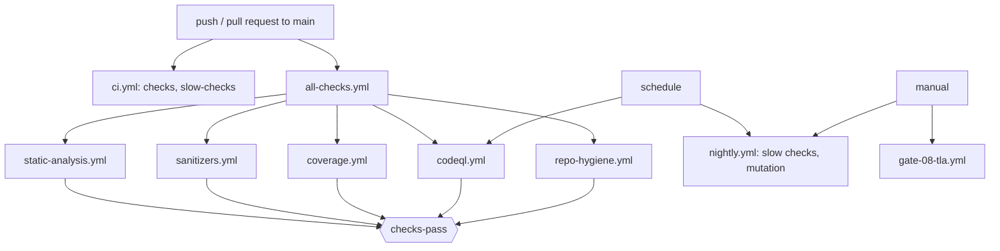

# CI architecture

Status: Established for what the files contain; none of the workflows below has run on GitHub yet
(not run on GitHub; each was validated locally as listed under "Local commands").

## Workflows

| Workflow | Trigger | What it catches |
|---|---|---|
| `ci.yml` (existing) | push, PR to main | Everything in `scripts/run_all_checks.sh` (steps [1]-[37], incl. Cortex-M0+ size) and `audit_docs.py`; `slow-checks` job runs `run_slow_checks.sh`. |
| `all-checks.yml` | push, PR to main, manual | Orchestrator. Calls the five workflows below and ends in the single job `checks-pass`. |
| `static-analysis.yml` | called | `c-strict-gcc`: `-Wall -Wextra -Wpedantic -Wconversion -Wsign-conversion -Wshadow -Wcast-qual -Wnull-dereference -fanalyzer -Werror` on `src/*.c` (null derefs, leaks, double free, silent integer narrowing). `cppcheck`: gating on warning/performance/portability, style report as artifact. `shellcheck`: `scripts/*.sh`. `python-lint`: ruff rules E9+F (syntax, undefined names, redefinitions) and `py_compile` of every tracked `.py`. |
| `sanitizers.yml` | called | gcc and clang, ASan+UBSan, running `fuzz_policy8`, `step_test self`, `kernel_test self`, `test_projection`. Out-of-bounds, use-after-scope, leaks, signed overflow, bad shifts, misaligned access. |
| `coverage.yml` | called | `scripts/ci/coverage_gate.py`: merged gcov line and branch coverage of `src/` over the four C tests; fails under the floors; report uploaded as artifact `coverage-report`. |
| `codeql.yml` | called, weekly | CodeQL `security-and-quality` for C/C++ and Python (results under Security > Code scanning; needs code scanning enabled for the repository). |
| `repo-hygiene.yml` | called | `secret_scan.py` (key blocks, tokens, secret assignments), actionlint (pinned 1.7.7) on all workflows, `check_links.py` (relative links and anchors in `*.md`, not `research-archive/`), `file_hygiene.py` (trailing whitespace and tabs in C, final newline, files over 2 MB, conflict markers, CRLF), `check_commits.py` on PRs (no `Co-Authored-By`, no "Generated with"). |
| `nightly.yml` | 02:23 UTC daily, manual | `run_slow_checks.sh` (power-cut sweep, full hazard sweep) and `mutation_test.py` and `mutation_test.py --step` in parallel jobs; logs uploaded. |
| `gate-08-tla.yml`, `rust-twin.yml` (existing) | manual / push | TLA+ base configuration (GATE-08); Rust versus C differential tests. |

## How they connect



Branch protection: require `all-checks / checks-pass` and `checks / checks` (from `ci.yml`). `ci.yml`
keeps its own triggers rather than being called by `all-checks.yml`, so renaming nothing that already
exists. `checks-pass` accepts only `success` from each called workflow; `commit-hygiene` runs only on
pull requests and is skipped on pushes (a skipped job inside a called workflow still counts as success).
Called workflows use fixed concurrency group names (not `github.workflow`) because inside a called
workflow that expression resolves to the caller and would cancel the parent run.

## Tuning record (2026-11-13)

- Strict gcc build: zero diagnostics on the current tree with every flag above, so nothing is suppressed.
- Coverage measured locally: lines 93.7% (267/285), branches 81.8% (297/363). Floors: 88% lines, 72% branches.
  Raise them as coverage improves; do not lower them to turn a failing run green.
- ruff: rules E9 and F, with F401/F841/F403/F405 ignored (14+ existing unused imports/locals and an
  intentional star import in `models/step_check.py`). `models/layout8.py:18` has an undefined name
  `set_` in a dead branch; F821 is ignored for that file only, in `ruff.toml`, until it is fixed.
- File hygiene baseline: `src/prototypes/test/test_powerfail.c:16` has trailing whitespace; it is listed in
  `scripts/ci/hygiene_baseline.txt` so new violations fail while this one is reported.
- cppcheck suppressions live in `.cppcheck-suppressions` (missingIncludeSystem, unusedFunction).

## Local commands (no Makefile needed)

```sh
# strict build + analyzer (static-analysis, C)
for f in src/policy8.c src/ac_step.c src/kernel.c src/p8test.c; do gcc -std=c99 -O2 -c $f -I src -o /dev/null -Wall -Wextra -Wpedantic -Wconversion -Wsign-conversion -Wshadow -Wstrict-prototypes -Wcast-qual -Wformat=2 -Wundef -Wdouble-promotion -Wnull-dereference -fanalyzer -Werror; done
cppcheck --std=c99 --enable=warning,performance,portability --suppressions-list=.cppcheck-suppressions -I src --error-exitcode=1 src/*.c
shellcheck --severity=warning --external-sources scripts/*.sh
ruff check models scripts simulations tests          # or: python3 -m pyflakes models scripts
# sanitizers (use clang by setting CC)
CC=gcc; for t in fuzz_policy8 step_test kernel_test test_projection; do $CC -std=gnu99 -O1 -g -fsanitize=address,undefined -fno-sanitize-recover=all -o build/$t tests/$t.c; done
build/fuzz_policy8; build/step_test self; build/kernel_test self; build/test_projection
# coverage
python3 scripts/ci/coverage_gate.py
# repo hygiene
python3 scripts/ci/secret_scan.py
python3 scripts/ci/check_links.py
python3 scripts/ci/file_hygiene.py
python3 scripts/ci/check_commits.py --range origin/main..HEAD
actionlint                                           # if installed
# existing suites
bash scripts/run_all_checks.sh; python3 scripts/audit_docs.py; bash scripts/run_slow_checks.sh
python3 scripts/mutation_test.py; python3 scripts/mutation_test.py --step
```
