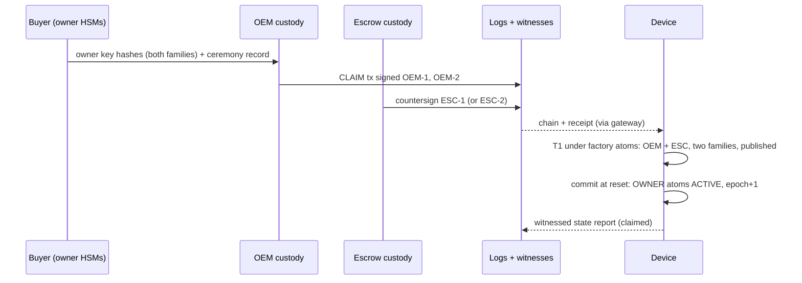
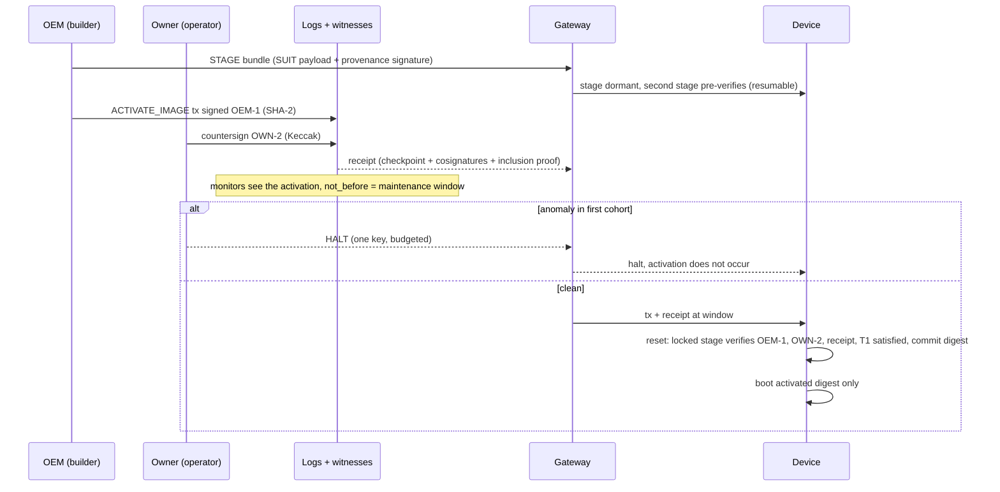
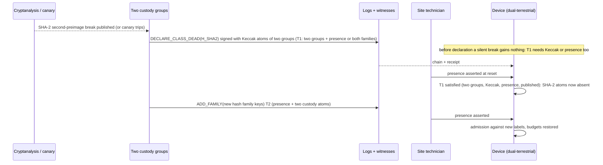
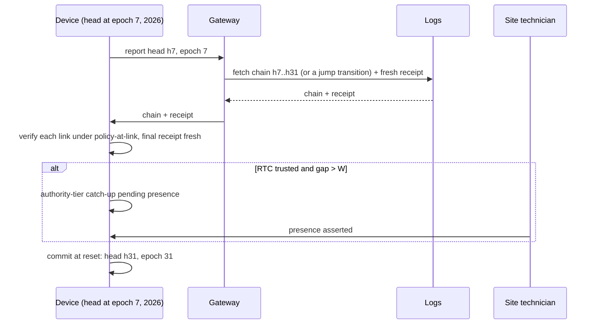

<!-- Title: Lifecycle from manufacture to resurrection -->
> **Provenance.** Sliced from legacy Rev 4 (`research-archive/legacy-blueprints/L5_Blueprint_Rev4_monolith.md`, matching sections).
> Document level: L3. Evidence labels: [P] proved, [M] machine-checked or measured by a script in this repo, [E] estimate, [S] standard/literature, [H] hypothesis.
> Reviewed against the R2 red-team findings on 2026-11-12; conflicting passages were corrected in place (see CHANGELOG).

# 7. The lifecycle, from manufacture to resurrection

### 7.1 Manufacture and provisioning

At the factory the locked stage is written and locked. The device receives its OEM and ESCROW atoms (key hashes, labels derived and declared), its PRES descriptor and its WIT log-set descriptor, plus default tables for its profile, `floor = 0` and `epoch = 0`. Its first transition is **TEST → UNCLAIMED**. That is a T2 action at the factory, so presence is asserted on the line. It is published, and its log entry carries a short human-readable *genesis record*: what each field means, which specification version applies, and where the specification and vectors are archived (§19). From this point every change to the device is a public, chained, admitted transition.

### 7.2 Claim

If the OEM has disappeared before the sale, the owner can still claim at the site. The escrow agent co-signs with both escrow keys and a person asserts presence: a T2 evidence set (presence + two custody atoms + publication). This closes the Rev 2 gap in which a device unclaimed before its OEM died stayed replaceable-only.

### 7.3 Routine update

### 7.4 Key compromise and rotation

A stolen key alone authorises nothing above HALT, so the worst it can do is spend its halt budget. The holder rotates with `ROTATE_KEY`: the T1 evidence plus a continuity signature from the outgoing key. If the key was *lost* rather than stolen, the continuity signature is impossible, so the group is re-keyed without its participation, except that installing into a still-ACTIVE slot requires that slot holder's co-signature (REQ-LIFE-02, ADR-015). That is `REKEY_GROUP` at T2 in terrestrial profiles, or T1 in remote ones.

### 7.5 Ownership transfer

The seller's OWNER atoms sign `TRANSFER_OWNER` over the buyer's key hashes, and one other group countersigns (T1). The FDO voucher chain stays off-device as evidence. Bearer vouchers remain rejected (J-02).

### 7.6 A hash family breaks

A remote profile cannot do the presence steps. After a family break it either freezes, which is safe, or enters a declared single-family degraded mode, which is live but unsafe against a second break (C-16 offers a third class). Over 40 years under the reference hazards, governance was permanently lost in 39% of runs for freeze-only, 9.9% for degraded mode and 1.0% for the terrestrial presence design [M].

### 7.7 The vendor disappears

`SOVEREIGN_EXIT` is a T2 action in terrestrial profiles: OWNER and ESCROW atoms plus presence, published and delayed. It retires the OEM atoms. The device then reports *below budget*, because T1 is no longer live after a further group loss (verified [M]). The owner appoints a replacement custodian, for example a service integrator or a second escrow agent, with `REKEY_GROUP` into the retired group's slots. If the OEM is alive but hostile, its halts are bounded by the halt budget and cancelled by a T1 RESUME from OWNER + ESCROW.

### 7.8 Two custodians are lost

The OEM went bankrupt and the escrow agent dissolved, so only the owner's two keys remain. T1 is unsatisfiable, since it needs two groups. T2 recoverable is satisfiable: presence plus the owner's two keys, published, after the delay. The owner re-keys the two lost groups to new custodians, and budgets are restored. The cost of this liveness is that a site insider colluding with one custodian could do the same. That is a two-fault event only if the owner does not control the site; an owner who controls the site satisfies recoverable T2 alone (F-R2-04), which REQ-LINT-03 and REQ-PRES-02 exist to catch. Either way it is publicly logged and delayed (Theorem 3). Fleets that prefer the opposite trade choose the fortress constitution (C-14) and accept frozen governance after two losses.

### 7.9 A device wakes after twelve years

Bound (§3.7): this is safe if at most one class broke during the sleep, and publicly visible otherwise. A device without an RTC cannot know it slept. Its owner must treat long-dormant spares as needing presence-backed re-claim by procedure.

### 7.10 Decommissioning and resurrection

`LIFECYCLE → DECOMMISSIONED` (T2) retires every atom except a *resurrection anchor*. By default the anchor is the two ESCROW atoms. It also burns the floor to its maximum, so no previously activated image can boot, and it publishes a final record. A decommissioned device can be resurrected only by `REACTIVATE`: T2 with presence and the anchor, followed by a fresh CLAIM. Retiring the anchor makes the device permanently inert for authority; it can then only be physically re-provisioned, if its locked stage is replaceable at all. Resale of a working device uses `TRANSFER_OWNER`, not decommissioning.

### 7.11 After the device

Because history lives in public logs with witnessed checkpoints, the authority history of a device can be checked long after the device is scrap. That holds as long as evidence is renewed (RFC 4998-style) before the classes that signed it age out. The renewal schedule is generated by the planner from label-retirement dates.

---

