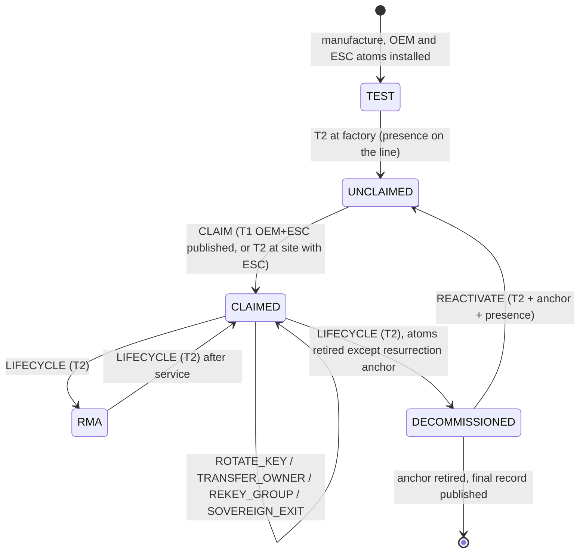

<!-- Title: Mechanisms in depth -->
> **Provenance.** Sliced from legacy Rev 4 (`research-archive/legacy-blueprints/L5_Blueprint_Rev4_monolith.md`, matching sections).
> Document level: L2. Evidence labels: [P] proved, [M] machine-checked or measured by a script in this repo, [E] estimate, [S] standard/literature, [H] hypothesis.
> Reviewed against the R2 red-team findings on 2026-11-12; conflicting passages were corrected in place (see CHANGELOG).

# 6. Mechanisms in depth

### 6.1 Signature atoms

* **Algorithms in the locked stage.** LMS/HSS (RFC 8554; NIST SP 800-208, which also approves SHAKE256-based LMS and XMSS parameter sets [F]) under SHA-256, and under SHAKE256 in the dual profile. SLH-DSA (FIPS 205) is added where its verifier fits. ML-DSA (FIPS 204) is an atom only where its verifier fits in the locked stage (C-06). Note that ML-DSA uses SHAKE128/256 internally [F], so its assumption labels include H_KECCAK *and* LATTICE. It is never independent of a SHAKE-based hash signature. FN-DSA (FIPS 206) is not final: NIST said in April 2026 that the draft was in administrative approval, and no draft had appeared by 6 November 2026 [F].
* **Stateful-signature custody.** LMS/HSS keys live in HSMs with index reservation (reserve, then sign) and no backup-restore of state. The algorithm descriptor's "stateful" flag makes the lint demand this. Per the red-team, two LMS slots under one HSM product share an operational fault. The ceremony declares that dependency as an infrastructure label, so the lint counts it.
* **Per-key digest rule (D-05 carry).** Each signer signs `TBS` hashed under its own family, so a SHA-2 collision cannot be transplanted into a Keccak signer's message and vice versa.
* **Continuity signature for rotation.** A T1 key rotation inside an atom's labels carries a signature by the *outgoing* key over the incoming key hash as well as the T1 evidence. A thief holding one key can neither rotate alone nor pre-empt the honest holder without a second group.
* **Duplicate rejection.** The device refuses any state in which two ACTIVE atoms share a key hash.

### 6.2 Actions and tiers

| Action | Tier | Payload bound by `payload_digest` | Notes |
|---|---|---|---|
| `STAGE` | provenance only: any one ACTIVE custody SIG | bundle digest, SVN | No effect; dormant; prevents junk staging |
| `ACTIVATE_IMAGE` | T1 | image digest, SVN ≥ floor, `not_before` | **Code is authority (D-27):** the locked stage boots only the activated digest |
| `HALT` | T0 | bundle ID, scope | Budget *h* per atom per epoch |
| `RESUME` | T1 | bundle ID | Cancels halts on that bundle |
| `ADVANCE_FLOOR` | T1 | new floor | Hardware shadow advanced after commit |
| `ROTATE_KEY` | T1 + continuity signature | atom index, new key hash (labels unchanged) | Same group, same family |
| `TRANSFER_OWNER` | T1 with current OWNER atoms in the evidence | new OWNER key hashes | Single hop; FDO voucher chain kept off-device as evidence |
| `SETTINGS_SETPOINT` | T1 + device echo | settings digest | Echo key from a different group |
| `SETTINGS_ENVELOPE_TIGHTEN` | T1 + device echo | limit table digest | Tighten-only check on the limit table |
| `TIGHTEN_TABLE` | T1 | tier, new table | Device checks new ≤ old and new ≥ Lo |
| `DECLARE_CLASS_DEAD` | T1 | label bit | Tightening; lint reports any budget shortfall; a canary trip (C-12) may perform it automatically for classical families |
| `CLAIM` | T1 under factory atoms (OEM + ESC, both families, published), or T2 at site (presence + two custody atoms) | first owner's key hashes | Escrow-assisted claim at site rescues unclaimed devices of a dead OEM |
| `REKEY_GROUP` | T2 (terrestrial); T1 (remote) | group, new key hashes | Recovery from a lost custodian; installing into a still-ACTIVE slot requires that slot holder's co-signature (REQ-LIFE-02, ADR-015) |
| `SOVEREIGN_EXIT` | T2 (terrestrial); T1 (remote) | retire OEM atoms | OWNER + ESCROW, OEM excluded; renewal invariant then asks for a third custodian |
| `ADD_ATOM`, `RELABEL`, `ADD_FAMILY` | T2 | atom descriptors | Labels from ceremony records, logged |
| `WIDEN_TABLE` | T2 | tier, new table | Device checks new ≤ U |
| `SETTINGS_ENVELOPE_WIDEN` | T2 + device echo | limit table | D-19 |
| `COUNTER_RESET` | T2 | counter ID, value | Recorded; never automatic |
| `DEBUG_ENABLE` | T2 | scope, expiry (next reset) | Emits a scoped intent; debug never re-enables silently |
| `LIFECYCLE` (RMA, DECOMMISSION) | T2 | target state | Decommission retires all atoms except a resurrection anchor (§7.10) |
| `REACTIVATE` | T2 + fresh CLAIM | new atoms | Only from DECOMMISSIONED-with-anchor |

**No side doors (P-4).** The atlas identified six separate authority chains: boot, debug, RMA, ownership, provisioning and configuration. Here each is an *action* above, so all six pass through the same admission rule, evidence and publicity. A port that implements any of them outside `ac_step` fails conformance.

### 6.3 Admission: the algorithm and its cost

```c
/* Admission core of src/policy8.c (signatures as of 2026-11-12; M0+ size unmeasured since the
 * additions below, see CLM-07). Error returns: -1 malformed input, -2 unsatisfiable budget. */
int  ac_tbl_monotone(const ac_tbl_t *t);                                   /* 256 x 8 edge checks */
int  ac_faults_from_labels(uint8_t *out, unsigned cap, const uint32_t lab[8],
                           uint8_t present, uint8_t singles, uint32_t label_filter);
int  ac_tbl_upper(ac_tbl_t *U, const uint8_t *f, unsigned nf, unsigned k, uint8_t expo,   const uint32_t *excl);
int  ac_tbl_lower(ac_tbl_t *L, const uint8_t *f, unsigned nf, unsigned k, uint8_t absent, const uint32_t *excl);
int  ac_tbl_within (const ac_tbl_t *t, const ac_tbl_t *U, const ac_tbl_t *L);  /* (t & ~U) | (L & ~t) == 0 */
int  ac_tbl_tighten(const ac_tbl_t *n, const ac_tbl_t *o);                     /* (n & ~o) == 0 */
void ac_tbl_project(ac_tbl_t *out, const ac_tbl_t *t, uint8_t present);        /* REQ-ADM-05 */
int  ac_tbl_is_projected(const ac_tbl_t *t, uint8_t present);
int  ac_tbl_authorises(const ac_tbl_t *t, uint8_t evidence_set);               /* table lookup */
/* Added after R2: */
int  ac_tbl_dual_authorises(const ac_tbl_dual_t *d, uint8_t S);                /* REQ-NV-01 */
int  ac_key_install_authorised(const ac_tbl_t *t, uint8_t S, uint8_t holder_atom, int active); /* REQ-LIFE-02 */
int  ac_no_duplicate_keys(const uint8_t kind[8], const ac_key_hash_t key[8], uint8_t present); /* REQ-EVD-03 */
void ac_derive_labels(uint32_t out[8], const uint8_t provider[8], const uint32_t declared[8], uint8_t present); /* REQ-EVD-02 */
```

* **Where it runs.** Admission runs when a T1 or T2 transition installs or changes a table, labels or atoms. Authorisation at use time is a single table lookup on the evidence bitmap, done twice with complementary encodings (D-20b) against the table and its stored complement.
* **Cost [E].** Computing U for 2-fault budgets with 12 fault classes is 256 × 66 pair tests ≈ 1.7 × 10⁵ simple operations, about 3–10 ms at 64 MHz on M0+. That is negligible against one LMS verification (≈ 42 ms [E]). EXP-19 measures it.
* **Correctness evidence [M].** The C code matched an independent Python reference on 3,000 random label structures and tables, covering k = 0, 1, 2, exposure atoms, absent atoms and random non-monotone tables, with 0 mismatches. Mutation testing kills all 46 detectable mutants of `src/policy8.c` (CLM-40), and a 200,000-input fuzz run under ASan/UBSan finds nothing (CLM-35). CBMC bounded proofs and a Lean or Isabelle proof of Theorem 1 are Phase 0 work (EXP-10).

### 6.4 The presence atom

Presence is the only evidence whose cost to an attacker **scales with the number of devices**. A stolen key forges for the whole fleet. Being physically present at 10,000 devices costs 10,000 visits. That is why presence guards the constitution tier: a mass compromise of T2 powers needs mass physical access.

**Requirements (D-25).**
1. The locked stage samples the input itself at reset, before any second-stage code runs, and requires assertion held across reset with debounce. The second stage is not running when the sample is taken, so it cannot fake it.
2. The input cannot be driven by the device's own outputs. Use an input-only pin, an external latch set by a physical actuator, or a switch contact that the locked stage configures as input before sampling.
3. Accepted forms are a key switch, a jumper, a held button at power-on, a service connector, or an optical or NFC local port carrying a short challenge-response. The local-token port is C-13; its parser is fuzzed.
4. Presence is per device and per transition. The `ac_tx` commits to `presence_required`, and the commit records that presence was sampled.
5. Presence domains are labelled by site, so two devices at one site share a site class.

**Limits [I].** Presence does not authenticate *who* is present. The class it represents is "anyone with physical access to this site", including insiders, contractors and paid remote-hands services. Supply-chain implants that assert the line are a hardware-trust problem shared with every physical control. The design therefore never lets presence act alone: T2 always needs custody atoms as well. That is not a second fault if the custody group supplying them also controls the site (F-R2-04, REQ-LINT-03, REQ-PRES-02).

### 6.5 The publicity atom

* **Log-set descriptor** (hashed into the atom's `ref`): two or more independent logs, each with an origin name, a witness key list and threshold k-of-n, and a maximum checkpoint age.
* **Receipt** delivered with a transition: a checkpoint in C2SP `tlog-checkpoint` form, ≥ k cosignatures in `tlog-cosignature` form (C2SP tlog-witness v1.1.0, 7 Oct 2026 [F]), and a Merkle inclusion proof in RFC 9162 audit-path form [F]. SCITT (RFC 9943, June 2026 [F]) statements carry the transition. Our profile *requires* checkpoints and cosignatures, which SCITT leaves optional (prior-art review).
* **Witness algorithms** must be verifiable in the locked stage, so by default HSS/LMS under SHA-256. The published C2SP cosignature format uses a classical signature algorithm [R], so our profile must define a hash-based cosignature variant (§17, Q6). Witnesses sign device-facing checkpoints on a fixed cadence (for example hourly), which keeps their one-time-signature state manageable. Witness key strength matters for *exposure*, not safety, because WIT is free to the attacker in the safety model.
* **Cost [E].** An inclusion proof for a 2²⁴-entry log is 24 × 32 = 768 B; a checkpoint is about 150 B; two LMS cosignatures are about 2 × 2.5 KB. That gives roughly 6 KB and ≈ 85 ms at 64 MHz per receipt. On a LoRa-class link that is about 6% of a 100 KB update [E]. Measured in EXP-19.
* **Who watches.** `ac-monitor` lets owners, OEMs and third parties watch the logs for transitions naming their devices and alert on unexpected ones or on two successors of one head. Exposure without watchers is worthless, so the pilot acceptance criteria include monitor coverage.

### 6.6 Chain verification, catch-up and forks

```text
catch_up(state, chain[1..n], final_receipt):
  for each tx_i in order:
     require tx_i.prev_head == state.head and tx_i.expect_epoch == state.epoch
     require tier(tx_i.action) == tx_i.tier and the evidence set E_i satisfies state.tables[tier]
     require every SIG in E_i verifies under state.atoms (as of this link) and WIT receipts verify
     if tx_i changes tables/labels/atoms: require admission against bounds derived from the *new* labels
     state = apply(state, tx_i)          # pure; intents emitted, committed at reset
  require final_receipt covers state.head with a checkpoint no older than the WIT max age
  if RTC trusted and now - state.last_fresh_checkpoint_time > W and any tx is T1-authority or T2:
     require presence                     # D-30
```

* **Compaction.** A *jump* transition from an old head to a new state is allowed. It is authorised under the policy at the old head, at the highest tier among the steps it replaces. It is exactly as safe as the steps it summarises and saves bandwidth for very stale devices. The red-team estimated 628 KB for 40 steps of SLH-DSA-sized pairs [E].
* **Forks.** A device follows the first valid successor it sees. Forks are prevented only up to the policy's fault budget and are otherwise *detected* by monitors (exposure). Device-side uniqueness is research (X-14).

### 6.7 Custody lifecycle



### 6.8 Class lifecycle: post-quantum migration as a special case

In this framework a cryptographically relevant quantum computer is a *compromise fault of the DLOG and FACTOR classes at an unknown time*. Migration has three steps:

1. **Add classes until no tier admits DLOG-only evidence.** The lint shows the device ready when every table lies within the interval computed with DLOG and FACTOR as compromise classes.
2. **Declare the classes dead** (`DECLARE_CLASS_DEAD`, a tightening). Their atoms then count as absent.
3. **Renew** until each tier meets its budget again.

For *signatures*, "harvest now, forge later" matters only where old signatures must still be believed later, as in archives, logs and evidence. That is handled by RFC 4998-style evidence renewal [F]: re-attest records under the current class set before the old class ages out.

The same machinery handles a future hash-family weakening. **Canary tripwires (C-12)** let a public proof of a classical break trigger `DECLARE_CLASS_DEAD` offline, using nothing-up-my-sleeve keys, tighten-only effect and classical families only.

The **renewal invariant** applies to every class. Keep at least t + s + 1 live classes per tier, renewing *before* a class retires. NIST IR 8547, final on 27 October 2026, sets 2030 for deprecating and 2035 for disallowing quantum-vulnerable algorithms [F]. Those dates become label-retirement dates in the planner.

### 6.9 Settings and safety envelopes

Operating setpoints are T1 actions with device echo. *Safety-envelope limit tables* (hard limits, rate limits, interlock thresholds) are a separate object. Tightening them is T1; widening is T2, which requires presence in terrestrial profiles. A valid remote quorum can therefore never widen a physical safety envelope (D-19). This governs the *custody* of limits only. Runtime enforcement belongs to the safety function, and a control-barrier evaluator in the locked stage remains rejected (J-22).

### 6.10 Upward evidence (state reports)

* **Baseline (D-02):** COSE_Mac0 under a per-device key enrolled by ML-KEM-768 (1,088-byte ciphertext [F]), wrapped by a gateway witness signature and logged.
* **Conditional (C-02):** device-scoped one-time LM-OTS signatures with the leaf list held off-device. That costs 2,144 B per signature [M], ≈ 48 ms in software [E], and 128 KiB of leaf list per device, about 12.2 GiB per 100,000 devices [M].
* Reports include the head, epoch, floor, tables' digests, `dead_classes`, halt usage and the budget status computed by the device. A fleet therefore learns *from the devices* which ones are below budget.

### 6.11 Image verification: code is authority

The locked stage stores `active_image` (digest + SVN) from the last committed `ACTIVATE_IMAGE`. At boot it verifies the image against that digest and nothing else (D-27). The OEM's signature on the image is *provenance*, checked at STAGE time and logged. It is not authority. With Merkle-page tiered verification (C-10) and an install-time-stored root (C-03), protection-ready time is ≈ 1.5–2.8 ms for the first 2 KiB page [E], against ≈ 45 ms without the stored root [E]. Hashing a whole 512 KiB image costs ≈ 0.37–0.69 s at 45–84 µs per block [E].

### 6.12 Non-volatile contract and part profiles (D-06, carried)

`nv_read_safe` returns OK, BLANK, TORN or ERR and never faults the CPU. The part profile records `torn_read ∈ {status, recoverable_trap, fatal_trap}`. On some parts reading a torn or unwritten ECC flash word raises an NMI (STM32H5 vendor material [S]). Backing preference: OTP unary or hardware counter for the coarse floor, then FRAM/MRAM, then ECC flash with program-once units and self-contained tagged snapshots. On `fatal_trap` parts flash journalling is forbidden.

The tighten-only tables have a natural fuse encoding: blowing fuses that store the *complement* can only tighten. This is optional, because of OTP budgets: 8 atoms × 32 B × 4 generations = 1,024 B of OTP [E].

### 6.13 Hardware integration

| Hardware feature | Role | Required? |
|---|---|---|
| Lockable first-stage flash or ROM-able region (≈ 8–16 KiB) | Holds the kernel | Yes (E-A1 survey decides coverage) |
| OTP / fuses or hardware monotonic counter | Floor shadow; optional tightened-table fuses | Strongly preferred; required on `fatal_trap` parts |
| Dedicated presence input | PRES atom | Terrestrial profiles |
| Hardware SHA-2 / SHA-3 engines | Faster verification; makes the dual profile cheap | Optional (decides C-01) |
| Battery-backed RTC | Trust-age window (C-15) | Optional |
| Debug lock with lifecycle states | Debug only via `DEBUG_ENABLE` intents | Yes |
| TPM 2.0 / secure element / Caliptra-class RoT | Platform provider: key storage for the reporting seed and ML-KEM key, measured boot evidence | Optional. TCG published TPM 2.0 Library v1.85 in March 2026; its PQC content is reported by a vendor release note [S] |
| Memory-safe cores (e.g. CHERIoT) | Keep application compromise away from authority code | Optional; does not change the root design |

### 6.14 Protocol interactions

| Standard | Role here | Status |
|---|---|---|
| SUIT manifests | Firmware payload description inside a bundle; `payload_digest` binds them | Reused; the draft MTI profile lists HSS/LMS but no ML-DSA profile [F, prior-art review] |
| TUF-shaped metadata | Fleet-side repository roles, expiry for *servers* | Reused off-device |
| COSE (incl. ML-DSA registrations) | Envelopes for reports, statements | Reused; COSE ML-DSA approved for Proposed Standard Oct 2025 [F] |
| SCITT (RFC 9943) + C2SP checkpoints | Statements and receipts | Reused, stricter profile |
| EAT (RFC 9711), CoRIM | State reports and reference values | Reused |
| FDO | Onboarding evidence; vouchers off-device | Reused (C-07 for a PQ voucher profile) |
| CycloneDX CBOM | Inventory of classes per fleet; feeds labels | Reused |
| RFC 4998 | Evidence renewal for archives | Reused |
| Industrial protocols (OPC UA, IEC 62351, DNP3-SA, Modbus Security) | Unchanged real-time paths stay symmetric; keys provisioned via ML-KEM enrolment | PQ profiles unverified (§17) |

### 6.15 Security boundaries and verification hygiene

* **Public inputs only** on every verification path (D-20a). The locked stage holds no secret.
* **Redundant decisions** with complementary encodings and table complements (D-20b, D-35).
* **Resumable verification** for staging, with the locked stage re-deciding (D-20c, J-23).
* **Domain separation** on every signed object: action, tier, target, previous head, epoch and format label (red-team X.2.5).
* **Fixed-capacity, allocation-free kernel** with static stack bounds. The core's worst path is ≈ 856 B [M, static frames]; admission adds ≈ 88 B [M].

### 6.16 Brownfield and containment (D-16, carried)

Devices that cannot change sit behind sectored PQ-terminating gateways with signed configuration and dated exit clocks. **Each gateway is itself a governed device running the kernel**, so the containment layer inherits the same tiers, publicity and recovery. Port-level enforcers remain conditional (C-05). RAM-shadow patching is research-only and never used on safety devices (X-04, J-16).

---

