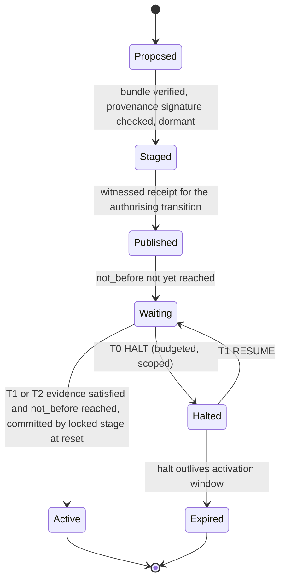

<!-- Title: Four primitives and the frozen waist -->
> **Provenance.** Sliced from legacy Rev 4 (`research-archive/legacy-blueprints/L5_Blueprint_Rev4_monolith.md`, matching sections).
> Document level: L2. Evidence labels: [P] proved, [M] machine-checked or measured by a script in this repo, [E] estimate, [S] standard/literature, [H] hypothesis.
> Reviewed against the R2 red-team findings on 2026-11-12; conflicting passages were corrected in place (see CHANGELOG).

# 4. The four primitives and the waist

The kernel is four primitives behind three frozen interfaces. Each primitive exists because removing it reintroduces a named failure class (§4.6).

### 4.1 Evidence: atoms the locked stage checks itself

**Evaluation-locality rule (carried from Rev 2, D-A1 refinement 2).** Every atom that counts towards an authority decision is evaluated by code in the locked stage. That code is authenticated without relying on any other atom's assumption. A lattice signature verified by the updatable second stage is not an independent atom, because the second stage is itself authenticated by a hash-based signature (§5.2 of stream A). On small parts the locked stage therefore holds hash-based verifiers only: LMS/HSS and, where it fits, SLH-DSA, under SHA-256 and optionally SHAKE256. ML-DSA counts as an atom only where its verifier fits in the locked stage (C-06).

**Atom descriptor** (fixed layout, 40 B per atom, 8 atoms = 320 B):

| Offset | Size | Field | Notes |
|---|---|---|---|
| 0 | 1 | `kind` | 1 SIG, 2 PRES, 3 WIT |
| 1 | 1 | `state` | 0 EMPTY, 1 ACTIVE, 2 RETIRED (D-03: no other on-device states) |
| 2 | 2 | `alg_id` | SIG: verifier registry ID; WIT: cosignature algorithm; PRES: input class |
| 4 | 4 | `labels` | bits 0–15 assumption (**device-derived** from `alg_id`), 16–23 group, 24–27 site, 28–30 infrastructure, 31 UNKNOWN |
| 8 | 32 | `ref` | SIG: hash of the public key; WIT: hash of the log-set descriptor (logs, witness keys, k-of-n); PRES: input descriptor (pin, polarity, hold time) and a reserved field |

**Registry and extension.** New *algorithms* enter as provider-table entries and descriptor IDs. New *atom kinds* would need new locked-stage code, so the three kinds are frozen at manufacture. Richer structures nest inside an atom. For example, an escrow atom can itself be "2-of-3 escrow trustees' LMS keys", verified as one atom, provided the inner signers share the atom's labels.

### 4.2 Rule: tiered monotone tables with on-device admission

Each device holds one 256-bit table per **tier**, stored together with its bitwise complement so that a single bit flip cannot change a decision silently (red-team X.2.3; D-35). A tier is defined by the *powers* it grants and the *fault budget* it must meet.

| Tier | Powers | Fault budget (t, s) | Why this budget |
|---|---|---|---|
| **T0 HALT** | Pause one named staged activation | none; one custody atom or local presence | Halting only delays. Its abuse is bounded by a per-key budget and override (D-29) |
| **T1 OPERATE** | Activate an image ≥ floor; advance the floor; rotate a key inside its labels, with the old key's continuity signature; transfer ownership *with* the current owner's participation; operating setpoints; tighten any table; declare a class dead; resume after a halt | (1,1): safe against one compromise of a key, group, family or site; live after one loss of a key, group, family or site | Everyday governance must survive any single failure |
| **T2 CONSTITUTION** | Re-key a group *without* its participation (lost custodian, sovereign exit), except that installing into a still-ACTIVE slot requires that slot holder's co-signature (REQ-LIFE-02, ADR-015); add, remove or re-label atoms; add a family; widen any table or safety envelope; counter reset; debug enable; RMA, decommission, reactivation | Recoverable default (1,2); fortress option (2,1); remote (1,1) restricted | Rule changes and recovery are the paths to full control (Theorem 3) |

**Default tables, terrestrial dual profile** (atoms: 0 OEM-1 H1, 1 OEM-2 H2, 2 OWN-1 H1, 3 OWN-2 H2, 4 ESC-1 H1, 5 ESC-2 H2, 6 PRES, 7 WIT; C = number of custody groups present, F = number of hash families present, K = number of custody atoms, p = presence, w = publicity). All are verified by `lint.py` [M].

| Tier | Predicate | Budget verified | Table (64-bit words w0..w3; w0 = sets without PRES or WIT, w1 = PRES only, w2 = WIT only, w3 = both) |
|---|---|---|---|
| T0 | K ≥ 1 ∨ p | exempt | all sets except ∅ and {WIT}: popcount 254 |
| T1 | (w ∧ C≥2 ∧ (F≥2 ∨ p)) ∨ (p ∧ C≥2 ∧ F≥2) | (1,1) incl. family and site | `0 · fffefafaffcceac0 · fffefafaffcceac0 · fffefffefffeeee0` (146 sets) |
| T2 recoverable | p ∧ K≥2 ∧ (w ∨ C≥2), plus mandatory delay | (1,2) except both-families, only if no custody group controls the site (F-R2-04, REQ-LINT-03); not live after site loss (by design) | `0 · fffefffefffeeee0 · 0 · fffffffefffefee8` (111 sets) |
| T2 fortress | p ∧ F≥2 ∧ ((C≥2 ∧ w) ∨ C≥3) | (2,1) key/group loss | `0 · eee0eae0eec00000 · 0 · fffefafaffcceac0` (71 sets) |

Read T1 this way. Normally, two custody groups using both hash families, with publication. If one family is lost, two groups plus a person at the device, with publication. If the logs are down, two groups, both families and presence. T2 recoverable requires someone physically present plus two custody keys, published, after a delay. So a site whose OEM and escrow agent have both vanished can still re-key, and a remote attacker holding any one group's keys cannot.

**Remote profile** (no presence atom): T1 = w ∧ C≥2 ∧ F≥2 (1,1 for keys and groups; not live after a family loss). T2 = w ∧ C≥3 ∧ (≥2 groups contribute SHA-2 atoms) ∧ (≥2 groups contribute Keccak atoms). This is safe against any two faults except both families, and live after one key loss. Re-keying a lost group must sit at T1 for liveness, so the remote effective budget for full control is (1,1) (Theorem 3).

**Nano profile** (one family): T1 = w ∧ C≥2 (safe against a key or group, *not* against a hash break). T2 = p ∧ K≥1 ∧ w: safe against one fault *including* a hash break, live after two group losses, and two-fault-unsafe (a site insider plus any custodian; one fault if a custody group controls the site, F-R2-04). Verified [M].

**Renewal invariant (D-31).** After any loss or retirement, the lint reports whether each tier still meets its budget. Below budget, the fleet is *degraded* and must renew: appoint a replacement custodian, install a new family, or replace a log. Example [M]: after a sovereign exit retires the OEM atoms, T1 remains single-fault safe but is no longer live after a further group loss until a third custodian is appointed.

### 4.3 Record: monotone authority state and hash-chained history

**State (fixed records, ≈ 700 B, A/B copies plus a committed snapshot).**

| Field | Size | Monotone? |
|---|---|---|
| Header, `device_uuid`, `lifecycle` (TEST, CLAIMED, PROD, RMA, DECOMMISSIONED), `claim`, `profile` | 28 B | lifecycle moves only along allowed edges |
| `authority_epoch` | 4 B | strictly increasing on every authority transition |
| `floor_idx` (minimum acceptable image security version) | 4 B | non-decreasing; hardware-backed shadow where available |
| `head` = SHA-256 chain head (dual: ‖ SHAKE256) | 32/64 B | replaced only by a valid successor |
| `atoms[8]` | 320 B | each ACTIVE → RETIRED only; EMPTY → ACTIVE only by T1/T2 |
| `tables[3]` + complements | 192 B | T1 may only tighten; T2 may widen, staying ≤ U |
| `budget` (T1, T2 mode) and excluded-pair matrix | 33 B | changed only by T2 |
| `dead_classes` (label bits declared dead) | 4 B | bits only set |
| `halt_used[8]` per atom per epoch | 8 B | reset when the epoch advances |
| `active_image` digest + SVN | 36 B | changed only by T1 activation |
| `rtc_window`, `last_fresh_checkpoint_time` (optional) | 12 B | time only restricts |

**Snapshot and commit (NV contract, D-06).** A 128-byte, self-contained snapshot holds `seq`, epoch, floor, head, `state_digest` and a commit tag `SHA-256("ac/snap/v3" ‖ payload)`. Each ECC program unit is written once per erase, payload first and commit last. On parts whose torn reads trap fatally, the profile forbids flash journalling and requires OTP, a hardware counter or FRAM (§6.12).

**Transition record `ac_tx` v2** (fixed binary projection, the only authority object the locked stage parses; 112 B + evidence):

| Offset | Size | Field |
|---|---|---|
| 0 | 8 | header (`type = TX`, format 2) |
| 8 | 1 | `action` (§6.2 table) |
| 9 | 1 | `tier` claimed (the device recomputes it from `action` and rejects a mismatch) |
| 10 | 1 | `n_evidence` |
| 11 | 1 | `flags` |
| 12 | 16 | `target` (device UUID, or a cohort selector hash) |
| 28 | 32 | `prev_head` (must equal the device's head) |
| 60 | 4 | `expect_epoch` (must equal current) |
| 64 | 4 | `new_epoch` (= current + 1) |
| 68 | 32 | `payload_digest` (dual digest in the dual profile, truncated per field rules) |
| 100 | 4 | `not_before` (staging: earliest activation, in witness-checkpoint time or device ticks) |
| 104 | 8 | `reserved` (zero; critical-flag rules apply) |

The signed bytes are `TBS = "ac/tx/2" ‖ device-class ‖ tx`. The `head` advances as `head' = H("ac/head/2" ‖ head ‖ H(tx) ‖ H(evidence-set bitmap))`. Every link is verified under the tables and atoms *in force at that link*, never the head's. **This is a chain, not a join-set (D-28).** Transitions are rare, a log sequences them, and a total order removes the ambiguity the red-team found between commutative joins and chained heads.

### 4.4 Effect: staged, published, delayed, haltable, then activated



* **HALT budget (D-29).** Each custody atom may issue at most *h* halts per authority epoch (default 2). A halt names one bundle, never lowers a floor, and is cancelled by a T1 RESUME. A stolen halt key can delay one activation window per budget unit, not freeze a fleet. That answers the red-team's halt-starvation concern (X.7).
* **Delay sources.** In order of strength: a witness-checkpoint time difference (`not_before` measured against the timestamps in fresh cosigned checkpoints); the device RTC where present; a count of device ticks. All of them only restrict.
* **Device echo (D-08) and settings tiers (D-19).** Settings-class payloads are parsed by the executor, rendered on its own display or read-only tap, and committed only after a key from a *different group* signs over the echoed hash. Widening a safety envelope is a T2 power.

### 4.5 The waist: three frozen interfaces

```c
/* W1: the pure kernel. No I/O, no allocation, no clock, no mutable globals, no recursion; libc limited to
 * memset, memcpy and memcmp (ADR-041). Executable definition: src/ac_waist.h, src/ac_step.c. */
typedef int32_t ac_status_t;               /* 0 OK; negative codes stable for ever, never reused */
ac_status_t ac_step(ac_ctx_t *ctx, const ac_msg_t *in, ac_effects_t *out, size_t *needed);
ac_status_t ac_ack (ac_ctx_t *ctx, uint32_t intent_seq);   /* platform confirms an intent executed */

/* W2: crypto providers (verify-only in the locked stage). */
typedef struct {
  uint16_t alg_id; uint32_t assumption_labels;            /* labels come from here, not from policy */
  ac_status_t (*verify)(const uint8_t *pk, size_t pk_len,
                        const uint8_t *msg, size_t msg_len,
                        const uint8_t *sig, size_t sig_len);
  ac_status_t (*verify_begin)(void *st, const uint8_t *pk, size_t pk_len);   /* resumable (D-20c) */
  ac_status_t (*verify_step) (void *st, const uint8_t *chunk, size_t len);
  ac_status_t (*verify_finish)(void *st, const uint8_t *sig, size_t sig_len);
} ac_sig_ops_t;
typedef struct {
  uint16_t alg_id; uint32_t assumption_labels;
  ac_status_t (*digest)(const uint8_t *const *parts, const size_t *lens, size_t n, uint8_t out[32]);
} ac_hash_ops_t;

/* W3: platform. Every call is fallible; none can fault the CPU. */
typedef struct {
  ac_status_t (*nv_read_safe)(uint32_t addr, uint8_t *buf, uint32_t len);   /* OK/BLANK/TORN/ERR */
  ac_status_t (*nv_program_unit_once)(uint32_t addr, const uint8_t *unit);
  ac_status_t (*nv_erase)(uint32_t unit_addr);
  ac_status_t (*ctr_read)(uint32_t id, uint64_t *v);
  ac_status_t (*ctr_advance_to)(uint32_t id, uint64_t v);                    /* never decreases */
  ac_status_t (*presence_sample)(uint32_t descriptor, uint8_t *asserted);    /* locked stage only */
  ac_status_t (*rtc_read)(uint64_t *unix_seconds, uint8_t *trusted_battery); /* optional; restricts only */
  uint8_t torn_read;                                                         /* 0 status, 1 recoverable, 2 fatal */
} ac_platform_t;
```

The waist changes only by a new major version. A device built against waist v1 is verified by any future tool that speaks waist v1. The specification, the vectors and a reference model are the long-lived artefacts (§19).

### 4.6 Why exactly these four primitives

| Remove… | …and this failure class returns | Evidence |
|---|---|---|
| **Evidence** with labels (count signatures instead of classes) | Shared-assumption collapse: plain 2-of-3 lets one Keccak break forge two "independent" signatures | `quorum.py` (stream A) [M]; κ model 0.5249% vs 0.0274% [M, model] |
| **Rule** with on-device admission (trust host tools) | A compromised compiler or a misleading summary produces an unsafe table that a valid quorum signs (G14). Tightening into a lockout goes unnoticed (G13) | Red-team: 22.6–32.4% of tables that pass weaker checks are breakable or non-live [M, n=5] |
| **Record** (monotone, chained) | Rollback and replay of authority (G11); no catch-up for stale devices (G10); no audit (G21) | TLA+ base model: run not completed, see GATE-08 |
| **Effect** (stage, publish, delay, halt) | All-at-once failures: staging alone does nothing (2.31% vs 2.32% devices out), auto-halt cuts it to 0.15% [M, synthetic twin]; covert targeted changes (G9) | `migration_twin.py` [M] |
| **The waist** | Every port re-implements authority semantics; atlas R9/R10 side doors and agility atrophy | Architecture scoring S 4.48 vs best alternative 4.20 [M, judgement weights] |

Adding a fifth primitive was considered and rejected for each candidate in turn. *Time as authority* is rejected by P-10. *A policy interpreter* by J-09: an interpreter on the irreversible path. *On-device gossip* by J-20. *Analog or physical-noise authentication* by J-17 and J-18. Each either fails the theory or can be expressed with the four.

---

