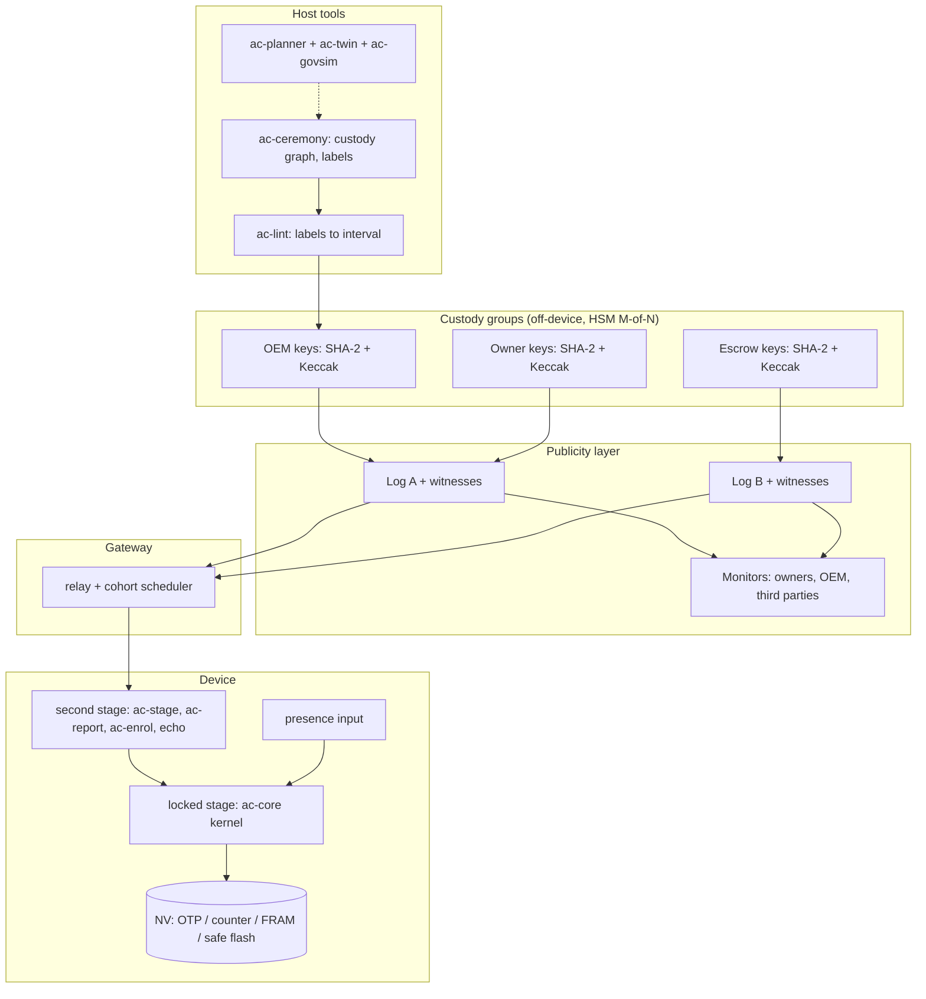
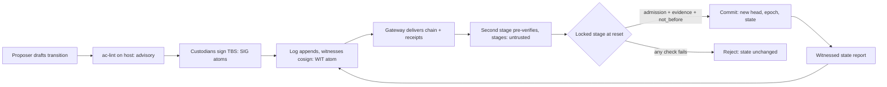

<!-- Title: System architecture -->
> **Provenance.** Sliced from legacy Rev 4 (`research-archive/legacy-blueprints/L5_Blueprint_Rev4_monolith.md`, matching sections).
> Document level: L2. Evidence labels: [P] proved, [M] machine-checked or measured by a script in this repo, [E] estimate, [S] standard/literature, [H] hypothesis.
> Rev 4 predates the R2 red-team fixes: absent atoms count as compromised and lost, tables must be projection-canonical, a slot holder must co-sign key installation, and presence can be correlated with ownership (see `docs/theory/red-team-r2-findings.md`). Where this text conflicts with those, the R2 document wins.

# 5. System architecture

### 5.1 Competing foundation visions

Before committing, seven foundation-level visions were compared. The criterion is the governed-change problem set G1–G24, not post-quantum readiness alone.

| # | Vision | Core idea | Real strength | Decisive weakness for long-lived machines | What we take from it |
|---|---|---|---|---|---|
| V1 | Algorithm-agility library | Make algorithms swappable; hybrids | Necessary plumbing | Algorithms are one label; custody, time and recovery are untouched (G3–G13) | Provider table, registry |
| V2 | PKI-centric | X.509 chains, revocation, short-lived certificates | Mature tooling | Needs online freshness and permanent CAs; offline 20-year devices cannot check revocation | Nothing on device; COSE and CoRIM at the edges |
| V3 | Update-framework-centric (TUF, Uptane, SUIT) | Role separation, thresholds, rollback counters, manifests | Best existing practice; offline roots; compromise-resilient repositories | Fixed role and threshold policies; no assumption classes; no on-device structural check; no presence or recovery theory | Metadata shape, manifests, counters |
| V4 | Ledger-centric (on-chain governance, timelocks, social recovery) | Global consensus orders all changes | Clear history; timelocks; guardians | Devices cannot verify consensus; institutions and fees for 40 years; global-clock assumptions | Timelock-with-cancel pattern, guardian recovery, weak-subjectivity lesson |
| V5 | Hardware-root-centric (DICE, Caliptra, TPM, secure elements) | Strong local identity and measurement | Hardware isolation, attestation | Authority remains vendor-anchored; multi-party custody and exits are out of scope; hardware generations churn | Platform providers, attestation evidence |
| V6 | Perimeter-centric (gateways, enclaves) | Leave devices alone | Only option for brownfield | Does not fix any updatable device; temporary enclaves become permanent | Sectored containment with dated exit (D-16) |
| **V7** | **Governed-change kernel** | Evidence + Rule + Record + Effect behind a frozen waist, composed with V3 and V5 | Covers G1–G24 with one rule; small enough to prove; renewable | Needs custody institutions (three groups, logs); requires disciplined ceremonies; theory is closed-world | — |

**Decision.** Choose V7, composed *with* V3 (its manifests and metadata ride inside our transitions) and V5 (hardware roots act as platform providers), and with V6 as the brownfield pattern. V7 does not compete with TUF or DICE. It supplies what they leave to integrators: a provable rule for *who may change what*, across parties, assumptions, places and time.

### 5.2 Device architecture alternatives (carried from stream A)

At device level, seven architectures were scored on nine weighted criteria (stream A, §A.1). The synthesis S, an authority state machine inside an hourglass, scored **4.48** against 4.20 for the state-machine core alone and 4.16 for a thin verify-only hourglass [M, judgement weights]. S ranked first under every weighting tried except one in which adoption cost dominates; there the verify-only hourglass wins (4.25 vs 4.07). It won in 65.6% of 100,000 random weightings. **Consequence for delivery:** ship the layering that existing bootloaders already resemble first. Make the authority kernel the opt-in addition per device class. Measure adoption effort explicitly (EXP-20).

### 5.3 Layers and placement

| Layer | Contents | Never contains |
|---|---|---|
| **L0 Kernel** (locked stage, T0 stability) | `ac-core`: lattice state, admission, tiers, chain verification, staging/halt logic; hash waist(s); verify-only LMS/HSS (+ SLH-DSA where it fits); presence sampling; witnessed-receipt verifier | CBOR parsers, network, clocks as authority, signing keys, interpreters |
| **L1 Providers and ports** | Crypto providers (mlkem-native, mldsa-native, LMS/SLH verify); `ac-nv` ports; platform ports per part; presence ports | Authority decisions |
| **L2 Formats and stores** | COSE/CBOR codecs, SUIT manifests, C2SP checkpoints, EAT/CoRIM reports; snapshot store | Anything the locked stage must parse |
| **L3 Optional modules** (second stage) | `ac-stage` (resumable pre-verification, staging), `ac-report`, `ac-enrol` (ML-KEM), `ac-config-echo`, protocol adapters | Authority mutation (single-mutator rule) |
| **L4 Host and fleet** | `ac-lint`, `ac-ceremony`, `ac-planner`, `ac-twin`, `ac-govsim`, `ac-monitor`, log and witness services, HSM signers | Direct device access; online authority keys |

| Where | Runs | Must never |
|---|---|---|
| Device locked stage | L0 | Hold secrets on the verify path; depend on the second stage's verdict |
| Device second stage | L1–L3 | Commit authority; be trusted to verify for the locked stage (J-23) |
| Safety core (C3) | Nothing of ours: zero crypto (D-07) | Run public-key operations in the control loop |
| Gateway / concentrator | Relay, cohort scheduler, KDC replica, sectored enclaves, passive inventory | Hold authority keys; be a single fleet-wide trust point |
| Fleet infrastructure | HSM custody groups, logs and witnesses, monitors, ceremony records, planners | Talk to devices except through signed, logged transitions |

### 5.4 Component view

### 5.5 Trust boundaries and authority flow

The bold boundary is the locked stage. Everything to its left is advisory or untrusted: the lint, the gateway and the second stage. The device recomputes admission, re-verifies every signature and receipt, and samples presence itself.

### 5.6 Libraries and modules

| Module | Layer | Language | Responsibility | Depends on | Stability tier |
|---|---|---|---|---|---|
| `ac-core` | L0 | C99 subset + Rust `no_std` twin | State, admission, tiers, chain, staging/halt, intents | nothing | T0 (frozen after Phase 3) |
| `ac-policy` | L0 | C / Rust | 256-bit tables, bounds from labels, admission (`policy8.c` lineage) | nothing | T0 |
| `ac-hash` | L0/L1 | C / Rust | SHA-256, SHAKE256 (and hardware-engine ports) | nothing | T1 |
| `ac-hbs-verify` | L0/L1 | C / Rust | Verify-only LMS/HSS and SLH-DSA, resumable | `ac-hash` | T1 |
| `ac-wit` | L0 | C / Rust | Checkpoint cosignature and inclusion-proof verification (C2SP formats) | `ac-hash`, `ac-hbs-verify` | T1 |
| `ac-nv` | L1 | C | NV contract, snapshot store, part profiles | platform | T1 |
| `ac-stage` | L3 | Rust / C | Resumable pre-verification, dormant staging | `ac-core` (read-only) | T2 |
| `ac-report` | L3 | Rust / C | EAT reports; witnessed MAC; optional LM-OTS | providers | T2 |
| `ac-enrol` | L3 | C | ML-KEM-768 enrolment; pre-encapsulated tokens | mlkem-native | T2 |
| `ac-config-echo` | L3 | C / Rust | Canonical settings rendering for device echo | — | T2 |
| `ac-lint` | L4 | Python reference + Rust | Labels to structures to [Lo, U]; budgets; renewal report | — | T2 |
| `ac-ceremony` | L4 | Rust | Key ceremonies, custody-graph capture, label declarations, logging | HSM SDKs | T3 |
| `ac-govsim`, `ac-twin`, `ac-planner` | L4 | Python | Governance-loss Monte Carlo; rollout twin; exposure-years planner | — | T3 |
| `ac-monitor` | L4 | Rust | Watches logs for unexpected transitions or forks per fleet | log APIs | T3 |

### 5.7 Profiles

| Profile | Hash families in locked stage | Presence | Default T1 | Default T2 | Effective full-control budget | Typical devices |
|---|---|---|---|---|---|---|
| **dual-terrestrial** (reference) | SHA-256 + SHAKE256 | yes | (1,1) incl. family and site | recoverable (1,2) or fortress (2,1) | (1,2) or (2,1) | PLCs, relays, RTUs, meters, vehicles, implants (programmer wand = presence) |
| **nano-terrestrial** | SHA-256 | yes | (1,1) excl. hash break | (1,2) incl. hash break | (1,2), but routine T1 is exposed to a SHA-256 break | Small, slow parts where Keccak cost bites (C-01 fails) |
| **dual-remote** | SHA-256 + SHAKE256 | no | (1,1) keys and groups | restricted; re-key at T1 | (1,1); frozen after a family loss unless degraded mode or a third class (C-16) | Satellites, sealed or buried assets |
| **nano-remote** | SHA-256 | no | (1,1) excl. hash break | — | (1,1) excl. hash break | Disposable or short-life sensors only |

### 5.8 Deployment patterns (carried from Rev 2, D-07, D-16, C-04, C-05, C-08)

| Pattern | For | Composition |
|---|---|---|
| **P1 single chip** | Greenfield C1/C2 | Locked stage (profile above) + second stage; NV via OTP, counter, FRAM or safe flash; ML-KEM enrolment; witnessed reports |
| **P2 safety split** | Greenfield C3 | Zero-crypto safety core; communications/security processor runs the kernel; optional hold-in-reset supervisor (C-04) |
| **P3 retrofit** | Brownfield C0–C2 | Sectored PQ gateways with signed configuration and dated exit; optional port-level enforcer (C-05); the gateway itself runs the kernel as its own governed device |
| **P4 cartridge** | Very long-life assets | Replaceable trust cartridge as provider and platform port (C-08); kernel unchanged |

---

