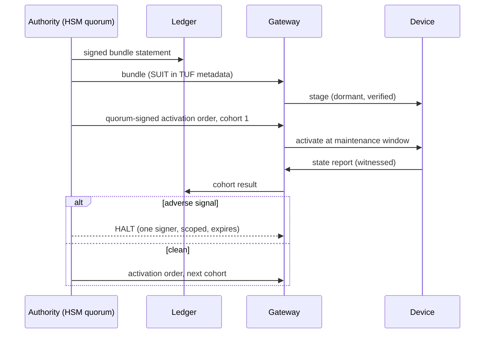
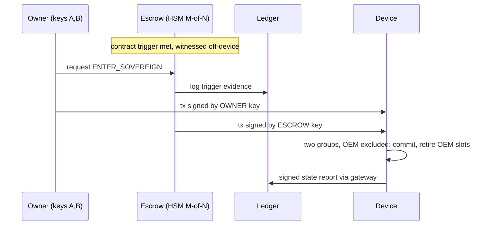
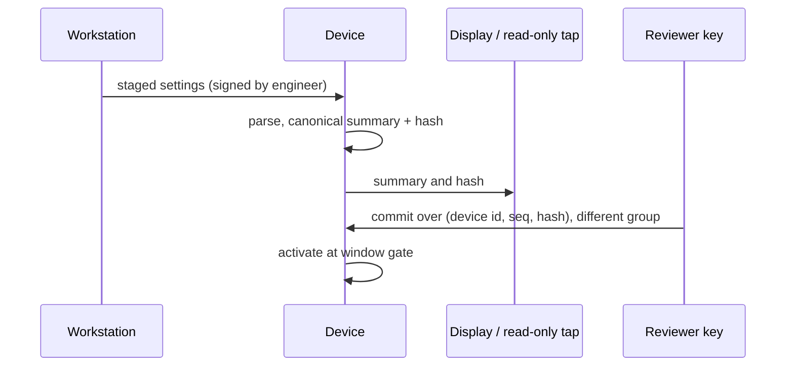
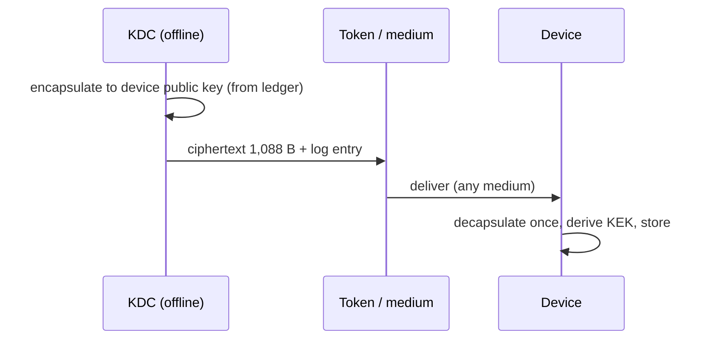

# The Final Blueprint
## One verifiable authority core, three deployment patterns, and the decisions we have actually committed to

*Status date: 6 November 2026. No project name is used. `ac_` and `ac-` remain placeholder prefixes.*
*Supersedes the earlier master blueprint where the two differ. Its stream memos (appendices A–F of the earlier bundle) remain the detailed reference for everything not changed here.*

---

## 0. How to read this, and what changed

This document merges four bodies of work: the atlas (two editions), the first master blueprint with its six stream memos, the independent investigation you attached, and a small amount of new verification I ran to settle disputes. I called the attachment "the independent investigation" below.

**Verdict on the independent investigation, in one paragraph.** It is better than our blueprint in three places and worse in two. It found a real hardware hazard we had only tested on a host simulator (torn writes on ECC flash can raise a non-maskable interrupt on read). It found a real design bug in our own plan (OEM exit still required the dead OEM's signature). It found a genuine internal contradiction (devices must report signed state but may not sign). It also pushed us, correctly, to cut on-device state. It is weaker where it replaces a hard problem with a hand-wave: off-device multi-party signing of standard hash-based signatures is research, not an engineering option; its timing figures for one-time signing omit the cost of authentication paths; and several of its hardware claims (a 150 mW connector-boot enforcer, $1.20 supervisors, $15–35 dongles) are unverified. Its "novel" bump-in-the-wire idea has a twenty-year literature behind it. Where it was wrong or unsupported I say so, and where it was right I took it.

**What changed in the architecture, in six lines.**

1. The locked stage got *smaller*, not larger: on-device slot states drop from six to three, and anergy and molting move off the device.
2. The two-hash-waist rule is demoted from default to an **upgrade profile**, because its cost on small parts is real and its benefit is a model result, not a measured risk.
3. Authority is restructured into **custody groups** (OEM, owner, escrow) with a single uniform rule: two keys from two distinct groups. OEM exit then needs no OEM.
4. The flash journal is replaced by a **fault-safe snapshot store** behind a HAL contract, because reading a torn write can halt some parts.
5. The "devices never sign" rule is amended to allow one **device-scoped, one-time reporting key** (conditional on a measurement), with a gateway-witness fallback.
6. Safety separation now prefers **zero crypto on the safety core** over software partitioning, and the workstation quorum is demoted from security boundary to process control.

**Evidence labels** are those of the atlas: [F] primary fact, [2nd] secondary, [V] vendor, [D] measured or demonstrated, [C] computed here, [E] estimate with arithmetic, [I] inference, [H] hypothesis or invention, [S] speculative.

---

## 1. What exactly are we building?

**One sentence.** A small, doubled, formally checked **authority core** that decides who may change what on a long-lived device, surrounded by replaceable layers for algorithms, storage, update, evidence and protocols, and deployed in one of three patterns depending on whether the device is new, safety-rated, or already in the field.

**Why this is the right direction, not an ordinary library.** Post-quantum migration in OT is mostly not "swap RSA for ML-KEM". The real-time paths are already symmetric. The exposure sits in **authority**: who may sign firmware, settings, debug unlocks, ownership transfers and key injection. A forger after a cryptographically relevant quantum computer does not decrypt anything; they sign. Devices live 25–40 years; algorithms, owners, networks and manufacturers do not. So the product is not an algorithm library. It is the machinery that lets authority survive those changes: custody groups, a floor that only rises, power-cut-safe state, staged and haltable rollouts, evidence that stays checkable, and conformance tests that keep ports honest.

**What makes it different.**

| Difference | Why it matters | Honest status |
|---|---|---|
| The unit of safety is *assumptions and custody groups*, not algorithm names | A hybrid or a threshold that shares a hidden dependency fails all at once | Combination of known ideas, plus a checker (κ) [H]; model-validated, not field-validated |
| Authority change is a pure function with a closed input alphabet | Small enough to prove, replay, and implement twice | Established technique applied to this problem [H] |
| Ownership and OEM exit are part of the cryptographic design | Dead vendors orphan fleets | Revised after the independent review (§5.4) |
| Ports are validated by a conformance suite and a machine-readable part profile | A 40-year project cannot maintain 30 ports itself | New infrastructure, not new cryptography [H] |
| Rollouts have a one-signer halt | The only mechanism the simulation showed to work | Measured in a synthetic model [C] |

**What it is not.** Not a dashboard, not a wrapper collection, not a new cipher, not a hardware product company, not a PKI replacement. It reuses SUIT, TUF-style metadata, SCITT, EAT, CoRIM, CycloneDX CBOM, FDO and COSE, and builds only the gaps listed in §7.

---

## 2. The problem landscape, reconstructed

### 2.1 Fundamental, eliminable, and merely hard

| Class of problem | Examples (atlas IDs) | Can architecture remove it? |
|---|---|---|
| **Fundamental (no design removes it)** | A device with a classical-only immutable verifier, no lock and no network until a CRQC exists (R1 boundary); physical attacks on a held device; humans signing what they cannot see; unfunded 40-year maintenance | No. Mitigate, bound, or replace |
| **Structural (a different architecture removes it)** | OEM exit deadlock (R3); contradictory evidence rules (R7); policy complexity in unpatchable memory (R1); counters that wrap (R10, R11); rollouts that fail all at once (R8) | Yes, and §5 does |
| **Environmental (needs policy, silicon, contracts, market)** | Certification timelines, procurement incentives, regulation, vendor roadmaps | Only partly. 41 of 108 problems end in a non-software residual (earlier stream R) |

### 2.2 The seven hard clusters and the selected response

| # | Cluster | Approaches compared | Selected |
|---|---|---|---|
| 1 | Immutable root versus 40 years of algorithm change | (a) on-device multi-slot machine; (b) single verifier plus off-device multi-party signing; (c) OTP fuse pointer; (d) universal bytecode or STARK verifier | **Tiered locked stage** (§5.2): a nano profile, a dual-waist profile, OTP as a floor backing. (b) and (d) are research |
| 2 | Safety recertification versus cryptographic change | (a) software partition; (b) black channel with zero-crypto safety core; (c) external supervisor that reflashes under a physical interlock | **(b) preferred**, (c) conditional on an assessor's written view, (a) fallback only |
| 3 | Un-updatable brownfield | (a) zone gateway; (b) port-level enforcer; (c) RAM patching; (d) replace | **Sectored gateways now, (b) as a reference design if a pilot confirms feasibility, (d) with dated exit**; (c) rejected for safety devices |
| 4 | Configuration authority (engineering workstations) | (a) workstation software quorum; (b) device-echo two-phase commit; (c) hardware diff token | **(b) for settings-class changes**; (c) research; (a) is process control, not security |
| 5 | Upward evidence without device signing keys | (a) gateway-witnessed MAC; (b) device one-time hash-based signatures; (c) KEM challenge-response | **(a) baseline, (b) conditional** |
| 6 | OEM exit and bankruptcy | (a) escrow of OEM material; (b) pre-signed bearer vouchers; (c) owner-sovereign custody groups | **(c)** |
| 7 | Monotonic state on real flash | (a) in-place records with void marks; (b) fault-safe snapshots; (c) OTP unary counter; (d) external FRAM/MRAM | **HAL contract with (c) or (d) preferred, (b) where safe-read is proven** |

---

## 3. Adjudicating the independent investigation

For every material claim: what it says, what the evidence shows, the verdict. "Accept", "Accept modified", "Conditional", "Research", "Reject".

### 3.1 The ten claimed flaws in our baseline

| # | Their claim | Evidence and reasoning | Verdict |
|---|---|---|---|
| F1 | Too much state machine in the unpatchable stage; TLC found an anergy lockout | **True.** Our own TLC run on the first model violated the no-lockout invariant after ~465,000 states [C]. Six slot states, anergy and molting are policy ideas, not boot ideas | **Accept.** On-device slot states reduce to EMPTY, ACTIVE, RETIRED. Anergy and molting move to the ledger and planner (D-03) |
| F2 | Two hash waists are theatre; preimage-class breaks are remote; software Keccak blows the time budget | **Half right.** Direction is right: the hash-based schemes lean on second-preimage-class properties, which are far more remote than collisions. Cost is real: our own estimate was ~17,000 cycles per Keccak permutation on M0+ [E, weak]. At 64 MHz that is 0.266 ms each. LMS-SHAKE verify at ~570 permutations ≈ 151 ms [C]. Hashing a 256 KiB image under SHAKE256 (rate 136 B) = 1,928 permutations ≈ 512 ms [C]. But the 19× figure is a *what-if* model (symmetric failure assumptions), not a forecast, and the atlas's extinction record is about structured families, not hash functions | **Accept modified.** Dual-waist becomes an upgrade profile (C-01). Single-waist nano is the default where the cost bites. Residual stated: a SHA-256 second-preimage break compromises a nano device completely |
| F3 | Workstation quorums fail against malware that shows benign content while passing malicious bytes | **True.** Custody is not intent integrity. Two humans signing what a compromised tool shows them is not a boundary | **Accept.** Demoted to process control (J-06). Replaced for settings by device-echo (D-08) |
| F4 | A zone gateway leaves the last metres open | **True** for cabinets with contractor laptops and bridged modems | **Accept modified.** Sectored gateways remain; port-level enforcement becomes a conditional reference design (C-05). The idea is not novel: serial and Ethernet bump-in-the-wire retrofits exist in the literature and as products (§3.3) |
| F5 | Software partitioning does not satisfy freedom-from-interference | **Plausible, unverified.** Assessors do ask for evidence of interference freedom on shared silicon; I have no assessor's statement | **Accept as risk.** Zero-crypto safety core is preferred (D-07); partition is fallback only |
| F6 | Verify-only rule contradicts signed device reports | **True.** Flagged as open in our own memos | **Accept.** Resolved by gateway-witnessed baseline plus conditional device-scoped one-time keys (D-02, C-02) |
| F7 | OEM exit needs the dead OEM's signature | **True.** Our stream A found the slot-replacement path infeasible after OEM exit | **Accept.** Custody groups and sovereign transition (D-05). The "pre-signed blank cheque" mechanism is **rejected** (J-02) |
| F8 | Per-device online ML-KEM enrolment is fragile on narrow or partitioned links | **Mostly answerable.** KEM encapsulation is one-way: the KDC can encapsulate to the device's public key ahead of time and carry the 1,088-byte ciphertext by any medium [F, ML-KEM-768 ciphertext size per FIPS 203]. Compromise of the enrolling party is a risk of every enrolment scheme, including factory-bound symmetric keys | **Accept modified.** Two delivery modes, online and pre-encapsulated token (D-09) |
| F9 | The journal design faults on ECC flash because reading or reprogramming torn words raises a bus fault | **Substantially true, and our biggest hardware blind spot.** ST engineers' forum answers state that on STM32H5 a double ECC error on read sets a flag and **raises an NMI**; a partial program can cause one; and a vendor article describes reading *unwritten* OTP or high-cycle flash raising the same error. A user reports an NMI boot loop in a bootloader after interrupted programming [2nd, vendor forum]. Our test ran on a host simulator. **Two corrections to their claim:** our journal did not reprogram a written unit (its VOID field is a separate, never-written unit), and a "10-instruction BusFault handler that skips the instruction" does not exist on all parts: Cortex-M0/M0+ have only HardFault, and on the H5 the ECC error is an NMI, not a BusFault [I] | **Accept the hazard, replace the mechanism.** The fix is a HAL contract (`nv_read_safe`), not a universal trick (D-06) |
| F10 | An open-source foundation cannot maintain 30 ports for 40 years | **Largely true.** PQClean was archived on 2026-08-04 and pqm4 is deprecated [2nd, landscape audit] | **Accept modified.** We do not maintain 30 ports; port owners do, under our conformance suite (D-15) |

### 3.2 The new directions and architectures

| Proposal | What I found | Verdict |
|---|---|---|
| **1A. Single verifier, multi-party signing off-device (MPC)** | Threshold stateful hash-based signing exists with a trusted dealer (NIST's Kelsey–Lucks, 2022) [F]. Fully distributed signing of *standard* hash-based schemes is an active research problem: a 2025 preprint reaches sub-second 3-party signing only by switching to an arithmetisation-friendly hash (so not standard-compatible) [2nd]; a 2026 preprint uses homomorphic encryption for one-round threshold XMSS and SPHINCS+ with online XMSS signing in 0.69 s [2nd]; another 2026 preprint proves a black-box impossibility for efficient fully distributed threshold signing of standard hash-based signatures [2nd]. **And it does not remove the single-assumption problem:** all authority collapses into one SHA-256 key, so a hash break forges directly, with the MPC irrelevant | **Research** (X-01). Custody by ordinary HSM M-of-N activation is kept; MPC is not a dependency |
| **1B. OTP key-hash array with unary fuse pointer** | Sound and simple where OTP exists; limited number of transitions; silicon vendor may use the bytes | **Accept** as a floor backing (D-06) |
| **1C. Universal verifier via STARK/FRI or bytecode** | Elegant, hash-only; 30–80 KB proofs and 8–16 KB verifier RAM are the attachment's figures and I did not verify them | **Research** (X-02). Not for C1 |
| **2A. Hold-in-reset external supervisor** | Plausible and the cleanest interference argument. Open points: the safety MCU's reflash path and debug pins become attack surface; the physical interlock is a human process; assessor view unknown; $1.20–1.50 BOM unverified | **Conditional** (C-04) |
| **2B. Black channel, zero-crypto safety core** | Established pattern (EN 50159; PROFIsafe and CIP Safety black-channel principle) [I; clauses not fetched] | **Accept as preferred C3 pattern** (D-07) |
| **3A. "Smart Jack" parasitic enforcer** | The concept is established: Dartmouth's YASIR (2007–08), SEL's serial encrypting transceiver and the AGA-12 module are bump-in-the-wire retrofits [F/2nd]. Genuinely new would be a PQ-key-derived Ethernet profile plus an authority-aware write blocker. **Feasibility problems:** two Ethernet PHYs plus an MCU will not fit in 150 mW as claimed [I]; vendor protocols (S7, CIP) are proprietary and change; a device with a second port, USB or serial bypasses the enforcer | **Conditional** (C-05), as a DIN-rail reference at realistic power |
| **3B. RAM-shadow "live vaccine"** | Fragile, lost at power cycle, unacceptable on safety devices | **Reject for SIL devices**; research only for orphan non-safety RTUs (X-04) |
| **4A. Display token with independent parser** | Strong principle, huge parser effort per vendor format | **Research** (X-03) |
| **4B. Device-echo two-phase commit** | Strong where the *executor itself* renders what it will run and the channel is not under the workstation's control. Works for settings tables; for arbitrary ladder logic a device LCD cannot show semantics | **Accept for settings-class changes** (D-08) |
| **5A. One-time hash-based report keys** | Good idea; their timing is wrong (see §3.4) | **Conditional** (C-02) |
| **5B. KEM challenge-response witnessing** | Whoever holds the decapsulation key or diversification root can forge | **Reject as evidence mechanism**; useful as a liveness probe |
| **6A. Sovereign owner slot with witness quorum** | Core idea right; two sub-parts wrong: bearer pre-signed vouchers are dangerous, and a 3-of-5 *on-device* witness quorum adds verification cost and a new institution that must exist for 40 years | **Accept modified** (D-05): one escrow slot, custody off-device by HSM M-of-N |
| **7A. Ping-pong snapshots** | Right shape; mechanism must be part-specific | **Accept as a pattern behind the HAL contract** (D-06) |
| **Vision I** (refined hourglass) | Our baseline, fixed | Basis |
| **Vision II** (physical interposition) | Right for C3 and brownfield, but hardware | Patterns, not repository scope |
| **Vision III** (one-primitive MPC) | Depends on research, collapses to one assumption | Nano profile kept; MPC rejected as dependency |
| **Vision IV** (replaceable trust cartridge) | Already the atlas's I-31. Architecture already accommodates it: a cartridge is a provider and platform port | **Conditional** (C-08), no core change |

### 3.3 Where the attachment's claims could not be verified

Unverified [V/unknown]: "over 85% of 2035 devices are already installed"; "56% of workstations have unpatched critical CVEs"; every BOM figure ($0.80, $1.20, $1.50, $15–35); "boot time drops by more than 60%"; "<100 µs" enforcer latency; "30–80 KB" STARK proofs; "Falcon/HQC-authenticated channel" (HQC is a key-encapsulation scheme, FN-DSA is not final [F, earlier standards check]). I did not treat any of them as input to a decision.

### 3.4 The one numeric correction that matters: one-time reporting signatures

The attachment says signing a report with a one-time Winternitz signature takes about 500 hash calls and "≈ 4 ms", and the Merkle path is cheap. Two problems.

1. **Timing.** Our measured hash-call counts for an LMS W4 verify are 473–563 calls, and our earlier estimate for that verify at 64 MHz was 42 ms, i.e. about 84 µs per call [E]. Signing needs roughly 67 secret derivations plus an expected ~500 chain steps, so ~570 calls ≈ **48 ms in software** [E], not 4 ms. That is still fine for a few reports a year. With a hardware SHA engine it would shrink a lot, but I have not measured.
2. **Authentication path.** A device that must output a Merkle path for leaf k of 4,096 cannot compute it cheaply: every sibling subtree requires computing its leaves (≈1,000 hash calls each). Naively that is millions of hashes. **Resolution [H]:** keep the 4,096 leaf public-key hashes off-device. 4,096 × 32 B = 128 KiB per device [C] held by the operator and committed to the ledger via a Merkle root. The device sends only index, report and a 2,144-byte one-time signature (67 × 32 B [C]); anyone holding the leaf list builds the path. Fleet storage: 100,000 devices × 128 KiB ≈ 12.2 GiB [C], trivial for an operator, and the root keeps it auditable.

---

## 4. Architectural Decisions We Have Actually Committed To

This is the contract of the project. Each entry has an ID. **Decided** means we build it. **Conditional** means we build it only if the named experiment passes, with a stated fallback. **Research** means we do not depend on it. **Rejected** means we considered it and chose not to, with the reason.

### 4.1 DECIDED: what we are going to build

| ID | Decision | Why (problems) | Source of the idea |
|---|---|---|---|
| **D-01** | **Hourglass with a pure-function authority core.** `step(state, message) → (state', intents)`; no I/O, allocation, clock or libc. Waist = three frozen surfaces: `ac_step`, crypto provider table, platform table | R1, R5, R10; laws 4, 12 | Our baseline, validated by scoring (S 4.48, robust in 18/18 perturbations [C]) |
| **D-02** | **No device holds fleet-scale or authority signing keys.** Devices verify. A device may hold one device-scoped reporting key *only if* C-02 passes. Baseline evidence = gateway-witnessed reports | R6, R7; N8 | Amended by the independent investigation |
| **D-03** | **Minimal on-device state.** Slot states are EMPTY, ACTIVE, RETIRED. No anergy, no shadow/hidden/pending on device. Those live in the ledger, planner and policy compiler | R1, N20; the anergy lockout found by TLC | Independent investigation (F1) plus our TLC result |
| **D-04** | **Two locked-stage profiles.** *core-nano:* one hash waist, ≥2 keys from distinct custody groups for any authority change, no assumption masks on device. *core-dual:* two hash waists, enforces κ ≥ 2 in addition. Host tools always compute κ for every fleet | R1, R2; M2 | Atlas M2 plus independent F2 |
| **D-05** | **Custody groups and owner-sovereign exit.** Groups: OEM, OWNER, ESCROW. Rule: **any authority change (floor advance, slot change, lifecycle) needs two valid signatures from two distinct groups**; in core-dual they must also have disjoint assumption sets. Boot image: one OEM signature. `ENTER_SOVEREIGN`: OWNER + ESCROW only, OEM excluded. `HALT`: any one active group, scoped to a bundle and expiring in two epochs. Claim state UNCLAIMED → CLAIMED: the first-owner binding is signed by the OEM at sale time and binds the first owner's key hashes. FDO vouchers stay off-device as evidence | R3; N22, N41, N49; red-team #10 | Independent investigation (6A), modified |
| **D-06** | **Fault-safe monotonic storage behind a HAL contract.** `nv_read_safe` returns a status instead of faulting. Backing preference: OTP unary counter or hardware counter for the coarse floor → external FRAM/MRAM → ECC flash with a part-specific safe-read port. Snapshots are self-contained with a commit tag, each ECC unit programmed once per erase. Part profile records `torn_read_behavior ∈ {status, recoverable_trap, fatal_trap}`; on `fatal_trap` parts flash journalling is forbidden | R6; N56; F9 | Independent investigation (7A), generalised; hazard confirmed from vendor sources |
| **D-07** | **Zero-crypto safety core is the preferred C3 pattern.** Crypto and update logic live on the communications or security processor; the safety image is not touched by our system. Software partition only as a fallback with assessor-accepted evidence | R5; N48 | Established practice (black channel), plus independent F5 |
| **D-08** | **Device-echo two-person commit for settings-class changes.** The device parses the staged settings, renders a canonical summary on its own display or a read-only tap, and activates only after a second, differently-held key signs over the staged hash. Workstation quorum remains as process control | N17, N18 | Independent investigation (4B) |
| **D-09** | **Enrolment by ML-KEM-768 into a per-device key-encryption key, with two delivery modes:** online through a gateway, and a **pre-encapsulated token** (1,088 B ciphertext carried by any medium). Per-device diversified keys; no fleet key. Process-bus MACs unchanged | R4; N10; P19 | Our baseline plus independent F8 |
| **D-10** | **Reuse the standards stack.** Ledger: SCITT-shaped statements (RFC 9943) over a tile log, with external witnesses. Update: SUIT manifests in TUF-shaped metadata. Evidence: EAT profile, CoRIM, CycloneDX CBOM, RFC 4998 renewal. Devices never read the ledger | R2, R7, R10 | Streams F and L |
| **D-11** | **Staging means a haltable activation order.** Dormant staging, a separate quorum-signed activation order, one-signer scoped halt, optional persister cohort, no global simultaneous activation | R8; N13–N15 | Our twin: staging without halt 2.31% vs 2.32% big-bang; with halt 0.15% [C, synthetic] |
| **D-12** | **Crypto providers.** Reuse mlkem-native and mldsa-native behind the provider table. Build small verify-only LMS and SLH-DSA verifiers. Avoid PQClean, pqm4 and liboqs in firmware. Signing only in HSM hosts | R1, R4 | Streams B, L |
| **D-13** | **Languages.** Locked stage and `core-min` in a C99 subset built with two compilers; independent Rust `no_std` twin; Rust and standard tooling above the waist and on the host | R10; N20 | Stream E |
| **D-14** | **Assurance as design.** TLA+ model of the authority machine finished and exhaustive on a bounded configuration; refinement or bounded checking of the C; differential testing of C, Rust and a Python reference on all small-universe inputs; reproducible builds; T0 frozen only after three unrelated ports and an external design review | R10; N20, N57 | Streams A, E |
| **D-15** | **Sustainability by division of labour.** The project owns: the waist spec, `ac-core` (both implementations), the conformance suite, the part-profile registry, host tools. **Port owners (silicon, board and integrator vendors) own their ports** and claim a profile only by passing the conformance suite | F10 | Independent F10, answered structurally |
| **D-16** | **Sectored containment with dated exit** for devices that cannot change: several small PQ-terminating zones, signed gateway configuration, per-exception expiry epochs | P16; N43 | Atlas 11.6, strengthened |
| **D-17** | **Migration planner and exposure-years KPI.** Class-ordered, hub-first and acquaintance orders; exposure-years as the programme metric | R7; M1, M5 | Atlas |
| **D-18** | **Counter and time discipline.** Every counter declares capacity, rate and life; lint requires capacity ≥ 2 × (life × rate + reserve). Time may only restrict authority | R11; N56 | Atlas Part 6 |

### 4.2 CONDITIONAL: build only if the experiment passes

| ID | Idea | Experiment and pass criterion | If it fails |
|---|---|---|---|
| **C-01** | **core-dual as default for C2.** Keccak-class verifier in the locked stage | **E-B1**: measure flash and cycles on two parts, with and without a hardware SHA-3 engine. Pass: total boot verification ≤ 250 ms on ≥ 50% of target parts, flash within 16 KiB; and an independent cryptographer's review of the independence claim | core-nano remains default permanently; core-dual only where hardware accelerates Keccak. Residual documented per fleet |
| **C-02** | **Device-scoped one-time report signatures** (RFC 8554 LM-OTS or equivalent; leaf list held off-device) | **EXP-03**: code delta ≤ 1 KiB, stack ≤ 128 B, ≤ 100 ms in software on Cortex-M0+ at 64 MHz [E target]; index can never repeat across any power cut (reserve-then-sign, tested exhaustively) | Gateway-witnessed reports for C1/C2; TPM-class attestation key for C4 |
| **C-03** | **Install-time full verification with boot-time local MAC** for slow parts | Lock assessment per part shows the MAC key is not readable by a local attacker; boot-time budget measured | Full signature and hash check at every boot, with a longer boot budget or a hash-engine requirement |
| **C-04** | **Hold-in-reset external supervisor** for new SIL-rated boards | **E-C1**: written pre-assessment from an assessor; a review of the supervisor's reflash path and the safety MCU's debug and boot pins; BOM confirmed | D-07 only: zero-crypto core, safety image updated through vendor-qualified tooling outside our system |
| **C-05** | **Port-level enforcer reference design** (DIN-rail, MACsec with PQ-derived keys, write-function allow-list) | **E-S1**: realistic power and form factor; coverage of the three most common field protocols; bypass analysis; latency measured; one asset-owner pilot | Sectored gateways only (D-16); document the residual |
| **C-06** | **ML-DSA verifier in the locked stage** on larger parts | **E-B1b**: footprint and an independence argument | Lattice schemes verified only in the second stage and *not* counted as independent quorum members |
| **C-07** | **PQ FDO voucher profile** | FIDO Alliance engagement; FDO v2.0 recommends PQ but does not mandate it [2nd] | Voucher evidence kept in a profile of our own, off-device |
| **C-08** | **Replaceable trust cartridge** as a provider/platform port | A vendor pilot; contact reliability in the target environment | None needed: the core does not change |
| **C-09** | **Persister cohort as a default** | **E-F1**: calibrate the twin with real pilot fault data. The twin showed only ~10% additional benefit when detection works | Keep as an option, off by default |

### 4.3 RESEARCH: we do not depend on these

| ID | Question | State |
|---|---|---|
| X-01 | Threshold or multi-party signing of *standard* hash-based signatures | Dealer-based threshold exists (NIST 2022); fully distributed schemes are preprints, and a 2026 preprint shows a black-box barrier [2nd]. Not a dependency |
| X-02 | Universal STARK/FRI or bytecode verifier on devices | Frontier; no benchmark on our targets |
| X-03 | Hardware diff token with independent parsers for PLC logic formats | Large per-vendor effort |
| X-04 | RAM-shadow patching of orphaned non-safety RTUs | Fragile; safety and legal limits |
| X-05 | A defensible formal model of independence between SHA-2 and Keccak | Needs independent cryptographic review |
| X-06 | Masking and side-channel resistance for ML-KEM and ML-DSA on Cortex-M | Status not established in our streams |
| X-07 | Real correlation of faults in OT rollouts | Needs pilot data |
| X-08 | Witness networks that survive 40 years | Institutional, not technical |

### 4.4 REJECTED: considered and deliberately not built

| ID | What | Why not |
|---|---|---|
| J-01 | Off-device multi-party signing as *the* multi-party mechanism (Vision III as stated) | Research; and it collapses to one assumption |
| J-02 | Pre-signed "blank cheque" vouchers created at manufacture | A bearer token: whoever holds it claims the device |
| J-03 | Neutral custodian utility; new-ROM licensing; threshold ML-DSA succession | Demoted earlier; nothing found here changes that |
| J-04 | In-place reprogramming of any flash unit; the earlier JM-A record layout | Illegal or hazardous on ECC parts; replaced by D-06 |
| J-05 | Anergy and molting states on device | The TLC lockout counterexample; policy belongs off device |
| J-06 | Workstation software quorum as a security boundary | Custody is not intent integrity |
| J-07 | Gateway-only containment as sufficient for high-value brownfield assets | Last-metres exposure |
| J-08 | Software partition on a shared MCU as the *primary* C3 argument | Interference-freedom evidence is weak; fallback only |
| J-09 | Policy interpreters or adaptive on-device policy | Interpreter on the irreversible path; unpredictable under a safety case |
| J-10 | OR-hybrids for authority | One broken half forges |
| J-11 | Dynamic loading or runtime registration below the waist | A runtime-extensible TCB |
| J-12 | Unscoped single-signer halt | A stolen halt key could freeze updates forever |
| J-13 | KEM challenge-response as evidence | Holder of the key can forge |
| J-14 | Hardware product lines as repository scope | We publish reference designs and conformance; partners build hardware |
| J-15 | A 150 mW RJ45-boot enforcer as a design target | Not credible with two Ethernet PHYs |
| J-16 | Live-vaccine patching on SIL devices | Reopens the safety case |

---

## 5. The architecture

### 5.1 Placement: what runs where

| Where | What | Never |
|---|---|---|
| **Device (locked stage)** | `core-nano` or `core-dual`; hash verifier; slot hashes; floor and epoch state through the NV contract; boot target selection | CBOR, policy interpretation, network, clock dependence, signing keys |
| **Device (second stage and application)** | `core-full`, `ac-stage`, `ac-report`, `ac-enrol`, `ac-timewin`, PQ providers, protocol glue, device-echo for settings | Authority mutation (only the locked stage burns floors or changes slots) |
| **Safety-rated device (C3)** | Zero crypto on the safety core; comms or security processor carries our stack; optional supervisor (C-04) | Public-key operations in the control loop |
| **Gateway or concentrator (C4)** | Update relay, KDC replica, passive parsers, evidence aggregation, sectored enclave termination, optional port-level enforcer | Authority keys online; being a single fleet-wide trust point |
| **External infrastructure (C5)** | HSM signers with M-of-N custody, ledger and witnesses, voucher store, escrow tooling, planner, twin, CBOM pipeline | Direct device access |

### 5.2 The locked stage, by profile

```
[Reset] → [LOCKED STAGE]  hash verifier(s) + custody slots + floor/epoch via NV contract
              │ verify second stage   (trust boundary = write-lock)
              ▼
        [Second stage A | B]  core-full, ac-stage, ac-report, PQ providers (updatable)
              │ fail → other slot → fail → last-known-good (control keeps running)
              ▼
        [Application]  (C3: separate chip or zero-crypto image)
```

| | **core-nano** | **core-dual** |
|---|---|---|
| Hash waists in the locked stage | 1 (SHA-256) | 2 (SHA-256 + SHAKE256) |
| Rule | 2 signatures from 2 distinct custody groups | Same, plus disjoint assumption sets (κ ≥ 2) |
| Slots | OEM, OWNER, ESCROW, SPARE = 4 × 32 B = 128 B | OEM-A, OEM-B, OWNER-A, OWNER-B, ESCROW, SPARE = 6 × 32 B = 192 B [C] |
| Code | ~1 KB less than dual [E per stream E] | Measured core 3,962 B on M0+ gcc -Os (SHA-256, SHAKE256, LMS verify, journal) [D-local] |
| Residual | SHA-256 second-preimage break compromises everything | Needs one more simultaneous break or a stolen key |
| When | Default, small and slow parts | Hardware SHA-3, or measured budget passes (C-01) |

The earlier atlas figure of 13 KB was a budget; the measured core is ~4 KB and a full stage ~8 KB [E]. The journal region is the larger locked-flash item and is now replaced by the NV contract below.

### 5.3 The NV contract (replaces the flash journal)

```c
typedef struct {
  uint32_t caps;            /* NV_OTP_UNARY, NV_HW_COUNTER, NV_PROG_ONCE_UNIT, NV_SAFE_READ, ... */
  uint16_t program_unit;    /* e.g. 16 for 128-bit ECC phrases */
  uint32_t erase_unit;
  uint8_t  torn_read;       /* 0 status, 1 recoverable_trap, 2 fatal_trap  (from the part profile) */
  /* A read that cannot fault the CPU. Returns AC_NV_OK, AC_NV_BLANK, AC_NV_TORN or AC_NV_ERR. */
  int (*read_safe)(uint32_t addr, uint8_t *buf, uint32_t len);
  int (*program_unit_once)(uint32_t addr, const uint8_t *unit);   /* never twice per erase */
  int (*erase)(uint32_t unit_addr);
  int (*counter_get)(uint32_t *v);          /* optional hardware or OTP backing */
  int (*counter_advance)(uint32_t to);      /* monotonic */
} ac_nv_ops_t;
```

**Snapshot record.** 128 B = 8 units of 16 B: six payload units (magic, `seq`, `floor_idx`, `authority_epoch`, `flags`, `lkg_svn`, `lkg_hash`, slot-table digest, active slot) and two commit units holding `SHA-256("ac/snap/v2" || payload)`. Written payload first, commit last. Scan: `read_safe` each slot; BLANK ends the log; TORN is skipped and never touched again until the sector is erased; a snapshot is valid only if its tag matches; the highest valid `seq` wins. Roll to the other erase unit when full, verify read-back, then erase the old one.

**What the contract promises and what it cannot.** It promises that the core never reads a location in a way the part treats as fatal. It cannot make a `fatal_trap` part safe on flash; for those, the part profile forces OTP, a hardware counter or external FRAM. The universal instruction-skipping handler proposed in the independent review is rejected as a generic mechanism: it does not exist on Cortex-M0/M0+ (HardFault only) and on the STM32H5 the error is an NMI whose handling is part-specific [I].

**Validation.** A power-cut rig on real hardware, not a host simulator (EXP-01, §9), across at least two ECC-flash families.

### 5.4 Authority: custody groups and the transition rules

| Transition | Required signatures | Notes |
|---|---|---|
| `BOOT_IMAGE` | 1 from OEM (normal) or OWNER (sovereign), image SVN ≥ floor | Per-key digest: each signer signs a digest under its own hash |
| `STAGE_UPDATE` | As above | Staging is dormant |
| `ACTIVATE` | Quorum-signed order (separate from the bundle) | Gives the window to halt |
| `HALT` | 1 from any active group | Scoped to a bundle, expires in two epochs, cannot lower the floor |
| `ADVANCE_FLOOR`, `CHANGE_SLOT`, `LIFECYCLE` | 2 from 2 distinct groups (core-dual: also disjoint assumptions) | An OEM key alone cannot burn the floor |
| `CLAIM` (UNCLAIMED → CLAIMED) | OEM quorum, binds the first owner's key hashes | Per-device, never a bearer token |
| `OWNER_TRANSFER` | Current owner keys sign the new owner's key hashes | Single hop; the FDO voucher chain stays off-device as evidence |
| `ENTER_SOVEREIGN` | OWNER + ESCROW, no OEM | Permanently retires OEM slots. Escrow release is contractual and witnessed, never a device-side timer |
| `REVOKE` | As `CHANGE_SLOT`, and **structurally invalid if it targets a current authority key** unless it carries the escrow signature plus presence evidence (PAM rule) | Protects against bricking by forgery |

**Consequences we accept.**

- *Owners can stall floor advances.* A fleet whose owner never co-signs keeps old firmware acceptable. Mitigation: OEM plus ESCROW may advance the floor when the owner is unreachable under contract. That lets OEM and escrow collude to force an owner onto new firmware only; the damage is bounded to availability, and the alternative (a vulnerable fleet) is worse.
- *Owners are less sophisticated custodians than OEMs.* Moving authority to them moves key-loss risk to them. We therefore ship an owner key ceremony kit and recovery path through the escrow slot. This is a gap neither investigation addressed.
- *A device that is never claimed before its OEM dies stays replaceable-only.* We state that cost to procurement.

### 5.5 Evidence

- **Baseline:** state reports are COSE_Mac0 under a per-device key, wrapped by a gateway witness signature that is logged; protected by the ledger.
- **If C-02 passes:** the device additionally emits a one-time hash-based signature over a canonical EAT report. The leaf list is held off-device (§3.4). Counters follow the capacity rule: 4,096 reports over 25 years is ~164 a year [C], far above need; index reuse is prevented by reserve-then-sign, never by hope.
- **Device-scoped:** the seed grants no authority over any other device; an opened device leaks only its own reporting key.
- **Archival:** records are renewed with RFC 4998-style re-timestamping before algorithms age.

### 5.6 Layers and the module map

Unchanged from the first blueprint (L0 core, L1 providers and ports, L2 formats and stores, L3 optional modules, L4 host tools; no cycles; core depends on nothing; T0–T3 stability tiers). Two additions: `ac-nv` (the contract in §5.3 with ports) and `ac-config-echo` (D-08). The module map and rules are in Appendix B of the earlier bundle.

### 5.7 Deployment patterns

| Pattern | Used for | Composition |
|---|---|---|
| **P1: single-chip** | Greenfield C1/C2 | Locked stage (nano or dual) + second stage; NV via OTP/FRAM/safe flash; ML-KEM enrolment; reports baseline or C-02 |
| **P2: safety split** | Greenfield C3 | Zero-crypto safety core; comms/security processor runs the stack; optional supervisor (C-04) |
| **P3: retrofit** | Brownfield C0/C1/C2 | Sectored PQ gateways; optional port-level enforcer (C-05); dated exit clocks; passive inventory |
| **P4: cartridge** (optional) | Very long-life assets | Cartridge as provider and platform port (C-08) |

### 5.8 Key sequences

**Staged update with halt**



**Sovereign exit without the OEM**



**Device-echo commit for settings**



**Offline enrolment**



### 5.9 Security properties and what we do not claim

| Property | Holds when | Not claimed |
|---|---|---|
| No authority change from one key | The core is correct and the lock holds | Protection from a local physical attacker who defeats the part's lock |
| Single-assumption safety (dual profile) | Both waists implemented; masks correct | Safety if both waists fail, or if the independence judgement is wrong |
| Floor monotone, power-cut safe | NV contract implemented per part; tested on hardware | Safety on a part whose torn read is fatal and has no OTP or FRAM |
| Time never grants authority | Policy lint passes | That devices know the time |
| One opened device yields no fleet authority | Locked stage holds only public hashes; reporting seed is device-scoped | Nothing about the device's own control logic |
| Halt cannot downgrade | Scoped and expiring | That a forged halt cannot delay updates |

---

## 6. Where both investigations might still be wrong

1. **All hardware-dependent claims remain unmeasured.** Neither work has cycle counts or fault behaviour from real silicon. Every decision that depends on the part is gated (EXP-01, E-B1, E-T1).
2. **The independence of SHA-2 and Keccak is a judgement.** Masks live in signed tables so a correction needs no new silicon; but if independence is overstated, core-dual's benefit shrinks.
3. **Owner-held authority is a bet about owners.** It moves the single point of failure from vendors to operators, who lose keys, change staff and sometimes disappear.
4. **Sector-wide assumptions.** We assumed regulators and assessors will accept zero-crypto safety cores and hash-based authority. I have not seen an assessor's view; C-04 and D-07 are gated on one.
5. **Reporting timing and the supervisor BOM** are estimates.
6. **No independent red team has attacked this version.** The first master blueprint was self-attacked only; this one adds the independent review but is still one team's work.
7. **Legal items are unverified:** EU CRA open-source steward duties, enforceability of escrow triggers, and patent freedom to operate. Nearest prior art includes OpenTitan's root-key slots and Caliptra's ECC+PQC manifest; neither has a cross-class floor rule, ledger or exposure-years [2nd, landscape audit]; one DARPA patent was found conceptually adjacent; counsel is needed.

---

## 7. What we genuinely build, and what we reuse

**Build (the gaps):** (1) the authority core in two implementations; (2) a permissive verify-only LMS and SLH-DSA implementation sized for a locked stage; (3) the custody-group and disjoint-quorum policy compiler and κ linter; (4) the NV contract, part-profile format, HAL contract tests and conformance suite; (5) the ledger statement vocabulary and verifier; (6) the migration planner, exposure-years calculator and twin; (7) the device-echo library; (8) a proposal for a PQ voucher profile.

**Reuse or integrate:** SUIT, TUF-style metadata, SCITT and Tessera, EAT, CoRIM, CycloneDX CBOM, FDO, COSE, mlkem-native, mldsa-native, TLA+/TLC, CBMC, Frama-C. Learn from: OpenTitan, Caliptra, wolfBoot, MCUboot, Nordic and ST bootloaders. Avoid: PQClean and pqm4 as dependencies, liboqs in firmware, GPL components in firmware.

**Implementation basics (from the streams, unchanged):** monorepo; CMake plus Cargo; pinned containerised toolchains; reproducible builds checked by two builders; zero dependencies in the core; CI gates for layer graph, undefined symbols, size budgets, conformance vectors, C/Rust/Python differential, bounded TLC, fuzzing with sanitizers, and policy lint. Releases signed with the project's own custody-group rule.

---

## 8. Resource picture for constrained devices

| Item | Value | Label |
|---|---|---|
| SHA-256 + SHAKE256 + LMS verify + journal core, Cortex-M0+, gcc -Os | 3,962 B (4,717 B clang) | [D-local; binaries not executed] |
| LMS W4/H5 verify hash calls | 473–563 | [D-local] |
| LMS verify at 64 MHz | ~42 ms (single-waist SHA-256) | [E] |
| SHAKE: one Keccak permutation, M0+ software | ~17,000 cycles = 0.266 ms at 64 MHz | [E, weak] |
| LMS-SHAKE verify | ~570 permutations ≈ 151 ms | [C from the estimate above] |
| SHAKE256 over 256 KiB (rate 136 B) | 1,928 permutations ≈ 512 ms | [C] |
| One-time report signature in software | ~570 hash calls ≈ 48 ms | [E] |
| One-time signature size | 67 × 32 = 2,144 B | [C] |
| Leaf list per device | 4,096 × 32 B = 128 KiB (off-device) | [C] |
| ML-KEM-768 ciphertext (enrolment token) | 1,088 B | [F] |
| Snapshot record | 128 B; region = two erase units (16 KiB on 8 KiB-sector parts) | [E] |
| Slot storage | nano 128 B; dual 192 B | [C] |
| Worst-path stack | ~856 B | [C from static frames] |
| Cycles on real hardware | **not measured** | — |

---

## 9. The roadmap, with gates

Durations and team sizes are estimates [E, H]; I have no reference project to benchmark them.

### Phase 0: falsification sprints (6 weeks)

| ID | Experiment | Pass | Fail → |
|---|---|---|---|
| **EXP-01** | Power-cut rig on real ECC-flash parts (an STM32H5 and at least one other family) with a `read_safe` port: 50,000 cuts | 0 unrecoverable faults; boots into the pre- or post-state every time; boot ≤ 45 ms | Force OTP, hardware counter or FRAM for that family (D-06) |
| **E-A1 / EXP-04** | Desk and register-level survey: what share of ten industrial MCU families offer a lockable maker-defined first stage and what their torn-read behaviour is | ≥ 50% lockable *and* a recoverable torn-read path; < 30% reopens the new-ROM and supervisor arguments | Mandate C-04 or replacement for failing families |
| **E-B1** | Dual-waist cost on two parts, with and without hardware SHA-3; ML-DSA locked-stage footprint (E-B1b) | C-01 and C-06 criteria | Nano default; lattice not counted as independent |
| **EXP-03** | One-time report signing on M0+ and M33 | C-02 criteria | Gateway-witnessed reports |
| **EXP-02** | Finish the TLA+ model for the new rule set (custody groups, scoped halt, claim, sovereign exit; no anergy) exhaustively on a bounded configuration; review the earlier revision | Zero violations of the five invariants; recorded state counts | Cut on-device state further; redesign the offending transition |
| **E-C1** | Assessor outreach for D-07 and C-04 | A written view | C-04 dropped |
| Legal | CRA text, FTO counsel, escrow enforceability | Documents in hand | Re-plan governance |

### Phase 1: the verified core and two ports (months 2–7)

Deliver `ac-core` v2 (C99 and Rust twin, both profiles), `ac-nv` with three ports (an ECC-flash M33, an M0+, a Linux-class host), providers behind the table, verify-only LMS and SLH-DSA, HAL contract tests and part-profile format v1, the policy compiler and κ linter, reproducible builds. **Acceptance:** all conformance vectors pass on every provider and port; C, Rust and Python agree on all small-universe inputs; ≥ 10⁵ power-cut cases on real hardware with zero violations; sizes inside the budgets; two builders produce identical binaries; **external design review of the waist and the custody rule passed.**

### Phase 2: authority, update and evidence end to end (months 7–15)

`ac-stage` with activation order and scoped halt; claim, transfer and sovereign flows; ledger verifier on SCITT and Tessera; evidence reports; offline enrolment; device-echo for settings; protocol adapters; planner and twin calibrated with a pilot; reference designs for C-04 and C-05 if their gates passed. **Acceptance:** the pilot's halt behaviour matches the twin's within stated bounds; a full sovereign exit is demonstrated with the OEM key destroyed; an interoperability event with at least three external implementers.

### Phase 3: freeze, audit, certification (months 12–24, overlapping)

T0 frozen only after three unrelated ports exist and the external review is closed. Implementation audit, constant-time review, formal refinement of the locked stage, ACVP and FIPS 140-3 work for providers, IEC 62443-4-1 process evidence, PSA or SESIP evidence for the locked stage. Stewardship: annual slot drill, annual release-ceremony rehearsal, evidence renewal.

---

## 10. Novelty ledger

| Item | Classification |
|---|---|
| SUIT, TUF, SCITT, EAT, CoRIM, FDO, COSE, MACsec | Established; reused |
| Black channel, zero-crypto safety core | Established practice |
| Bump-in-the-wire retrofit | Established (2007–08 literature, products); only a PQ-derived profile plus authority-aware write blocking would be new |
| Hash-based locked stage with key-hash slots | Prior art (Nordic, ST, OpenTitan, Caliptra) |
| Custody-group rule with a cross-group floor, scoped halt, claim and sovereign exit | Combination of known ideas; **not proven novel; not patent-cleared** [H] |
| κ hitting-set checker and the disjoint-quorum rule | Combination; model-validated only [H] |
| Device-scoped one-time reporting keys with an off-device leaf list | Combination of RFC 8554 and ledger commitments [H], conditional |
| Conformance suite plus part-profile registry with a torn-read field | New infrastructure, not new cryptography |
| Exposure-years planner | Combination of network-immunisation results with a KPI [H] |
| Threshold and STARK-based universal verification | Speculative research [S] |

Our claim to differentiation rests on being the open, verified, conformance-tested composition, not on any single new primitive.

---

## 11. Limits and open questions

1. The first hardware result may overturn D-06 for some families; that is the point of EXP-01.
2. Whether any real fleet shares an assumption (E-N3) and whether counters hide wrap risks (E-N7) remain the cheapest high-value audits, and I did not run them.
3. PQ profiles for OPC UA, IEC 62351, DNP3-SA, Modbus Security and Sparkplug are unverified.
4. Standards still moving: FIPS 206 and HQC not final, SP 800-230 a draft, SUIT PQ profile absent, CNSA 2.0 excludes SLH-DSA (so a national-security profile uses LMS/XMSS only).
5. Owner key custody service design; escrow trigger enforceability.
6. The formal verification and prototype streams were cut short earlier; the TLA+ run on the full model was not completed.
7. An independent red team should attack this version before the T0 freeze.

---

## 12. Sources

New in this pass (fetched or seen in search results here):
- STM32H5 flash ECC behaviour: [ST Community, "Handling ECC errors in STM32H5 series: reading unwritten OTP and flash"](https://community.st.com/t5/stm32-mcus/handling-ecc-errors-in-stm32h5-series-reading-unwritten-otp-and/ta-p/750986); [ST Community thread on NMI when reading flash](https://community.st.com/t5/stm32-mcus-products/flash-read-write-issue-on-h5-h573-gt-runs-onto-nmi-when-reading/m-p/750515); [ST Community thread on disabling the ECC NMI](https://community.st.com/t5/stm32-mcus-products/disable-flash-ecc-nmi-issue/m-p/636900); [ST AN5342, ECC management](https://www.st.com/resource/en/application_note/dm00623136.pdf). Vendor forum material [2nd]; I did not read the reference manual itself.
- Threshold hash-based signatures: [Kelsey and Lucks, "Coalition and Threshold Hash-Based Signatures", ePrint 2022/241](https://eprint.iacr.org/2022/241/20220225:081240); [ePrint 2025/2290](https://eprint.iacr.org/2025/2290); [ePrint 2026/2360](https://eprint.iacr.org/2026/2360); [ePrint 2026/2194](https://eprint.iacr.org/2026/2194.pdf). Abstracts only; preprints.
- Bump-in-the-wire retrofits: [Tsang and Smith, YASIR](https://www.cs.dartmouth.edu/~sws/pubs/yasir-sec08.pdf); [Solomakhin, Tsang and Smith, Predictive YASIR](https://link.springer.com/chapter/10.1007/978-3-642-16806-2_5).
- The independent investigation (attachment), used as a source of proposals and criticisms, not of facts.

Carried over from the earlier work (not re-verified here): the atlas and its register; the stream memos A–F and their sources (SCITT RFC 9943, EAT RFC 9711, RFC 4998, SUIT drafts, CoRIM draft-12, Tessera, NIST IR 8547, SP 800-230 draft, RFCs 9858, 9964, pqm4 benchmarks, pyhsslms vectors, project release pages); code and logs under `blueprint/code/` (`F/migration_twin.py`, `B/dq.py`, `V/` TLC outputs, `E/` and `P/` sources and tests).

**Not verified in this session:** IEC and ISO clause numbers; CMVP status of PQ providers; the PQ roadmaps of TF-M, Nordic and ST bootloaders; protocol PQ profiles; the STM32 reference manual text; any BOM or price figure.
