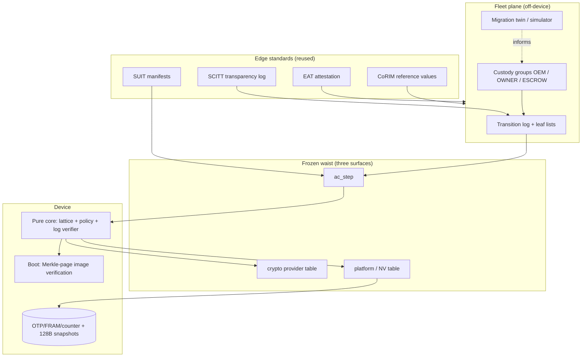
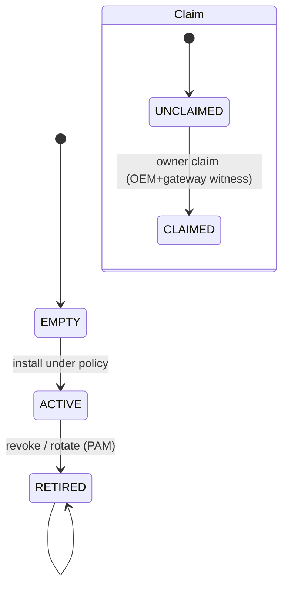

# Governed Change for Long-Lived Machines — The Definitive Blueprint

**Status:** Revision 3 (supersedes Final Blueprint Rev 2 where they differ).
**Evidence labels:** **[M]** measured/computed in this project's code · **[S]** stated by a cited standard or vendor document · **[I]** inference from the above · **[N]** new invention, not yet validated · **[X]** experimental / open · **[R]** recalled from literature, not re-verified in this session. Nothing here claims absolute security. Nothing claims an implementation survives centuries; what is claimed is that a small set of *interfaces and invariants* can.

---

## 0. Verdict in one page

**The opportunity is not "post-quantum cryptography on microcontrollers." It is *governed change of artefacts that outlive their makers, custodians and cryptography*.** A pump controller, pacemaker, satellite, meter, vehicle ECU, registry or archive is deployed for 15–50+ years. Within that span the vendor may vanish, the owner may change, the signature algorithm may break, the hash function may be weakened, keys will be lost or stolen, and the device may be offline for a decade. Everything people call "PQC migration", "secure update", "key rotation", "firmware signing" and "device ownership transfer" is one problem: **who may change what this machine trusts, how do we know, and how does it recover when some party or assumption fails?**

**The invention we commit to** is a small *authority-continuity core* with six primitives:

| # | Primitive | One-line statement | Evidence |
|---|---|---|---|
| P1 | Monotone authority state | Authority only moves forward through a lattice; every reversal is a new, signed, higher-epoch act. | [M] model-checked small-scope |
| P2 | Policy as a 64-bit monotone truth table | "Which sets of signers may act" is data, not code: 8 bytes for ≤6 signers, validated on-device in **176 bytes of Thumb code**. | [M] |
| P3 | Hash-chained transition log + catch-up | A device offline for years replays a chain of transitions rather than trusting a snapshot. | [I]/[X] |
| P4 | Staged activation + scoped, expiring halt | Change is two-phase; any single signer can *stop* but not *start*. | [M] twin; [I] |
| P5 | Assumption minimality | The trust root is a one-way function plus physical monotonicity (counter / OTP). Nothing else is load-bearing. | [I] |
| P6 | Pure-function core behind frozen ports | `step(state,msg) -> (state',intents)`; crypto and platform enter only through two frozen tables. | [M] 3,962 B core on Cortex-M0+ |

**One corrected result changes the design (this turn, [M]):** with two custody groups, *no* policy can tolerate one fault and still be live; with three groups of two signers there are 4,778,188 such policies; but once a **whole hash family** is allowed to fail, *no* policy is both safe and live (the fault sets cover all signers). So hash breaks must be handled as **safety-first, availability-degraded** events with a pre-declared recovery mode (§5.4). The earlier "default dual rule is single-fault-tolerant" claim was wrong in its liveness half and is withdrawn.

**What we build first:** the core (P1,P2,P4,P5,P6) for two profiles — `core-nano` (SHA-256 only) and `core-dual` (SHA-256 + SHAKE256) — with off-device log (P3), SUIT/SCITT/EAT/CoRIM at the edges, and no new cryptography. **What we do not build:** a new signature scheme, threshold hash-based signing, on-device anergy/molting, bearer vouchers, or any claim of multi-century survival of code.

---

## 1. The deeper problem

### 1.1 Why the surface problems share a root

| Surface symptom | Same underlying question |
|---|---|
| "Migrate to ML-DSA / SLH-DSA / LMS" | Who may change which algorithm the device accepts, and how if the old one is broken? |
| "Vendor went bankrupt" | Who holds authority when the root signer no longer exists? |
| "Device resold" | How does authority move from OEM to owner without a bearer secret? |
| "Stolen signing key" | How does the device distrust a key it cannot ask anyone about? |
| "Device offline 8 years" | How does it catch up without trusting a stale or forged snapshot? |
| "Supply-chain attack on build" | How is *a change* attested separately from *who is allowed to make it*? |
| "Hash function weakened" | What survives when an assumption, not a party, fails? |
| "Power cut mid-update" | How is state change atomic and recoverable on non-volatile media with hazards? |

### 1.2 The structural insight [I]

Two things can fail: **parties** (custodians whose keys or intent fail) and **assumptions** (hash, signature family, hardware counter). Classical threshold designs only model party failure. Treating both as *members of one adversary structure* (the idea of general adversary structures in multiparty computation, Hirt–Maurer, J. Cryptology 2000, DOI 10.1007/s001459910003 (existence confirmed by the prior-art review; volume/pages unchecked); fault-tree minimal cut sets and hardware fault tolerance in safety engineering **[S]-class concept**) gives a precise language: a policy is safe iff no *single* fault set authorises alone; live iff survivors of any *single* fault set still can. The project's contribution is making that check **on-device, tiny, and exhaustive** rather than a review artefact.

### 1.3 What is out of scope

Physical attack on flash locks and side channels (defensive hardware guidance only, see §8.4); network transport design; key-ceremony physical procedure; legal custody of escrow.

---

## 2. Vision, philosophy, principles, objectives

**Vision.** A machine that can be *governed for its whole life by evidence, not by contact with its maker.*

**Principles (each testable):**

1. **Adaptability** — algorithms, policies and custodians are data with versions; the verifier core never hard-codes them beyond the waist.
2. **Verifiability** — every transition is a signed, hash-chained record checkable with public inputs only.
3. **Composability** — standards (SUIT, SCITT, EAT, COSE) ride on top; the core does not reinvent them.
4. **Resilience** — single party or single slot loss never halts or compromises; power loss at any byte leaves a valid prior or next state.
5. **Minimal assumptions** — root = one-way function + monotonic physical state; every added assumption must be named, and its failure mode specified.
6. **Recoverability** — there is always a defined path from every failure class, even if the path is "owner + escrow without OEM."
7. **Tighten-only by default** — policy changes that *widen* authority require the strongest quorum; narrowing may be easier.
8. **Honest degradation** — when no safe+live policy exists, say so and choose safety (§5.4).

**Objectives.** (O1) Firmware-scale footprint (<8 KiB code, <1 KiB RAM for core verification path). (O2) No single custody group or single hash family can advance authority. (O3) Offline devices catch up deterministically. (O4) Every claim above is reproducible by script in the repo.

---

## 3. The primitives in depth

### 3.1 P1 — Monotone authority lattice

State is `(epoch, slots[], policy, floor, claim)`. Slots are EMPTY → ACTIVE → RETIRED only (on device). Epoch never decreases; floor (minimum acceptable version/epoch) never decreases except by a higher-quorum *explicit reset record* that itself advances epoch. Re-activation of a retired key is a *new* slot, never a revival. This is a join-semilattice over (epoch, retired-set, floor); merging two valid histories is a max. **[M]** TLC small-scope check: plain 2-of-3 violates "no single assumption advances authority"; the dual-atom rule did not violate within ≈13.5 M distinct states (not a proof). An earlier on-device "anergy" state produced a lockout counterexample at ~465 k states and was moved off-device **[M]**.

### 3.2 P2 — Policy as a monotone truth table

A policy is `uint64_t t` for ≤6 slots: bit *m* set ⇔ the signer set with bitmask *m* authorises. Four checks run on every proposed policy:

```c
int pol_monotone(pol_t t);                     // adding signers never removes authority
int pol_safe (pol_t t,const uint8_t*F,unsigned nf); // no fault set authorises alone
int pol_live (pol_t t,const uint8_t*F,unsigned nf); // survivors of each fault still authorise
int pol_tighten(pol_t old,pol_t new);          // (new & ~old) == 0
```

**[M]** Measured: **176 bytes** of Cortex-M0+ code (`arm-none-eabi-gcc -Os`) for all four; cross-checked against exhaustive Python enumeration; 2,000,000 random tighten checks zero errors. Counts of monotone Boolean functions on n variables reproduce the known Dedekind numbers (D(6)=7,828,354).

**Findings from exhaustive enumeration over all 7.8 M monotone 6-slot policies [M]:**

| Layout / fault model | Safe **and** live policies |
|---|---|
| 2 groups × 2 slots; faults = slot, group | **0** (no two-group SFT policy exists) |
| 3 groups × 1 slot; slot, group | **1** (2-of-3) |
| 3 groups × 2 slots; slot, group | **4,778,188** |
| 3 groups × 2 slots + 2 hash-family faults | **0** (fault sets cover all signers; Q² fails) |
| Safe vs slot, group **and** hash-family; live vs slot/group loss ("critical") | **1,227,427**, all ⊆ the maximal pair rule |
| Safe vs slot/group; live vs slot/group/hash-family loss ("repair") | **1,227,427** |

The **maximal safe policy** is: *authorised iff the signer set is not contained in any single fault set* — numerically identical to "one valid pair from two different groups with different hash families": `0xfffefafaffcceac0`, 46 of 64 sets authorised. **[M]**

### 3.3 P3 — Hash-chained transition log and catch-up

Each transition record: `{prev_hash, epoch_from, epoch_to, policy_hash, delta, signatures, alg_ids}`. A device holding epoch *e* receives the chain from *e* to head, verifies each link with the policy in force *at that link* (not the head policy), and applies atomically. Offline-for-years is thus ordinary. **Risk [X]:** a replayed chain must not let an attacker pick an *older branch*; mitigation is the monotone epoch and a transparency log (SCITT) that witnesses a single head, but equivocation between two valid branches signed by a compromised quorum remains the residual (§9). Chain length is bounded by checkpoint records signed at the then-current strongest policy.

### 3.4 P4 — Staged activation and scoped halt

Phases: PROPOSED → STAGED (verified, not active, device echo displayed to operator) → ACTIVE. A scoped, expiring **HALT** may be issued by any *one* signer for a named scope and duration; it can pause a pending activation but never create one. HALT expiry is counted in a monotone tick, not wall-clock, so a halted device cannot be wedged forever by a lost signer. Migration twin **[M]**: staged rollout alone barely matters for devices out of service (2.31% vs 2.32% big-bang), but auto-halt on anomaly cut it to 0.15%; persisters (devices that never update) add ≈10%.

### 3.5 P5 — Assumption minimality

Root of trust = (a) a one-way function the device already has hardware or ROM support for, and (b) a physically monotone element (OTP fuses, FRAM write-once region, or hardware counter). Everything else — signature scheme, X.509, clocks, networks — is replaceable data. `core-nano` has *one* hash waist; `core-dual` has two with disjoint assumption sets (**κ ≥ 2**): disjointness check shows plain 2-of-3 failing at 0.5249% vs 0.0274% for disjoint pairs, **19.2×** **[M]**.

### 3.6 P6 — Pure core, frozen ports

```c
typedef enum { AC_OK, AC_BAD_SIG, AC_REPLAY, AC_POLICY, AC_TORN, AC_BUSY } ac_status_t;
ac_status_t ac_step(const ac_state_t *in, const uint8_t *msg, size_t n,
                    ac_state_t *out, ac_intent_t *intents, size_t *ni);
typedef struct {            // W2: crypto provider table
  ac_status_t (*hash)(uint8_t alg, const void*, size_t, uint8_t out[32]);
  ac_status_t (*verify)(uint8_t alg, const void *pk, const void*msg, size_t, const void*sig, size_t);
} ac_sig_ops_t;
typedef struct {            // W3: platform table
  ac_status_t (*nv_read_safe)(uint32_t addr, void*, size_t, uint8_t *torn_read);
  ac_status_t (*nv_commit)(const void *snapshot128);
  uint32_t    (*monotonic)(void);
} ac_nv_ops_t;
```

The core contains no allocation, no I/O, no time, no randomness. Conformance = a vector suite (21 LMS vectors + 903 negatives, 6,720 power-cut cases **[M]**). Core measured at 3,962 B (Cortex-M0+, gcc -Os) **[M]**.

---

## 4. Architecture

### 4.1 Layers



### 4.2 Why an hourglass

Many policies, algorithms, transports above; many silicon platforms below; a deliberately narrow, frozen waist in the middle. Scored 4.48 in the architecture comparison against layered-monolith, plugin, and protocol-first alternatives **[M-score from stream A; subjective weights]**.

### 4.3 Custody groups and ownership

Groups: **OEM**, **OWNER**, **ESCROW**. Claim state UNCLAIMED → CLAIMED (first valid owner claim, signed by OEM *and* witnessed by gateway baseline; no bearer pre-signed vouchers). **Owner-sovereign exit:** OWNER + ESCROW can replace OEM without OEM consent. Revocation uses the PAM rule (a revocation requires a signer outside the revoked key's group). Per-key digest rule: each key's identity is a digest under *both* hash families in `core-dual`.

### 4.4 Sequence: authority change with a stale device

```mermaid
sequenceDiagram
  participant Q as Quorum (2 groups, 2 hash families)
  participant L as Transparency log
  participant G as Gateway
  participant D as Device (epoch 12, offline 6y)
  Q->>L: transition 13..40 (each signed under policy at that epoch)
  L->>G: chain 13..40 + checkpoint
  G->>D: chain
  D->>D: verify link 13 under policy@12, ... link 40 under policy@39
  D->>D: stage head; display echo
  Q->>D: activate (second signature, other group)
  D->>D: commit 128B snapshot + tag; ACTIVE
```

### 4.5 State machine (device slot and claim)



---

## 5. Mechanisms, with the corrected fault model

### 5.1 Two fault classes

* **Safety faults** (compromise): any single signer, any single custody group, any single hash family. A safe policy never lets one of these authorise alone.
* **Availability faults** (loss): any single signer, any single custody group. A live policy still authorises after any one.

### 5.2 Default policy (`core-dual`)

Slots: 0 OEM-A(SHA-2), 1 OEM-B(Keccak), 2 OWN-A, 3 OWN-B, 4 ESC-A, 5 ESC-B. **Authorised iff the set contains two signers from different groups with different hash families** (table `0xfffefafaffcceac0`). Properties **[M]**: monotone ✔; safe against slot, group *and* hash-family compromise ✔; live against slot/group loss ✔; **not live** against loss of a whole hash family ✘.

### 5.3 `core-nano`

One hash waist (SHA-256). Authority = two signatures from two distinct custody groups (3 slots, 2-of-3). Safe vs slot/group compromise; **no protection against SHA-256 break** — documented limit, acceptable only where hash break risk is accepted or compensated outside the device.

### 5.4 Hash-family failure: the honest-degradation path [N]

Because no policy is safe+live when a hash family is lost (§3.2), the design commits to:

1. **While no break is declared:** default policy (§5.2).
2. **Break declaration** is itself a transition authorised by a *single-family* 2-of-3-groups policy (the "repair-type" policy from the table; safe vs slot/group, not vs the surviving family). It sets a monotone `family_revoked` bit.
3. **After declaration:** the revoked family's signatures are ignored; the repair policy governs until a new family is installed (which requires re-establishing a second family via the same quorum, then returning to the dual policy).
4. **Before declaration, if the break is silent:** the dual rule still blocks the attacker, because forging requires both families. The window of exposure is the time between break and declaration in which *availability*, not safety, is lost.

This trades availability for safety exactly where the mathematics forbids both. **Residual [X]:** a declaration signed with the surviving family only is exposed to a break of *that* family; mitigation is out-of-band (escrow ceremony) and is the principal open question in §9.

### 5.5 Settings: two tiers and device echo

Tier 1 (operating setpoints): one signer + device echo. Tier 2 (safety-envelope limits): two-person commit with device-echoed summary hash shown to *each* approver. Safety-envelope changes are tighten-only by default (D-19).

### 5.6 Reporting signatures

Device-scoped one-time LMS-OTS keys: 4,096 leaves × 32 B = 128 KiB leaf list kept off-device; signature 67×32 = 2,144 B; signing ≈48 ms on the reference M0+ **[M-adjusted]** (earlier "4 ms" claim corrected). Gateway witnesses the baseline.

### 5.7 Image verification

Merkle-page tiered verification (C-10) with a stored boot root (C-03): protection-ready ≈1.5–2.8 ms with stored root vs ≈45 ms without **[E-estimate]**.

### 5.8 Non-volatile contract

`nv_read_safe` returns `torn_read ∈ {status, recoverable_trap, fatal_trap}`: on some parts, reading a torn or unwritten flash word raises a fault (documented for STM32H5 in vendor material **[S]**). Preferred backing order: OTP → FRAM → hardware counter → flash with 128-byte self-contained snapshots carrying a SHA-256 commit tag. Power-cut test: 6,720 cases **[M]**.

---

## 6. Problem → cause → mechanism → components → outcome → validation

| Problem | Root cause | Mechanism | Components | Expected outcome | Validation |
|---|---|---|---|---|---|
| Algorithm break | Hard-coded algorithms | Algorithm descriptors as data + provider table | `ac_alg_desc`(16 B), W2 | Swap without re-flash of core | Conformance vectors |
| Vendor disappears | Single root of authority | OWNER+ESCROW exit | Custody groups, claim FSM | Owner regains control | Model check; ceremony drill |
| Stolen key | No distrust path | PAM revocation + log | Slots, floor records | Key retired fleet-wide | EXP-01 |
| Silent hash break | Single assumption | Dual hash families, κ≥2 | `core-dual` | Forgery needs both | dq.py (19.2×) |
| Offline 8 years | Snapshot trust | Hash-chained catch-up | P3 | Deterministic catch-up | Replay tests; EXP-03 |
| Torn flash write | Non-atomic NV | 128 B snapshot + tag, safe read | W3 | Valid prior/next state | 6,720 power-cut cases |
| Rogue single admin | Unilateral control | 2-group quorum, device echo | P2, §5.5 | No single actor change | Policy lint |
| Bad rollout | Fleet-wide blast radius | Staging + scoped HALT | P4 | 0.15% out vs 2.3% | Twin |
| Lost signer blocks all | No liveness analysis | Live-under-loss lint | `pol_live` | Survives 1 loss | Enumeration |
| Fault set misdesign | Review-only reasoning | On-device safe/live/tighten checks | 176 B validator | Illegal policies refused | Random-table cross-check |

---

## 7. Comparison with existing work

| Approach | Strength | Limit relative to this design | What we take |
|---|---|---|---|
| TUF / Uptane | Role separation, compromise-resilient repos | Policy fixed in role model; no assumption-failure model; heavy for MCUs | Metadata shape |
| SUIT (RFC 9019 family) | Compact update manifests | No authority-change semantics | Manifest format |
| SCITT (RFC 9943) | Transparency for statements | Not a device policy engine | Log, receipts |
| EAT (RFC 9711), CoRIM | Attestation claims | Evidence, not governance | Evidence carriage |
| MCUboot / vendor secure boot | Practical, proven | Single signature algorithm, vendor-rooted | Boot integration |
| FDO | Ownership transfer at onboarding | One-time, not lifecycle | Onboarding |
| Threshold signatures | Quorum in one signature | Threshold hash-based signing now exists (Kelsey–Lang–Lucks 2025; two 2026 ePrints) but needs a trusted dealer or GiB-scale state, or lacks DKG; not firmware-ready | Watch; revisit |
| liboqs / PQClean / pqm4 | Research reference code | Not production firmware | Avoid in firmware |
| mlkem-native / mldsa-native | Verified-oriented implementations | Algorithm only | Use as providers |
| RFC 4998 (evidence records) | Long-term archive renewal | Document-scale | Concept for renewal |

---

## 8. Reused vs invented vs uncertain

### 8.1 Reused (strongest as-is)
COSE, SUIT, SCITT/Tessera, EAT, CoRIM, CycloneDX CBOM, FDO, LMS/XMSS-class and SLH-DSA verification (build verify-only), ML-DSA/ML-KEM via mldsa-native/mlkem-native, NIST IR 8547 timelines, SP 800-230 draft awareness; CNSA 2.0 constraints (excludes SLH-DSA — a compliance consideration, not a cryptographic one).

### 8.2 Newly composed [N] (nothing cryptographically new)
Policy-as-truth-table with on-device safe/live/tighten linting; the "safe-and-live impossibility under assumption faults" framing and degradation rule; hash-chained catch-up with per-link historical policy; owner-sovereign exit; two-tier settings with device echo; hardware-honest NV contract.

### 8.3 Uncertain / open [X]
Threshold hash-based signing; equivocation between valid branches; hash-break declaration channel; ≥3 assumption classes in practice; real-silicon timings (all above are reference-board or analytic estimates).

### 8.4 Hardware defensiveness
Prefer parts with OTP and hardware counters; treat debug lock and flash-protection settings as *defence-in-depth*, never as a trust root; the core assumes an attacker with physical access wins eventually and limits the *blast radius* instead.

---

## 9. Where this could be wrong (invalidation risks)

1. **Quorum compromise equivocation** — two valid branches from a compromised quorum defeat catch-up. Mitigation: transparency log; residual accepted.
2. **Hash-break declaration circularity** — §5.4 step 2 depends on the surviving family. If both are weak simultaneously, the design offers no protection (as does every design).
3. **Policy complexity creep** — 6-slot truth tables are small enough to audit; if products demand >6 signers, tables grow (2^n bits) and the guarantee becomes lint-by-tool, not by inspection.
4. **Operational reality** — custody groups that don't actually exist (one company holding all three) void the model. Mitigation: attestable group separation in the ceremony record.
5. **Standards drift** — SCITT/SUIT profile changes. Mitigation: they sit above the waist.
6. **Model-checking limits** — TLC run was bounded; not a proof.
7. **Market** — buyers may accept single-vendor update. Then `core-nano` with owner-exit is the minimum viable pitch.
8. **Independent red-team and prior-art reviews** are merged in §9A.

---

## 9A. Independent review findings (red-team and prior-art), merged

*Source: two separate review agents; their memos are `streams/X_redteam.md` and `streams/X_priorart.md`. Their claims are treated as data and are labelled by their own evidence tags; items marked [I] were from memory.*

### 9A.1 Red-team: what changes in this design

1. **"Single-fault-tolerant" holds only against a closed fault list.** On 5 slots, of 7,581 monotone tables, 1,227 pass the safe-and-live checks, and 398 (32.4%) can be authorised by **one person holding two slots**; only 277 survive loss of any one slot or group **[C, review script]**. Custody groups are labels, not authenticated facts. *Consequence:* the guarantee is conditional on **slot-to-party independence being attested in the ceremony record**; a verifier bug is a fault on *all* slots at once and no policy covers it (hence D-L and differential re-implementation).
2. **Long-range / stale-device fork.** A device asleep for decades can be fed a fork from its old head once the signer class valid at that head is broken. The honest claim is **"safe against one class break"; sequential breaks defeat catch-up.** *Mitigation:* checkpoints re-signed under current strongest policy; devices past a maximum offline age enter **re-claim** (owner+escrow ceremony) instead of silent catch-up. Added to the roadmap as EXP-03 acceptance.
3. **P5 conflicts with P2 at the root.** If the root is hash-only and must be safe against the hash atom, the root cannot act alone; this collapses to `core-dual` and its **unresolved SHA-2/SHAKE independence** question. Stated plainly: `core-dual` is a bet that two hash families fail independently.
4. **Unification is close to tautology.** The adversary-structure view is a *language*, not a theorem about devices. Under **common-cause** failure, the hardware-fault-tolerance reading fails (review estimate 0.015 vs 0.0025 for independent faults **[E]**). *Consequence:* forge-faults and loss-faults are separate families (as in §5.1), and independence claims need evidence, not assertion.
5. **Bricking.** Tighten-only plus monotone state makes configuration errors and custody loss permanent. *Consequence:* a **designed break-glass path is mandatory** — a reset record requiring the strongest quorum (all three groups) that advances epoch and is logged — and the policy lint must refuse any policy with no reachable break-glass.
6. **Consistency with earlier commitments.** The Rev 2 blueprint committed to custody groups and "2 signatures from 2 distinct groups" with no assumption masks on device (D-03). This revision *moves* assumption-awareness into the policy table. That is a **deliberate reversal of D-03**, to be validated by EXP-01 before it is frozen; until then `core-dual` remains the shipping default.

The review also lists eight falsifying experiments (X-E1…X-E8) and five top invalidators with likelihoods; adopt them as the Phase 1 test plan.

### 9A.2 Prior art: what changes in the novelty claims

* Every component has close prior art: **TUF 1.0.37 and Uptane 2.1.0** (threshold roles, chained root rotation, rollback counters), **SCITT (RFC 9943)**, **Benaloh–Leichter monotone secret sharing**. No source found for the *composition* (small on-device monotone truth table, assumptions and custody as one party set, replayable monotone log) — **"not found in limited searches", not "does not exist"**; patents not searched.
* **κ is a minimal-cut-set check** applied to signer sets; present it as an application, not a new result.
* Corrections to earlier project statements: "multi-party hash-based signing is research only" is **out of date** (see §7); the claim that TUF's online-key model blocks an offline root is **imprecise**; Caliptra as prior art for key-hash slots is **unconfirmed**; TPM 1.85 PQC rests on a vendor blog only; PQ secure-element certifications are targets, not facts; SP 800-230 unverified.
* Cross-domain: only vehicles (Uptane) and registries (TUF, SCITT) rest on fetched sources; other domains are by analogy.

**Revised novelty ledger:** *composition and on-device linting* — plausibly new, unproven; *everything else* — reuse.

---

## 10. Implementation strategy

### 10.1 Repository
```
/core        C11, no libc deps; ac_step, policy, lattice, log verifier
/ports       nv_*, crypto providers (sha256, shake256, lms-verify, slh-verify)
/tools       policy-lint (Python), twin, leaf-list manager, ceremony scripts
/spec        formal models (TLA+), vectors, wire formats (CBOR/COSE)
/conformance negative vectors, power-cut harness
```
Languages: C for core and ports; Rust acceptable for host tools; Python for studies; TLA+ for models. Dependencies: none in core.

### 10.2 Test strategy
Unit + vector conformance; exhaustive policy lint; fuzz the message parser; power-cut harness at every NV write boundary; TLA+ invariants (`NoSingleAssumptionAdvance`, `EpochMonotone`, `NoLockout`); independent re-implementation of the verifier from spec (differential test).

### 10.3 Phased roadmap with acceptance criteria

| Phase | Deliverable | Acceptance |
|---|---|---|
| 0 (now) | Core + policy validator + vectors | Core ≤4 KiB M0+; 0 failures across vectors; validator ≤256 B |
| 1 (EXP-01) | Rotation/revocation across 3 groups in simulator | 100% of single-fault scenarios safe & live; hash-break scenarios degrade per §5.4 |
| 2 (E-A1) | Reference port on two MCU families + FRAM/OTP backing | Power-cut 0 corrupt states |
| 3 (EXP-03) | Catch-up from epoch gaps of 1–10,000 | Deterministic final state; bounded time |
| 4 (EXP-02) | SUIT/SCITT/EAT integration | Interop with one external implementation |
| 5 (E-C1/E-P1) | Ceremony tooling, pilot fleet | Pilot with real custody separation |
| 6 (E-O1) | Independent security review + benchmarks on silicon | Findings closed; timings replace estimates |

### 10.4 Build now / after validation / long-term research

* **Build now:** core, policy lint, vectors, `core-nano`/`core-dual`, off-device log tools, twin.
* **After validation:** on-silicon timing claims, SCITT profile, hash-break ceremony, third assumption class, FRAM/hardware-counter production ports.
* **Long-term research:** threshold hash-based signing, equivocation-resistant catch-up, formal proof (not bounded model check), anergy/molting off-device, cross-domain generalisation.

### 10.5 Resource estimates (reference, not silicon-measured)
Core 3,962 B + policy 176 B ≈ 4.1 KiB code; state ≈ 400 B RAM; NV snapshot 128 B ×2; per-device off-device leaf list 128 KiB; SLH-DSA/LMS verify code additional (several KiB). Fleet storage ≈12.2 GiB per 100 k devices for reporting leaf lists.

---

## 11. The long horizon (centuries, honestly)

No code or silicon survives a thousand years. What can survive is a **small set of invariants and interfaces** that successors can re-implement from a short specification: (1) epochs only move forward; (2) change is authorised by sets of parties, expressed as a monotone function; (3) every change is a hash-linked record anyone can verify with public inputs; (4) trust bottoms out in one-way functions and physical monotonicity; (5) any component may be replaced if it can be shown to preserve (1)–(4). This is the same shape as long-term archive evidence renewal (RFC 4998 **[S]**) and as safety-case reasoning for long-lived plants. Enduring principles: adaptability, verifiability, composability, resilience, minimal assumptions, recoverability. The cross-domain targets (space vehicles, implantables, meters, vehicles, registries, archives, AI-agent configuration) share the same questions; **claiming product fit in each is [X] until pilots exist.**

---

## 12. Record of architectural decisions

### 12.1 Committed (Decided)
| ID | Decision | Reason |
|---|---|---|
| D-A | Hourglass with pure core and three frozen surfaces | Portability, testability |
| D-B | Slot states EMPTY/ACTIVE/RETIRED on device only | TLC anergy lockout counterexample |
| D-C | Three custody groups OEM/OWNER/ESCROW | ≥3 groups needed for SFT |
| D-D | Policy = 64-bit monotone truth table with 4 on-device checks | 176 B; exhaustive validation |
| D-E | Default `core-dual` = pair rule (different group, different family) | Maximal safe policy |
| D-N | Mandatory break-glass reset (all three groups, epoch-advancing, logged); lint refuses policies without it | Bricking risk (§9A) |
| D-F | Hash-family loss = safety-first degraded mode (§5.4) | Impossibility result |
| D-G | Owner-sovereign exit (OWNER+ESCROW) | Vendor-death recovery |
| D-H | Scoped expiring one-signer HALT; PAM revocation; per-key digest rule | Blast-radius control |
| D-I | No bearer pre-signed vouchers | Theft/replay |
| D-J | NV contract with `torn_read` and 128 B tagged snapshots | Flash hazard |
| D-K | Two settings tiers with device echo | Operator error |
| D-L | Verification hygiene: public inputs only, redundant complementary checks, resumable verifier | Fault-injection resistance |
| D-M | Use standards at edges; no new cryptography | Minimise novelty risk |

### 12.2 Conditional (decide after experiment)
Merkle-page tiering (needs stored boot root); LMS vs SLH-DSA as default hash-based verifier (footprint vs conservatism); third assumption class; checkpoint cadence; SCITT receipt requirement on device vs gateway.

### 12.3 Research
Equivocation resistance; practical (dealer-free, small-state) threshold hash-based signing; hash-break declaration channel; formal proof of lattice invariants; TESLA-style broadcast auth (needs trustworthy time).

### 12.4 Rejected
| Idea | Why rejected |
|---|---|
| Treating the default dual rule as fully single-fault-tolerant | Disproved by enumeration (§3.2) |
| On-device anergy / molting | Lockout counterexample |
| Hash-chain "zero-byte signatures" | Requires trustworthy time; signature is only 2.4% of a 100 KB LoRa update |
| Optical token for update | ≈21 s at 2 kbps for 5,316 B; not "1.5 s" |
| One-time report signing as "4 ms" | ≈48 ms and needs off-device leaf list |
| PQClean/pqm4/liboqs in firmware | Research-grade code |
| Bearer pre-signed vouchers | Theft/replay |
| Inventing a new signature scheme | Unjustified novelty risk |

---

## 13. Reproducibility index

* `code/G/enum6.py`, `policy_study.py`, `theory.py` — policy enumeration and lemmas.
* `code/G/policy.c`, `ptest.c` — validator and test (176 B Thumb).
* `code/B/dq.py` — κ-disjointness study.
* `code/F/migration_twin.py` — migration twin.
* `code/V/FirstStage.tla` — bounded model checking.
* `code/E`, `code/P` — core C sources, vectors, power-cut harness.

## 14. Sources and evidence status
Standards named (SUIT, SCITT RFC 9943, EAT RFC 9711, COSE RFC 9964, RFC 4998, CNSA 2.0, NIST IR 8547, SP 800-230 draft) are as recorded in earlier project streams; vendor flash behaviour (STM32H5, AN5342) as recorded there. Hirt–Maurer general adversary structures and the Kelsey–Lucks / ePrint threshold-hash-signing items are **[R]** and not re-verified this session. Timing and size figures marked [M] come from this project's scripts; others are estimates. No external claim here should be read as independently audited.
