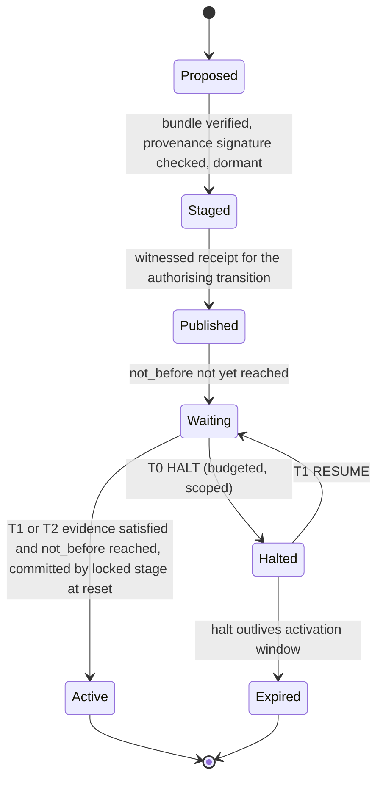
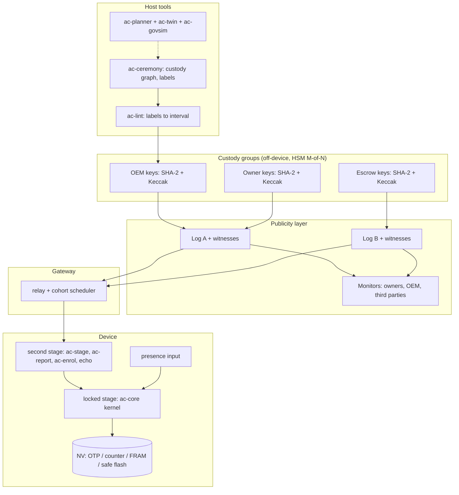
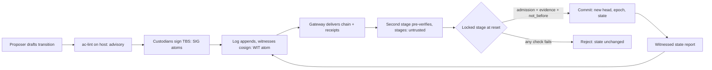
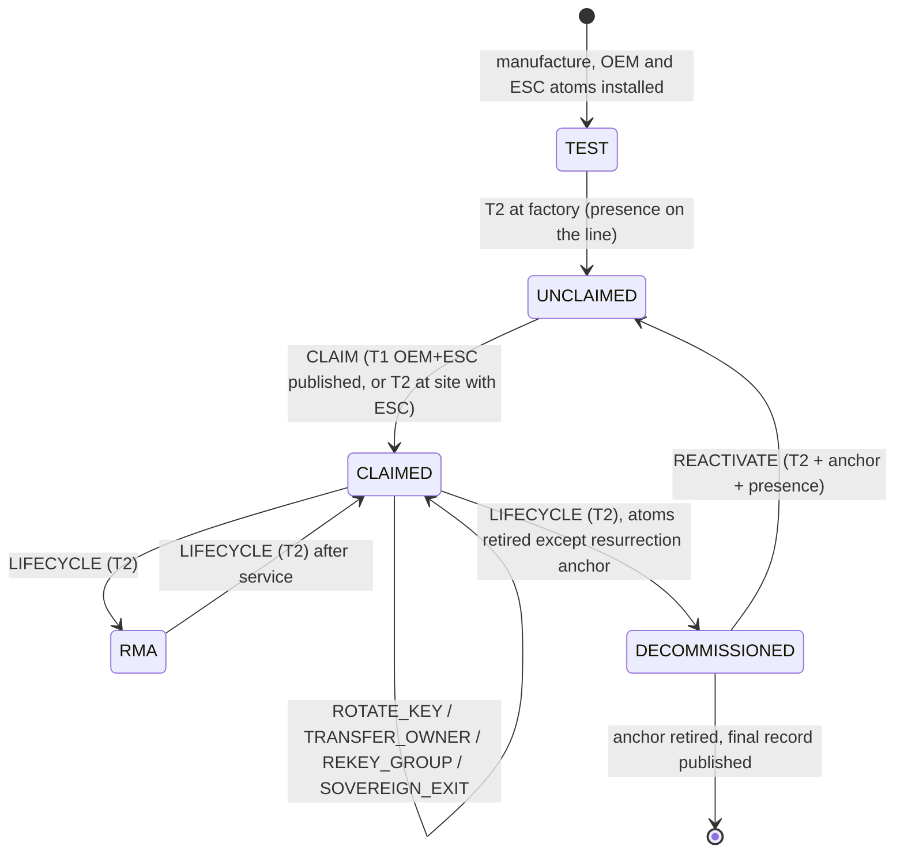
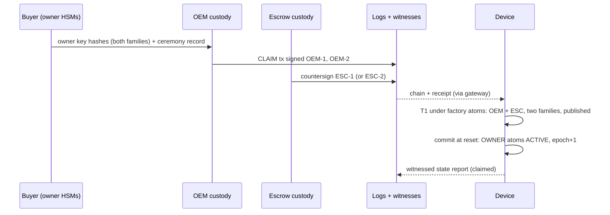
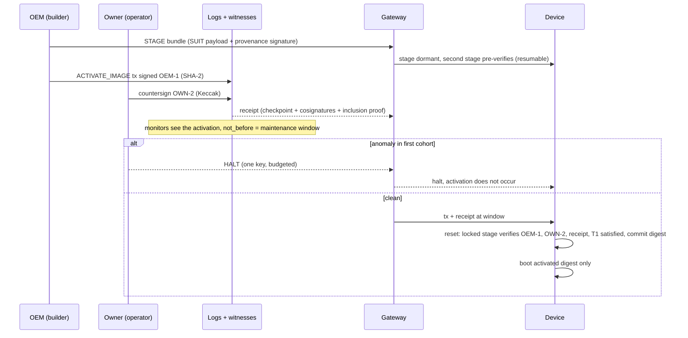
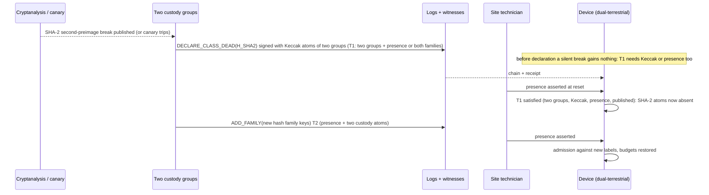
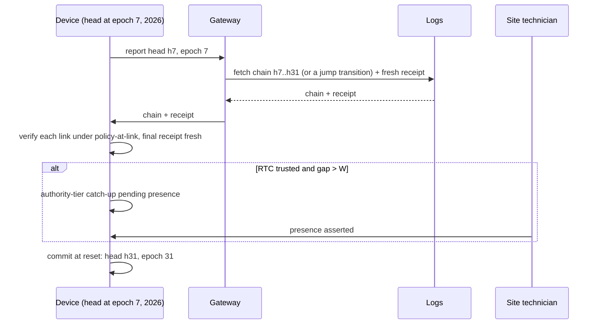

# Governed Change for Long-Lived Machines
## The definitive blueprint: one theory, one kernel, one programme of proof

*Status: Revision 4, 6 November 2026. Supersedes the Final Blueprint (Rev 2) and the Definitive Blueprint (Rev 3) wherever they differ; every Rev 2 decision is carried forward, amended or reversed explicitly in §20. No project or product name is used. `ac_` and `ac-` remain placeholder prefixes.*

**Evidence labels.** **[M]** measured or computed by this project's scripts (paths in §21) · **[P]** proved in this document · **[F]** primary source fetched and checked · **[S]** standard or vendor statement, not independently checked · **[E]** estimate with stated arithmetic · **[I]** engineering inference · **[N]** new invention, not yet validated · **[X]** experimental or open · **[R]** recalled from literature, not re-verified. Nothing here claims absolute security, and nothing claims that an implementation will survive centuries. What is claimed is narrower: a small set of rules, interfaces and invariants that can be re-implemented, checked and renewed by whoever comes next.

**How to read it.** Three minutes: §0. Thirty minutes: §0, §3.1–3.6, §4, §20. Full engineering read: everything. Independent reviewers should start with §3 (the theory), §17–18 (what could be wrong) and §21 (how to reproduce every number).

---

## 0. Executive summary

### 0.1 The opportunity

Industry describes the coming decade as "post-quantum migration": replace RSA and elliptic-curve signatures with ML-DSA, SLH-DSA, LMS or XMSS before a cryptographically relevant quantum computer exists. For long-lived machines that framing is too small and slightly wrong. A pump controller, protection relay, meter, vehicle ECU, implant, satellite, package registry or archive lives 15 to 50 years. Over that span the algorithm may break, but so may the hash function under it. The vendor may vanish, the owner may change, keys will be lost and stolen, the device may sit offline for a decade, and the people who understood the system will retire. Each of these is handled today by a different mechanism: secure boot, update frameworks, key rotation, PKI, ownership vouchers, escrow contracts, vendor support, physical recall. Each is designed separately and each has its own failure modes, and the side doors between them are where incidents live.

**The deeper problem we found** is that all of these are one problem: *governed change of an artefact that outlives its makers, its custodians and its cryptography.* The question is always the same. Who may change what this machine trusts? What evidence must they show? How does the machine know? And how does it recover when a party, an assumption or a place fails?

**The opportunity** is to make that question have one answer, small enough to put in a locked boot stage and precise enough to prove. Post-quantum migration then becomes one instance of it: retiring a broken assumption class while keeping authority safe and live. So do ownership transfer, vendor exit, key rotation, debug unlock, safety-limit changes, decommissioning and resurrection.

### 0.2 The foundation, in one paragraph

We will build a **governed-change kernel**: four primitives behind a frozen waist. **Evidence:** up to eight *evidence atoms*, each something the locked boot stage can check itself. An atom is a signature under a stored key hash, physical presence at the device, or publication in a witnessed log, and each carries *labels* naming what it depends on: custody group, cryptographic family, site. **Rule:** for each tier of power, a monotone policy stored as a 256-bit truth table over those atoms, *admitted on the device itself* only if it lies inside a lattice interval computed from the labels. **Record:** a monotone authority state (epochs and floors that only rise, keys that can only be retired), extended by a hash-chained, per-device transition history that a device asleep for years can replay. **Effect:** every change is staged, delayed, haltable by any one custodian and activated only by quorum, and every change made without physical presence is published before it takes effect. The waist is three frozen interfaces: `ac_step(state, message) → (state', intents)`, a crypto-provider table and a platform table. Everything else, from algorithms and transports to formats, storage, fleet services and user interfaces, is replaceable data or replaceable code above or below the waist.

### 0.3 What makes it a foundation rather than a product

Three results, each checked by exhaustive or randomised computation, give the design its shape. Each is stated precisely in §3.

1. **The interval theorem [P][M].** Describe what an adversary can do in one fault, and what loss the system must survive, as families of atom sets. Then the policies that are both *safe* (no single fault authorises) and *live* (the survivors of any single loss can still act) are exactly the monotone functions in one lattice interval **[Lo, U]**. That interval is non-empty if and only if no compromise set and loss set together cover every atom, a mixed form of the Q² condition from general-adversary multiparty computation. Admission therefore reduces to `monotone(f) ∧ (f & ~U) = 0 ∧ (Lo & ~f) = 0`. The C implementation computes U and Lo on the device from the labels. It takes **682 bytes** of Cortex-M0+ code with an 88-byte worst-case stack, and it matched an independent Python reference on 3,000 random cases.
2. **The class-count law, or diversity budget [P][M].** Suppose evidence falls into *k* independent classes and the system must resist *t* compromised classes while remaining live after *s* lost classes. A policy exists if and only if **k ≥ t + s + 1**. Two custody groups can never give single-fault safety and liveness; three can. Two hash families can never give safety against one break and liveness after one break; adding physical presence as a non-cryptographic class can.
3. **Every recovery path is an attack path [P].** The effective security of a device is the weakest path to full control, so for full control *t_eff + s_max ≤ k − 1*. A design cannot be maximally recoverable and maximally resistant at once. It must *spend* its diversity, and it must say how.

A 40-year Monte Carlo of custody loss and hash-family breaks shows why the spending decision matters. The hazards are illustrative; the comparison between designs is the result [M]. The Rev 2 rule (two groups and two families required, no presence) lost governance permanently in **39%** of runs even with renewal. The presence-based recovery tier adopted here lost it in **1.0%**.

### 0.4 What we are building first

| Build now (Phase 0–1) | After validation (Phase 2–3) | Research frontier (not depended on) |
|---|---|---|
| Kernel in C99 subset plus a Rust `no_std` twin and a Python reference: lattice state, interval admission, tiers, chain verification, staging and halt | End-to-end flows: claim, operate, constitution, recovery, sovereign exit, decommission, reactivation; pilot fleets | Device-side fork uniqueness through verifiable maps |
| Verify-only LMS and SLH-DSA providers, SHA-256 and SHAKE256 waists, ML-KEM enrolment through mlkem-native | Witness network with ≥ 2 independent logs (Tessera + C2SP checkpoints); monitors | Third cryptographic class for remote devices (Ascon- or AES-based hash signatures) |
| Presence atom reference designs (key switch, jumper, optical/NFC local port) | Fortress constitution option; RTC trust-age window | Threshold hash-based signing for custody groups |
| NV contract and part profiles; power-cut rig on real silicon | Certification evidence (IEC 62443-4-1, SESIP/PSA), external audit, T0 freeze | Formal machine-checked proofs (Lean/Isabelle) of the whole kernel |
| Host tools: label-driven lint, ceremony kit, migration twin, governance-loss simulator | Cross-domain pilots: vehicles, meters, registries | Proximity-bounded presence; zero-knowledge fleet posture |

### 0.5 What changed from Revision 3, in nine lines

1. The six primitives are condensed into **four (Evidence, Rule, Record, Effect)** plus the waist.
2. The on-device policy check is generalised from a fixed 6-slot validator to **interval admission over labelled atoms**, with bounds computed on the device.
3. **Physical presence and publicity become evidence atoms.** Presence is preventive, publicity is exposure-only, and the theory says exactly what each buys.
4. The single "default dual rule" is replaced by **tiers derived from fault budgets**: HALT, OPERATE (1,1), CONSTITUTION (1,2) recoverable or (2,1) fortress, with remote and nano variants.
5. **Code is authority.** The locked stage boots only an image whose digest an authorised activation committed. One OEM key no longer suffices, which fixes the red-team's single-key boot finding.
6. **Chain, not join-set,** for history, with per-link historical policy and full domain separation.
7. **HALT is budgeted and overridable**, so a stolen halt key cannot freeze a fleet.
8. **Stale devices** get an explicit bound: safe against one class break during their sleep. An RTC window can force presence for older catch-up.
9. **Claims are narrowed** after independent prior-art, citation and red-team reviews. Composition and on-device admission are the plausibly new parts; the mathematics underneath is classical and is cited as such.

---

## 1. The deeper problem

### 1.1 One problem wearing many masks

| What practitioners call it | The governed-change question underneath |
|---|---|
| PQC migration | When a class of evidence (RSA/ECDSA signatures) is about to fail, how do we stop accepting it without losing the ability to act? |
| Hash-function weakening | Same question, for a class that every hash-based signature depends on |
| Firmware update | Who may change the code the device runs, and how does the device know? |
| Key rotation / stolen key | How does the device stop trusting one key without being able to ask anyone? |
| Vendor bankruptcy / end of support | Who holds authority when one custodian disappears for ever? |
| Resale, RMA, change of operator | How does authority move between custodians without a bearer secret? |
| Debug unlock, factory provisioning, engineering workstations | Why do these side doors have different, weaker rules from the front door? |
| Safety-limit changes | How do we stop a validly signed change from widening a physical safety envelope? |
| Device offline for 8 years | How does a device catch up without trusting a forged or stale history? |
| Supply-chain attack on a build | How is "who built it" kept separate from "who may make it effective"? |
| Covert targeted update | How do we make every authority act public before it takes effect? |
| Power cut during an authority change | How is state change atomic on non-volatile media with hazards? |
| Decommissioning and resurrection | How does a device die cleanly and come back only under strong evidence? |

### 1.2 Four things fail, not one

The industry's mental model has one failure mode: *keys are compromised.* Over a 40-year life four kinds of thing fail, and each can fail in two ways: it can be **compromised** (it now works for the adversary) or **lost** (it no longer works for anyone).

| Failing thing | Compromise | Loss |
|---|---|---|
| **Parties** (custodians, keys, HSMs, insiders) | Theft, coercion, insider abuse | Bankruptcy, lost keys, staff churn, dissolved escrow agent |
| **Assumptions** (hash families, hardness problems, implementations) | Cryptanalytic break; an implementation bug shared by many keys | A deprecated algorithm that can no longer legally or safely be used |
| **Places** (the site where a device sits) | Malicious insider or contractor with physical access | Unmanned, sealed, orbital or buried device: nobody can be there |
| **Time** (clocks, freshness, ordering) | Manipulated clock, replayed old history | No clock at all after a long sleep |

A rule that tolerates one stolen key but not a dead vendor, or that survives a dead vendor but not a broken hash family, is not a solution. It is a choice of which failure to ignore. This project's earlier passes found many such choices hidden in good designs, including our own.

### 1.3 Assumptions the industry relies on, and what is wrong with each

| Inherited assumption | Why it is incomplete | What replaces it here |
|---|---|---|
| Security is a property of algorithms | Authority fails through custody, policy and procedure long before cryptanalysis | Security is a property of *evidence structures*, of which algorithms are one label |
| A root of trust is one key or one vendor | Vendors and keys do not last 40 years | A root is a monotone policy over independent classes, with defined exits |
| Freshness comes from being online | OT devices are partitioned or offline for years | Freshness from monotone counters and witnessed checkpoints; time may only *restrict* authority |
| Host tools that produce policies are trustworthy | Humans sign what tools show them; a compromised compiler emits an unsafe policy that a valid quorum signs | The device re-derives its own safety and liveness bounds and refuses inadmissible policies |
| Recovery is an operational matter | Every recovery path is an attack path; recovery decides the real security level | Recovery is a tier with an explicit fault budget, presence and publicity |
| Logs and transparency prevent attacks | A log publishes; it does not consent | Publicity is modelled as exposure, not prevention, and is paired with delay and veto |
| More signatures means more safety | Signatures that share an assumption fail together (plain 2-of-3 lets one Keccak break forge both Keccak-based signatures) | Count *independent classes*, not signatures |
| Physical access means game over | True for one device's secrets; false for fleet authority, and presence is also a *resource* | One opened device yields no fleet authority; presence is a deliberate evidence class |

### 1.4 The problem set this foundation addresses

Each governed-change problem G1–G24 is mapped to mechanisms, components, outcomes and validation in §10. Atlas codes (R-, N-, P-) refer to the earlier atlas and blueprints.

| ID | Problem | Class |
|---|---|---|
| G1 | Signature-algorithm obsolescence or break, including a cryptographically relevant quantum computer | Assumption |
| G2 | Hash-family break or weakening | Assumption |
| G3 | Single key compromise | Party |
| G4 | Custodian (group) compromise or insider | Party |
| G5 | Custodian loss: lost keys, dissolved escrow, staff churn | Party |
| G6 | Ownership change: sale, transfer, RMA | Party |
| G7 | Vendor exit or hostility (OEM death or refusal) | Party |
| G8 | Malicious-but-authorised change, including signed harmful settings | Effect |
| G9 | Covert, targeted change (split view) | Time/publicity |
| G10 | Stale or offline device catch-up | Time |
| G11 | Rollback and replay of old authority or images | Time |
| G12 | Power loss during authority change; hazardous non-volatile memory | Record |
| G13 | Policy misconfiguration and bricking by tightening | Rule |
| G14 | Toolchain or host compromise producing an unsafe policy | Rule |
| G15 | Verifier bugs (systematic faults shared by every slot) | Implementation |
| G16 | Side-door authority chains: debug, RMA, provisioning, configuration | Rule |
| G17 | Upward evidence (state reports) without fleet-scale device keys | Evidence |
| G18 | Real-time and safety constraints; recertification cost | Deployment |
| G19 | Brownfield devices that cannot change | Deployment |
| G20 | Provenance of changes (who built it) versus authority (who may make it effective) | Evidence |
| G21 | Long-term verifiability of history after algorithms age | Record |
| G22 | Decommissioning, resale and resurrection | Lifecycle |
| G23 | Time manipulation granting authority | Time |
| G24 | Counter exhaustion and wrap | Record |

### 1.5 What no design can solve

These are stated up front so that nothing later implies otherwise.

* **A device whose immutable verifier accepts only a broken class, and which has no lock and no second path, cannot be rescued by cryptography.** It must be contained or replaced (§6.16).
* **If every class of evidence a device accepts is compromised, no policy can be both safe and live** (interval theorem, §3.6 row (a)). If all cryptography is gone, only presence remains, and one insider has it.
* **A local attacker who defeats a part's physical lock can do anything to that device.** The design bounds the blast radius to that device. It does not prevent the compromise.
* **Fault models are closed-world.** Every guarantee here holds relative to the declared classes. A common-mode fault nobody declared, such as a shared HSM firmware bug, a verifier bug or a ceremony script used by every group, is outside the proof (§17, §18).
* **Systematic faults in the verifier itself** are a single fault on every atom at once. No policy covers them; only implementation assurance does (D-13, D-14, D-20).

---

## 2. Vision, philosophy, principles and objectives

### 2.1 Vision

*A machine that can be governed for its whole life by evidence, not by contact with its maker. Its rules of change are small enough to read, strict enough to prove, and renewable by whoever comes next.*

### 2.2 Architectural philosophy

1. **Authority is the asset.** A forger after a quantum computer decrypts nothing; they *sign*. The exposure of long-lived infrastructure lies in who may change it, so the foundation is a theory and kernel of authority, not an algorithm library.
2. **Small, frozen waist; everything else is data or replaceable code.** The locked stage contains no parser for rich formats, no clock dependence, no policy interpreter and no secret.
3. **Structure over trust.** Where a property can be checked by the device from public data, the device checks it. It does not trust a host tool, a gateway or a human summary.
4. **Diversity is a budget, not a slogan.** Independent classes are counted, spent per tier, and renewed when lost.
5. **Monotone history.** Authority state only moves forward. Undoing is a new, higher-epoch, more strongly authorised act, and it is public.
6. **Every power has a recovery path, and every recovery path requires presence, is delayed, and is public.**
7. **Time may only restrict authority, never grant it.**
8. **Honest degradation.** When the mathematics forbids both safety and liveness, the design says so and chooses safety by default.

### 2.3 Principles, each with its test

| # | Principle | How it is tested |
|---|---|---|
| P-1 | No single declared fault can authorise any non-halt action | Lint: each tier table ≤ U for its compromise budget; device refuses otherwise |
| P-2 | The survivors of any single declared loss can still govern | Lint: each tier table ≥ Lo for its loss budget; Monte Carlo of governance loss |
| P-3 | The device itself refuses inadmissible policies | Conformance vectors: unsafe or non-live tables rejected on all ports |
| P-4 | Every authority-bearing action routes through one admission rule (no side doors) | Code review and static check: only `ac_step` emits authority intents; debug, RMA, provisioning and configuration are actions |
| P-5 | Only the locked stage mutates authority; it verifies every atom itself | Verification-locality lint; tests in which the second stage lies |
| P-6 | Authority state is monotone and power-cut safe | TLA+ invariants; ≥ 10⁵ power cuts on real silicon |
| P-7 | Every authority act without presence is published before it is effective | Device requires a witnessed receipt for every evidence set lacking presence; on-site acts during a log outage need extra custody diversity and appear in the next witnessed report |
| P-8 | One opened device yields no fleet authority | Locked stage holds only public key hashes; reporting seed device-scoped |
| P-9 | Verification paths take public inputs only | Code audit; no secret in the verify path |
| P-10 | Time restricts, never grants | Lint over all rules; property tests with a hostile clock |
| P-11 | Every counter declares capacity, rate and life with a 2× margin | Lint on part profiles |
| P-12 | The specification is small enough to re-implement from scratch | Independent re-implementation from the spec in Phase 3; differential testing |

### 2.4 Objectives with measurable targets

| Objective | Target | Status |
|---|---|---|
| O1 Locked-stage footprint | ≤ 8 KiB code for kernel + admission + hash waist(s) + LMS verify on Cortex-M0+; ≤ 4 KiB RAM | Core 3,962 B [M, not executed]; admission 682 B [M]; total ≈ 6–8 KiB [E] |
| O2 Admission cost | Bounds and admission ≤ 10 ms at 64 MHz on M0+ | ≈ 3–10 ms [E from loop counts]; to be measured (EXP-19) |
| O3 Single-fault safety, all tiers except HALT | 100% of declared single faults rejected | Proven per table by lint [M] |
| O4 Governance survivability | P(permanent governance loss in 40 yr) ≤ 2% under the reference hazard model | 1.0% [M, illustrative hazards] |
| O5 Power-cut safety | 0 unrecoverable states in ≥ 10⁵ cuts on ≥ 2 ECC-flash families | Host simulator only so far: 6,720 cases [M]; silicon pending (EXP-01) |
| O6 Publicity | 100% of authority acts without presence carry device-verified witnessed receipts | Design; EXP-19 measures cost |
| O7 Reproducibility | Every number in this document reproducible by a script in the repository | §21 |
| O8 Independent implementations | ≥ 2 implementations (C, Rust) plus a Python model agreeing on all small-universe inputs | Phase 1 gate |

### 2.5 Non-goals

Not a new signature scheme. Not a PKI replacement. Not a blockchain. Not a gateway product. Not a hardware company. Not a dashboard. Not protection of one device against a well-equipped local attacker. Not a guarantee about the plant: the kernel governs *who may change the machine*, not whether a validly changed machine is safe. That is the safety function's job, and the kernel only protects the safety envelope's custody (D-19).

---

## 3. The theory of governed change

This section is the intellectual core. It is short on purpose: a foundation meant to outlive its implementers has to fit in a few pages. Every statement is either proved here **[P]**, computed by a script **[M]**, or labelled as inference.

### 3.1 Evidence atoms and labels

An **evidence atom** is a predicate that the device's locked stage can evaluate *by itself* for a proposed transition *x*. The kernel supports at most eight atoms. That ceiling is deliberate: a 256-bit table is exhaustively checkable, fits in a few words of RAM, and can be read by a human auditor. Three kinds exist:

| Kind | True for transition *x* when… | Preventive? | Example |
|---|---|---|---|
| `SIG` | A signature over `TBS(x)` verifies under the key whose hash is stored in the atom slot, using a verifier inside the locked stage | Yes | OWN-1: LMS-SHA-256 key of the owner's first HSM |
| `PRES` | The locked stage sampled a dedicated presence input at reset (key switch, jumper, held button, optical or NFC local port), on a pin that firmware cannot drive while the locked stage runs | Yes, against remote attackers | A maintenance key switch on a PLC |
| `WIT` | *x* is included, by Merkle inclusion proof, in a checkpoint cosigned by ≥ k of n witnesses of one of ≥ 2 independent logs listed in the atom | **No: exposure only** | Two transparency logs, each with 2-of-3 witnesses |

Each atom carries a **label word** naming what it depends on:

* **Assumption labels** (bits 0–15) are *derived by the device* from the algorithm descriptor of the atom's verifier: H_SHA2, H_KECCAK, LATTICE, DLOG, FACTOR and others, with UNKNOWN intersecting everything. A policy author cannot mislabel them.
* **Custody-group labels** (bits 16–23): OEM, OWNER, ESCROW, plus any further groups.
* **Site labels** (bits 24–27): which physical site or presence domain.
* **Infrastructure labels** (bits 28–30): declared shared dependencies such as HSM vendor, cloud KMS or ceremony tooling.

Group, site and infrastructure labels are *declared*. They are installed only by a constitution-tier transition, recorded in the public log together with the ceremony record that justifies them, and they cannot be verified by the device. The device does check what it can: assumption labels come from the verifier itself, and duplicate key hashes are rejected.

### 3.2 Faults, budgets and structures

A **fault class** is one atom, or all atoms sharing one label value. One fault means one class fails, in one of two ways:

* **Compromise:** the adversary can make every atom in the class true.
* **Loss:** nobody can make any atom in the class true.

A **fault budget** (t, s) says a tier must remain *safe* when any t classes are compromised simultaneously, and *live* when any s classes are lost simultaneously. Some combinations may be declared out of scope, for example "both hash families broken at once". These declarations are themselves logged.

From the labels the device builds:

* the **compromise structure** 𝒜c: every union of t compromise classes, *plus every exposure atom*, because an attacker can always get a transition logged: publication is not consent;
* the **loss structure** 𝒜l: every union of s loss classes, *plus every absent atom*, because an atom that does not exist on this device is permanently lost.

Let P be the set of all atoms. A **policy** is a monotone Boolean function f on subsets of P: adding evidence never removes authority. f(S) = 1 means the evidence set S authorises.

### 3.3 Theorem 1: the interval theorem [P][M]

**Definitions.** f is **safe** if f(A) = 0 for every A ∈ 𝒜c. It is **live** if f(P ∖ L) = 1 for every L ∈ 𝒜l. Define

* **U**(S) = 1 if and only if S ⊄ A for every A ∈ 𝒜c (the most permissive safe policy), and
* **Lo**(S) = 1 if and only if S ⊇ P ∖ L for some L ∈ 𝒜l (the most restrictive live policy).

**Theorem 1.** Among monotone policies:
(i) f is safe ⇔ f ≤ U;
(ii) f is live ⇔ f ≥ Lo;
(iii) the safe-and-live policies are exactly the lattice interval [Lo, U];
(iv) [Lo, U] ≠ ∅ ⇔ A ∪ L ≠ P for every A ∈ 𝒜c and L ∈ 𝒜l (the mixed Q² condition).

**Proof.** (i) If f is safe and f(S) = 1 with S ⊆ A for some A ∈ 𝒜c, monotonicity gives f(A) = 1, a contradiction; so f(S) = 1 ⇒ U(S) = 1. Conversely, f ≤ U and U(A) = 0 give f(A) = 0. (ii) If f is live and S ⊇ P∖L, monotonicity gives f(S) ≥ f(P∖L) = 1; so Lo ≤ f. Conversely, Lo(P∖L) = 1 ≤ f(P∖L). (iii) follows from (i) and (ii); U and Lo are themselves monotone. (iv) The interval is non-empty iff Lo ≤ U. Lo is the upward closure of the sets P∖L, so this holds iff U(P∖L) = 1 for every L, i.e. iff P∖L ⊄ A for all A, L, i.e. iff A ∪ L ≠ P. ∎

**Corollaries.**
* *Admission is two bitwise comparisons.* Given U and Lo, a candidate table f is admissible iff `monotone(f) && (f & ~U) == 0 && (Lo & ~f) == 0`. A tightening update f_new from f_old additionally needs `(f_new & ~f_old) == 0`. Tightening never breaks safety. It breaks liveness only by leaving the interval, which the check catches.
* *Mandatory evidence is an upper bound.* Requiring atom W ("must be published") is the constraint f ≤ x_W, so the admissible set remains an interval: [Lo, U ∧ x_W]. Every property we need (safety, liveness, mandatory atoms, tighten-only) is either an upper or a lower bound. This is why one tiny check covers all of them.

**Verification [M].** On 1,050 randomly generated compromise and loss structures over 3–5 atoms, exhaustively over all monotone functions (168 for 4 atoms, 7,581 for 5), the brute-force safe-and-live set equalled the predicted interval and existence equalled the mixed Q² condition in every case (`code/G/interval.py`). The earlier 6-slot results are reproduced as interval sizes. Over all 7,828,354 monotone functions on six slots, 4,778,188 are safe and live under slot and group faults. Adding hash-family compromise gives 1,227,427. Adding hash-family loss gives 0.

**Worked example.** Take six signature slots: OEM-1 (SHA-2), OEM-2 (Keccak), OWN-1, OWN-2, ESC-1, ESC-2, alternating families. With compromise classes {slot, group, family}, U = `0xfffefafaffcceac0`. This is exactly the rule "two signers from different groups *and* different families", the rule the project used informally since Rev 2. The theorem shows it is the *most permissive* safe policy, not merely a safe one, and that it cannot be live after a family loss.

### 3.4 Theorem 2: the class-count law (the diversity budget) [P][M]

**Theorem 2.** Partition the atoms into k classes. Faults are whole classes, the adversary may compromise any t of them, and any s may be lost. A safe-and-live policy exists if and only if **k ≥ t + s + 1**.

**Proof.** (⇐) The threshold policy "evidence from at least t + 1 distinct classes" is safe, since t compromised classes give at most t, and live, since k − s ≥ t + 1 classes survive. (⇒) If k ≤ t + s, pick t classes as A and s classes as L, disjoint and covering all k; then A ∪ L = P and Theorem 1(iv) says no policy exists. ∎ Brute-force check over k ≤ 6, t, s ≤ 2: 0 disagreements [M].

**Consequences.**

| Situation | k | Best budget | Meaning |
|---|---|---|---|
| Two custody groups | 2 | (1,0) or (0,1) | Either one bad group can act, or losing one group freezes governance. **There is no two-party governance that is both safe and live.** |
| Three custody groups | 3 | (1,1) | The minimum for single-fault-safe *and* single-loss-live authority |
| Two hash families as both compromise and loss classes | 2 | (1,0) | Safe against one break, frozen after it; or live after one break, forgeable by it |
| Two hash families + physical presence | 3 | (1,1) | Safe against one break *and* live after one break |
| Three custody groups + presence (terrestrial) | 4 | (1,2) or (2,1) | Recoverable *or* fortress, not both |
| Three custody groups, no presence (remote) | 3 | (1,1) | No double-loss recovery that is also single-fault safe |

When classes cross-cut, such as groups × families, there is no simple partition and Theorem 1 is the exact tool. The lint computes the interval directly from labels (§6.3). Theorem 2 is the rule of thumb for design.

### 3.5 Theorem 3: every recovery path is an attack path [P]

Call a transition sequence a **path to full control** if it ends in a state where the actor can authorise arbitrary future transitions: re-keying all groups or re-labelling. Let each path g have compromise tolerance t(g) and loss tolerance s(g).

**Theorem 3.** The device's effective compromise tolerance is t_eff = min_g t(g). Its ability to regain full control after losses is s_max = max_g s(g). For any partition into k independent classes, **t_eff + s_max ≤ k − 1**.

**Proof.** Let g* achieve s_max. By Theorem 2 applied to g*'s policy, t(g*) ≤ k − 1 − s_max. Then t_eff ≤ t(g*). ∎

**What it means.** Recoverability and resistance draw on the *same* diversity. A designer who adds an "easy recovery" path has lowered the device's security to that path's level, whatever the front door says. A "stronger" tier above the weakest full-control path buys delay and visibility, not safety. This is why §4.2 assigns re-keying to exactly one tier per profile, and why the fortress option (2,1) is only meaningful if re-keying a group lives in the 2-safe tier (checked by `tiers_extra.py` [M]).

### 3.6 What no policy can do: the impossibility catalogue [M]

Each row was computed with the label-driven lint (`code/G/lint.py`) on the reference layouts. "Impossible" means the interval [Lo, U] is empty: *no* policy exists, so no cleverness in the policy language can help.

| # | Profile and requirement | Result | Design consequence |
|---|---|---|---|
| (a) | Terrestrial: safe against one fault, live after losing **both** hash families | Impossible | If all cryptography is gone, only presence remains, and one insider has it. Re-provision physically. |
| (b) | Terrestrial: safe against **two** faults, live after losing one family | Impossible | The fortress option gives up liveness after a family loss |
| (c) | Terrestrial: safe against two faults, live after site loss | Impossible | Fortress constitution needs presence |
| (d) | Remote (no presence): safe against one fault incl. a family, live after a family loss | Impossible | Remote devices freeze or degrade after a hash break; a third crypto class is the only fix (C-16) |
| (e) | Remote: any policy safe against every pair of faults | Impossible | Two family breaks forge every signature; remote devices are at most "two-safe except double family" |
| (f) | Remote: safe against one fault, live after two group losses | Impossible | Remote fleets need a fourth independent custodian class, or accept frozen governance after two losses |
| (g) | Nano (one hash family) without presence: any policy safe against a hash break | Impossible | Nano's residual: a SHA-256 break compromises the device unless presence is required |
| (h) | Nano with presence: safe against a hash break, live after it | Impossible | Nano governance freezes after a hash break, by necessity |

### 3.7 Time: cumulative faults and stale devices

Faults accumulate. A device that sleeps through the interval in which classes A₁ and then A₂ break faces A₁ ∪ A₂ when it wakes: an adversary who can forge both may build a fork from the device's old head. This is the *long-range attack* known from proof-of-stake systems, where it motivated "weak subjectivity" checkpoints (Buterin, 25 Nov 2014 [F]).

**Bound [P from Theorem 1].** A device whose head policy is safe against single faults is safe at catch-up against any one class break during its sleep, but not against two sequential breaks unless its policy requires an atom outside both. Physical presence is such an atom. For a remotely reachable device, no policy is safe across two family breaks (§3.6 (e)).

**Mitigations adopted (D-30).** Every accepted chain must end at a *fresh* witnessed checkpoint, so a fork must be published to be accepted (exposure). If the device has a battery-backed RTC, authority-tier catch-up from a head older than a window W requires presence. The RTC can only *restrict*, so a manipulated clock can cause denial, never authority. Without an RTC, the bound above is the honest claim.

### 3.8 Publicity: exposure, not prevention

A transparency log with witnesses guarantees that the checkpoints a device sees are consistent with those everyone else sees. It does **not** guarantee that the logged content was authorised or wanted: witnesses cosign whatever the log appends. In the fault model, therefore, `WIT` atoms belong to *every* compromise set (§3.2). What publicity buys is the property **Exposure(f) ⇔ f ≤ x_WIT**: every authorising evidence set includes publication. Our default tables satisfy this for every evidence set without presence. Sets with presence may omit publication only with extra custody diversity, so that governance stays live during log outages (§4.2). Combined with staging delay and a one-custodian HALT, that turns a covert authority act into a visible one with a window for veto. Uniqueness, meaning no two successors of one head, is *not* given by witnesses. Monitors detect forks after the fact, and device-side uniqueness needs a verifiable map (X-14).

### 3.9 How this relates to existing theory, and what is new

| Existing theory | What it gives us | Source status |
|---|---|---|
| Access structures as monotone functions (Ito, Saito, Nishizeki, 1987; Benaloh and Leichter, CRYPTO '88) | Policies as monotone Boolean functions | [F] titles and venues verified |
| General adversary structures and the Q² / Q³ conditions (Hirt and Maurer, *J. Cryptology* 13(1):31–60, 2000) | Adversaries as families of corruptible sets; Q²-type existence conditions | [F] verified via DOI |
| Fault-tree minimal cut sets; common-cause failure and the β-factor method (IEC 61508-6 Annex D) | "No single point of failure" as minimal cut order ≥ 2; correlated faults dominate | [F] standard preview |
| Threshold fault tolerance (n ≥ t + s + 1 style bounds) | The class-count law is the threshold bound applied to classes | [I] standard argument |
| Weak subjectivity (Buterin 2014) | Long-range attacks need out-of-band checkpoints | [F] |
| CRDTs and join-semilattices (Shapiro et al., SSS 2011) | Monotone, mergeable state; we choose a chain instead (D-28) | [F] |
| Attenuation of authority (Macaroons, NDSS 2014; object capabilities) | Tighten-only updates as attenuation | [F] |
| Witness cosigning (Syta et al., IEEE S&P 2016, pp. 526–545; C2SP tlog-witness v1.1.0) | Split-view resistance for checkpoints | [F] |
| One-way functions suffice for signatures (Rompel, STOC 1990) | The minimal cryptographic root is a one-way function | [F] |
| TUF 1.0.37, Uptane 2.1.0 | Threshold roles, chained root rotation, rollback counters | [F] fetched by prior-art review |

**What is plausibly new [N]** is the composition, not the mathematics. It has four parts. (1) The device itself derives the adversary structure from labels that mix parties, assumptions, places and publicity, and admits only policies inside [Lo, U]. (2) The diversity-budget method assigns each power exactly one (t, s) budget and treats the weakest full-control path as the security level. (3) Physical presence is a first-class, non-cryptographic evidence class that restores safety and liveness under a hash-family loss. (4) There is an impossibility catalogue for device governance (§3.6). Limited searches found none of these combined; patents were not searched. "Not found" is weaker than "does not exist".

---

## 4. The four primitives and the waist

The kernel is four primitives behind three frozen interfaces. Each primitive exists because removing it reintroduces a named failure class (§4.6).

### 4.1 Evidence: atoms the locked stage checks itself

**Evaluation-locality rule (carried from Rev 2, D-A1 refinement 2).** Every atom that counts towards an authority decision is evaluated by code in the locked stage. That code is authenticated without relying on any other atom's assumption. A lattice signature verified by the updatable second stage is not an independent atom, because the second stage is itself authenticated by a hash-based signature (§5.2 of stream A). On small parts the locked stage therefore holds hash-based verifiers only: LMS/HSS and, where it fits, SLH-DSA, under SHA-256 and optionally SHAKE256. ML-DSA counts as an atom only where its verifier fits in the locked stage (C-06).

**Atom descriptor** (fixed layout, 40 B per atom, 8 atoms = 320 B):

| Offset | Size | Field | Notes |
|---|---|---|---|
| 0 | 1 | `kind` | 1 SIG, 2 PRES, 3 WIT |
| 1 | 1 | `state` | 0 EMPTY, 1 ACTIVE, 2 RETIRED (D-03: no other on-device states) |
| 2 | 2 | `alg_id` | SIG: verifier registry ID; WIT: cosignature algorithm; PRES: input class |
| 4 | 4 | `labels` | bits 0–15 assumption (**device-derived** from `alg_id`), 16–23 group, 24–27 site, 28–30 infrastructure, 31 UNKNOWN |
| 8 | 32 | `ref` | SIG: hash of the public key; WIT: hash of the log-set descriptor (logs, witness keys, k-of-n); PRES: input descriptor (pin, polarity, hold time) and a reserved field |

**Registry and extension.** New *algorithms* enter as provider-table entries and descriptor IDs. New *atom kinds* would need new locked-stage code, so the three kinds are frozen at manufacture. Richer structures nest inside an atom. For example, an escrow atom can itself be "2-of-3 escrow trustees' LMS keys", verified as one atom, provided the inner signers share the atom's labels.

### 4.2 Rule: tiered monotone tables with on-device admission

Each device holds one 256-bit table per **tier**, stored together with its bitwise complement so that a single bit flip cannot change a decision silently (red-team X.2.3; D-35). A tier is defined by the *powers* it grants and the *fault budget* it must meet.

| Tier | Powers | Fault budget (t, s) | Why this budget |
|---|---|---|---|
| **T0 HALT** | Pause one named staged activation | none; one custody atom or local presence | Halting only delays. Its abuse is bounded by a per-key budget and override (D-29) |
| **T1 OPERATE** | Activate an image ≥ floor; advance the floor; rotate a key inside its labels, with the old key's continuity signature; transfer ownership *with* the current owner's participation; operating setpoints; tighten any table; declare a class dead; resume after a halt | (1,1): safe against one compromise of a key, group, family or site; live after one loss of a key, group, family or site | Everyday governance must survive any single failure |
| **T2 CONSTITUTION** | Re-key a group *without* its participation (lost custodian, sovereign exit); add, remove or re-label atoms; add a family; widen any table or safety envelope; counter reset; debug enable; RMA, decommission, reactivation | Recoverable default (1,2); fortress option (2,1); remote (1,1) restricted | Rule changes and recovery are the paths to full control (Theorem 3) |

**Default tables, terrestrial dual profile** (atoms: 0 OEM-1 H1, 1 OEM-2 H2, 2 OWN-1 H1, 3 OWN-2 H2, 4 ESC-1 H1, 5 ESC-2 H2, 6 PRES, 7 WIT; C = number of custody groups present, F = number of hash families present, K = number of custody atoms, p = presence, w = publicity). All are verified by `lint.py` [M].

| Tier | Predicate | Budget verified | Table (64-bit words w0..w3; w0 = sets without PRES or WIT, w1 = PRES only, w2 = WIT only, w3 = both) |
|---|---|---|---|
| T0 | K ≥ 1 ∨ p | exempt | all sets except ∅ and {WIT}: popcount 254 |
| T1 | (w ∧ C≥2 ∧ (F≥2 ∨ p)) ∨ (p ∧ C≥2 ∧ F≥2) | (1,1) incl. family and site | `0 · fffefafaffcceac0 · fffefafaffcceac0 · fffefffefffeeee0` (146 sets) |
| T2 recoverable | p ∧ K≥2 ∧ (w ∨ C≥2), plus mandatory delay | (1,2) except both-families; not live after site loss (by design) | `0 · fffefffefffeeee0 · 0 · fffffffefffefee8` (111 sets) |
| T2 fortress | p ∧ F≥2 ∧ ((C≥2 ∧ w) ∨ C≥3) | (2,1) key/group loss | `0 · eee0eae0eec00000 · 0 · fffefafaffcceac0` (71 sets) |

Read T1 this way. Normally, two custody groups using both hash families, with publication. If one family is lost, two groups plus a person at the device, with publication. If the logs are down, two groups, both families and presence. T2 recoverable requires someone physically present plus two custody keys, published, after a delay. So a site whose OEM and escrow agent have both vanished can still re-key, and a remote attacker holding any one group's keys cannot.

**Remote profile** (no presence atom): T1 = w ∧ C≥2 ∧ F≥2 (1,1 for keys and groups; not live after a family loss). T2 = w ∧ C≥3 ∧ (≥2 groups contribute SHA-2 atoms) ∧ (≥2 groups contribute Keccak atoms). This is safe against any two faults except both families, and live after one key loss. Re-keying a lost group must sit at T1 for liveness, so the remote effective budget for full control is (1,1) (Theorem 3).

**Nano profile** (one family): T1 = w ∧ C≥2 (safe against a key or group, *not* against a hash break). T2 = p ∧ K≥1 ∧ w: safe against one fault *including* a hash break, live after two group losses, and two-fault-unsafe (a site insider plus any custodian). Verified [M].

**Renewal invariant (D-31).** After any loss or retirement, the lint reports whether each tier still meets its budget. Below budget, the fleet is *degraded* and must renew: appoint a replacement custodian, install a new family, or replace a log. Example [M]: after a sovereign exit retires the OEM atoms, T1 remains single-fault safe but is no longer live after a further group loss until a third custodian is appointed.

### 4.3 Record: monotone authority state and hash-chained history

**State (fixed records, ≈ 700 B, A/B copies plus a committed snapshot).**

| Field | Size | Monotone? |
|---|---|---|
| Header, `device_uuid`, `lifecycle` (TEST, CLAIMED, PROD, RMA, DECOMMISSIONED), `claim`, `profile` | 28 B | lifecycle moves only along allowed edges |
| `authority_epoch` | 4 B | strictly increasing on every authority transition |
| `floor_idx` (minimum acceptable image security version) | 4 B | non-decreasing; hardware-backed shadow where available |
| `head` = SHA-256 chain head (dual: ‖ SHAKE256) | 32/64 B | replaced only by a valid successor |
| `atoms[8]` | 320 B | each ACTIVE → RETIRED only; EMPTY → ACTIVE only by T1/T2 |
| `tables[3]` + complements | 192 B | T1 may only tighten; T2 may widen, staying ≤ U |
| `budget` (T1, T2 mode) and excluded-pair matrix | 33 B | changed only by T2 |
| `dead_classes` (label bits declared dead) | 4 B | bits only set |
| `halt_used[8]` per atom per epoch | 8 B | reset when the epoch advances |
| `active_image` digest + SVN | 36 B | changed only by T1 activation |
| `rtc_window`, `last_fresh_checkpoint_time` (optional) | 12 B | time only restricts |

**Snapshot and commit (NV contract, D-06).** A 128-byte, self-contained snapshot holds `seq`, epoch, floor, head, `state_digest` and a commit tag `SHA-256("ac/snap/v3" ‖ payload)`. Each ECC program unit is written once per erase, payload first and commit last. On parts whose torn reads trap fatally, the profile forbids flash journalling and requires OTP, a hardware counter or FRAM (§6.12).

**Transition record `ac_tx` v2** (fixed binary projection, the only authority object the locked stage parses; 112 B + evidence):

| Offset | Size | Field |
|---|---|---|
| 0 | 8 | header (`type = TX`, format 2) |
| 8 | 1 | `action` (§6.2 table) |
| 9 | 1 | `tier` claimed (the device recomputes it from `action` and rejects a mismatch) |
| 10 | 1 | `n_evidence` |
| 11 | 1 | `flags` |
| 12 | 16 | `target` (device UUID, or a cohort selector hash) |
| 28 | 32 | `prev_head` (must equal the device's head) |
| 60 | 4 | `expect_epoch` (must equal current) |
| 64 | 4 | `new_epoch` (= current + 1) |
| 68 | 32 | `payload_digest` (dual digest in the dual profile, truncated per field rules) |
| 100 | 4 | `not_before` (staging: earliest activation, in witness-checkpoint time or device ticks) |
| 104 | 8 | `reserved` (zero; critical-flag rules apply) |

The signed bytes are `TBS = "ac/tx/2" ‖ device-class ‖ tx`. The `head` advances as `head' = H("ac/head/2" ‖ head ‖ H(tx) ‖ H(evidence-set bitmap))`. Every link is verified under the tables and atoms *in force at that link*, never the head's. **This is a chain, not a join-set (D-28).** Transitions are rare, a log sequences them, and a total order removes the ambiguity the red-team found between commutative joins and chained heads.

### 4.4 Effect: staged, published, delayed, haltable, then activated



* **HALT budget (D-29).** Each custody atom may issue at most *h* halts per authority epoch (default 2). A halt names one bundle, never lowers a floor, and is cancelled by a T1 RESUME. A stolen halt key can delay one activation window per budget unit, not freeze a fleet. That answers the red-team's halt-starvation concern (X.7).
* **Delay sources.** In order of strength: a witness-checkpoint time difference (`not_before` measured against the timestamps in fresh cosigned checkpoints); the device RTC where present; a count of device ticks. All of them only restrict.
* **Device echo (D-08) and settings tiers (D-19).** Settings-class payloads are parsed by the executor, rendered on its own display or read-only tap, and committed only after a key from a *different group* signs over the echoed hash. Widening a safety envelope is a T2 power.

### 4.5 The waist: three frozen interfaces

```c
/* W1: the pure kernel. No I/O, no allocation, no clock, no libc. */
typedef int32_t ac_status_t;               /* 0 OK; negative codes stable for ever, never reused */
ac_status_t ac_step(ac_ctx_t *ctx, const ac_msg_t *in, ac_effects_t *out, size_t *needed);
ac_status_t ac_ack (ac_ctx_t *ctx, uint32_t intent_seq);   /* platform confirms an intent executed */

/* W2: crypto providers (verify-only in the locked stage). */
typedef struct {
  uint16_t alg_id; uint32_t assumption_labels;            /* labels come from here, not from policy */
  ac_status_t (*verify)(const uint8_t *pk, size_t pk_len,
                        const uint8_t *msg, size_t msg_len,
                        const uint8_t *sig, size_t sig_len);
  ac_status_t (*verify_begin)(void *st, const uint8_t *pk, size_t pk_len);   /* resumable (D-20c) */
  ac_status_t (*verify_step) (void *st, const uint8_t *chunk, size_t len);
  ac_status_t (*verify_finish)(void *st, const uint8_t *sig, size_t sig_len);
} ac_sig_ops_t;
typedef struct {
  uint16_t alg_id; uint32_t assumption_labels;
  ac_status_t (*digest)(const uint8_t *const *parts, const size_t *lens, size_t n, uint8_t out[32]);
} ac_hash_ops_t;

/* W3: platform. Every call is fallible; none can fault the CPU. */
typedef struct {
  ac_status_t (*nv_read_safe)(uint32_t addr, uint8_t *buf, uint32_t len);   /* OK/BLANK/TORN/ERR */
  ac_status_t (*nv_program_unit_once)(uint32_t addr, const uint8_t *unit);
  ac_status_t (*nv_erase)(uint32_t unit_addr);
  ac_status_t (*ctr_read)(uint32_t id, uint64_t *v);
  ac_status_t (*ctr_advance_to)(uint32_t id, uint64_t v);                    /* never decreases */
  ac_status_t (*presence_sample)(uint32_t descriptor, uint8_t *asserted);    /* locked stage only */
  ac_status_t (*rtc_read)(uint64_t *unix_seconds, uint8_t *trusted_battery); /* optional; restricts only */
  uint8_t torn_read;                                                         /* 0 status, 1 recoverable, 2 fatal */
} ac_platform_t;
```

The waist changes only by a new major version. A device built against waist v1 is verified by any future tool that speaks waist v1. The specification, the vectors and a reference model are the long-lived artefacts (§19).

### 4.6 Why exactly these four primitives

| Remove… | …and this failure class returns | Evidence |
|---|---|---|
| **Evidence** with labels (count signatures instead of classes) | Shared-assumption collapse: plain 2-of-3 lets one Keccak break forge two "independent" signatures | `quorum.py` (stream A) [M]; κ model 0.5249% vs 0.0274% [M, model] |
| **Rule** with on-device admission (trust host tools) | A compromised compiler or a misleading summary produces an unsafe table that a valid quorum signs (G14). Tightening into a lockout goes unnoticed (G13) | Red-team: 22.6–32.4% of tables that pass weaker checks are breakable or non-live [M, n=5] |
| **Record** (monotone, chained) | Rollback and replay of authority (G11); no catch-up for stale devices (G10); no audit (G21) | TLA+ base model, 13.5M states, no violation [M, bounded] |
| **Effect** (stage, publish, delay, halt) | All-at-once failures: staging alone does nothing (2.31% vs 2.32% devices out), auto-halt cuts it to 0.15% [M, synthetic twin]; covert targeted changes (G9) | `migration_twin.py` [M] |
| **The waist** | Every port re-implements authority semantics; atlas R9/R10 side doors and agility atrophy | Architecture scoring S 4.48 vs best alternative 4.20 [M, judgement weights] |

Adding a fifth primitive was considered and rejected for each candidate in turn. *Time as authority* is rejected by P-10. *A policy interpreter* by J-09: an interpreter on the irreversible path. *On-device gossip* by J-20. *Analog or physical-noise authentication* by J-17 and J-18. Each either fails the theory or can be expressed with the four.

---

## 5. System architecture

### 5.1 Competing foundation visions

Before committing, seven foundation-level visions were compared. The criterion is the governed-change problem set G1–G24, not post-quantum readiness alone.

| # | Vision | Core idea | Real strength | Decisive weakness for long-lived machines | What we take from it |
|---|---|---|---|---|---|
| V1 | Algorithm-agility library | Make algorithms swappable; hybrids | Necessary plumbing | Algorithms are one label; custody, time and recovery are untouched (G3–G13) | Provider table, registry |
| V2 | PKI-centric | X.509 chains, revocation, short-lived certificates | Mature tooling | Needs online freshness and permanent CAs; offline 20-year devices cannot check revocation | Nothing on device; COSE and CoRIM at the edges |
| V3 | Update-framework-centric (TUF, Uptane, SUIT) | Role separation, thresholds, rollback counters, manifests | Best existing practice; offline roots; compromise-resilient repositories | Fixed role and threshold policies; no assumption classes; no on-device structural check; no presence or recovery theory | Metadata shape, manifests, counters |
| V4 | Ledger-centric (on-chain governance, timelocks, social recovery) | Global consensus orders all changes | Clear history; timelocks; guardians | Devices cannot verify consensus; institutions and fees for 40 years; global-clock assumptions | Timelock-with-cancel pattern, guardian recovery, weak-subjectivity lesson |
| V5 | Hardware-root-centric (DICE, Caliptra, TPM, secure elements) | Strong local identity and measurement | Hardware isolation, attestation | Authority remains vendor-anchored; multi-party custody and exits are out of scope; hardware generations churn | Platform providers, attestation evidence |
| V6 | Perimeter-centric (gateways, enclaves) | Leave devices alone | Only option for brownfield | Does not fix any updatable device; temporary enclaves become permanent | Sectored containment with dated exit (D-16) |
| **V7** | **Governed-change kernel** | Evidence + Rule + Record + Effect behind a frozen waist, composed with V3 and V5 | Covers G1–G24 with one rule; small enough to prove; renewable | Needs custody institutions (three groups, logs); requires disciplined ceremonies; theory is closed-world | — |

**Decision.** Choose V7, composed *with* V3 (its manifests and metadata ride inside our transitions) and V5 (hardware roots act as platform providers), and with V6 as the brownfield pattern. V7 does not compete with TUF or DICE. It supplies what they leave to integrators: a provable rule for *who may change what*, across parties, assumptions, places and time.

### 5.2 Device architecture alternatives (carried from stream A)

At device level, seven architectures were scored on nine weighted criteria (stream A, §A.1). The synthesis S, an authority state machine inside an hourglass, scored **4.48** against 4.20 for the state-machine core alone and 4.16 for a thin verify-only hourglass [M, judgement weights]. S ranked first under every weighting tried except one in which adoption cost dominates; there the verify-only hourglass wins (4.25 vs 4.07). It won in 65.6% of 100,000 random weightings. **Consequence for delivery:** ship the layering that existing bootloaders already resemble first. Make the authority kernel the opt-in addition per device class. Measure adoption effort explicitly (EXP-20).

### 5.3 Layers and placement

| Layer | Contents | Never contains |
|---|---|---|
| **L0 Kernel** (locked stage, T0 stability) | `ac-core`: lattice state, admission, tiers, chain verification, staging/halt logic; hash waist(s); verify-only LMS/HSS (+ SLH-DSA where it fits); presence sampling; witnessed-receipt verifier | CBOR parsers, network, clocks as authority, signing keys, interpreters |
| **L1 Providers and ports** | Crypto providers (mlkem-native, mldsa-native, LMS/SLH verify); `ac-nv` ports; platform ports per part; presence ports | Authority decisions |
| **L2 Formats and stores** | COSE/CBOR codecs, SUIT manifests, C2SP checkpoints, EAT/CoRIM reports; snapshot store | Anything the locked stage must parse |
| **L3 Optional modules** (second stage) | `ac-stage` (resumable pre-verification, staging), `ac-report`, `ac-enrol` (ML-KEM), `ac-config-echo`, protocol adapters | Authority mutation (single-mutator rule) |
| **L4 Host and fleet** | `ac-lint`, `ac-ceremony`, `ac-planner`, `ac-twin`, `ac-govsim`, `ac-monitor`, log and witness services, HSM signers | Direct device access; online authority keys |

| Where | Runs | Must never |
|---|---|---|
| Device locked stage | L0 | Hold secrets on the verify path; depend on the second stage's verdict |
| Device second stage | L1–L3 | Commit authority; be trusted to verify for the locked stage (J-23) |
| Safety core (C3) | Nothing of ours: zero crypto (D-07) | Run public-key operations in the control loop |
| Gateway / concentrator | Relay, cohort scheduler, KDC replica, sectored enclaves, passive inventory | Hold authority keys; be a single fleet-wide trust point |
| Fleet infrastructure | HSM custody groups, logs and witnesses, monitors, ceremony records, planners | Talk to devices except through signed, logged transitions |

### 5.4 Component view



### 5.5 Trust boundaries and authority flow



The bold boundary is the locked stage. Everything to its left is advisory or untrusted: the lint, the gateway and the second stage. The device recomputes admission, re-verifies every signature and receipt, and samples presence itself.

### 5.6 Libraries and modules

| Module | Layer | Language | Responsibility | Depends on | Stability tier |
|---|---|---|---|---|---|
| `ac-core` | L0 | C99 subset + Rust `no_std` twin | State, admission, tiers, chain, staging/halt, intents | nothing | T0 (frozen after Phase 3) |
| `ac-policy` | L0 | C / Rust | 256-bit tables, bounds from labels, admission (`policy8.c` lineage) | nothing | T0 |
| `ac-hash` | L0/L1 | C / Rust | SHA-256, SHAKE256 (and hardware-engine ports) | nothing | T1 |
| `ac-hbs-verify` | L0/L1 | C / Rust | Verify-only LMS/HSS and SLH-DSA, resumable | `ac-hash` | T1 |
| `ac-wit` | L0 | C / Rust | Checkpoint cosignature and inclusion-proof verification (C2SP formats) | `ac-hash`, `ac-hbs-verify` | T1 |
| `ac-nv` | L1 | C | NV contract, snapshot store, part profiles | platform | T1 |
| `ac-stage` | L3 | Rust / C | Resumable pre-verification, dormant staging | `ac-core` (read-only) | T2 |
| `ac-report` | L3 | Rust / C | EAT reports; witnessed MAC; optional LM-OTS | providers | T2 |
| `ac-enrol` | L3 | C | ML-KEM-768 enrolment; pre-encapsulated tokens | mlkem-native | T2 |
| `ac-config-echo` | L3 | C / Rust | Canonical settings rendering for device echo | — | T2 |
| `ac-lint` | L4 | Python reference + Rust | Labels to structures to [Lo, U]; budgets; renewal report | — | T2 |
| `ac-ceremony` | L4 | Rust | Key ceremonies, custody-graph capture, label declarations, logging | HSM SDKs | T3 |
| `ac-govsim`, `ac-twin`, `ac-planner` | L4 | Python | Governance-loss Monte Carlo; rollout twin; exposure-years planner | — | T3 |
| `ac-monitor` | L4 | Rust | Watches logs for unexpected transitions or forks per fleet | log APIs | T3 |

### 5.7 Profiles

| Profile | Hash families in locked stage | Presence | Default T1 | Default T2 | Effective full-control budget | Typical devices |
|---|---|---|---|---|---|---|
| **dual-terrestrial** (reference) | SHA-256 + SHAKE256 | yes | (1,1) incl. family and site | recoverable (1,2) or fortress (2,1) | (1,2) or (2,1) | PLCs, relays, RTUs, meters, vehicles, implants (programmer wand = presence) |
| **nano-terrestrial** | SHA-256 | yes | (1,1) excl. hash break | (1,2) incl. hash break | (1,2), but routine T1 is exposed to a SHA-256 break | Small, slow parts where Keccak cost bites (C-01 fails) |
| **dual-remote** | SHA-256 + SHAKE256 | no | (1,1) keys and groups | restricted; re-key at T1 | (1,1); frozen after a family loss unless degraded mode or a third class (C-16) | Satellites, sealed or buried assets |
| **nano-remote** | SHA-256 | no | (1,1) excl. hash break | — | (1,1) excl. hash break | Disposable or short-life sensors only |

### 5.8 Deployment patterns (carried from Rev 2, D-07, D-16, C-04, C-05, C-08)

| Pattern | For | Composition |
|---|---|---|
| **P1 single chip** | Greenfield C1/C2 | Locked stage (profile above) + second stage; NV via OTP, counter, FRAM or safe flash; ML-KEM enrolment; witnessed reports |
| **P2 safety split** | Greenfield C3 | Zero-crypto safety core; communications/security processor runs the kernel; optional hold-in-reset supervisor (C-04) |
| **P3 retrofit** | Brownfield C0–C2 | Sectored PQ gateways with signed configuration and dated exit; optional port-level enforcer (C-05); the gateway itself runs the kernel as its own governed device |
| **P4 cartridge** | Very long-life assets | Replaceable trust cartridge as provider and platform port (C-08); kernel unchanged |

---

## 6. Mechanisms in depth

### 6.1 Signature atoms

* **Algorithms in the locked stage.** LMS/HSS (RFC 8554; NIST SP 800-208, which also approves SHAKE256-based LMS and XMSS parameter sets [F]) under SHA-256, and under SHAKE256 in the dual profile. SLH-DSA (FIPS 205) is added where its verifier fits. ML-DSA (FIPS 204) is an atom only where its verifier fits in the locked stage (C-06). Note that ML-DSA uses SHAKE128/256 internally [F], so its assumption labels include H_KECCAK *and* LATTICE. It is never independent of a SHAKE-based hash signature. FN-DSA (FIPS 206) is not final: NIST said in April 2026 that the draft was in administrative approval, and no draft had appeared by 6 November 2026 [F].
* **Stateful-signature custody.** LMS/HSS keys live in HSMs with index reservation (reserve, then sign) and no backup-restore of state. The algorithm descriptor's "stateful" flag makes the lint demand this. Per the red-team, two LMS slots under one HSM product share an operational fault. The ceremony declares that dependency as an infrastructure label, so the lint counts it.
* **Per-key digest rule (D-05 carry).** Each signer signs `TBS` hashed under its own family, so a SHA-2 collision cannot be transplanted into a Keccak signer's message and vice versa.
* **Continuity signature for rotation.** A T1 key rotation inside an atom's labels carries a signature by the *outgoing* key over the incoming key hash as well as the T1 evidence. A thief holding one key can neither rotate alone nor pre-empt the honest holder without a second group.
* **Duplicate rejection.** The device refuses any state in which two ACTIVE atoms share a key hash.

### 6.2 Actions and tiers

| Action | Tier | Payload bound by `payload_digest` | Notes |
|---|---|---|---|
| `STAGE` | provenance only: any one ACTIVE custody SIG | bundle digest, SVN | No effect; dormant; prevents junk staging |
| `ACTIVATE_IMAGE` | T1 | image digest, SVN ≥ floor, `not_before` | **Code is authority (D-27):** the locked stage boots only the activated digest |
| `HALT` | T0 | bundle ID, scope | Budget *h* per atom per epoch |
| `RESUME` | T1 | bundle ID | Cancels halts on that bundle |
| `ADVANCE_FLOOR` | T1 | new floor | Hardware shadow advanced after commit |
| `ROTATE_KEY` | T1 + continuity signature | atom index, new key hash (labels unchanged) | Same group, same family |
| `TRANSFER_OWNER` | T1 with current OWNER atoms in the evidence | new OWNER key hashes | Single hop; FDO voucher chain kept off-device as evidence |
| `SETTINGS_SETPOINT` | T1 + device echo | settings digest | Echo key from a different group |
| `SETTINGS_ENVELOPE_TIGHTEN` | T1 + device echo | limit table digest | Tighten-only check on the limit table |
| `TIGHTEN_TABLE` | T1 | tier, new table | Device checks new ≤ old and new ≥ Lo |
| `DECLARE_CLASS_DEAD` | T1 | label bit | Tightening; lint reports any budget shortfall; a canary trip (C-12) may perform it automatically for classical families |
| `CLAIM` | T1 under factory atoms (OEM + ESC, both families, published), or T2 at site (presence + two custody atoms) | first owner's key hashes | Escrow-assisted claim at site rescues unclaimed devices of a dead OEM |
| `REKEY_GROUP` | T2 (terrestrial); T1 (remote) | group, new key hashes | Recovery from a lost custodian |
| `SOVEREIGN_EXIT` | T2 (terrestrial); T1 (remote) | retire OEM atoms | OWNER + ESCROW, OEM excluded; renewal invariant then asks for a third custodian |
| `ADD_ATOM`, `RELABEL`, `ADD_FAMILY` | T2 | atom descriptors | Labels from ceremony records, logged |
| `WIDEN_TABLE` | T2 | tier, new table | Device checks new ≤ U |
| `SETTINGS_ENVELOPE_WIDEN` | T2 + device echo | limit table | D-19 |
| `COUNTER_RESET` | T2 | counter ID, value | Recorded; never automatic |
| `DEBUG_ENABLE` | T2 | scope, expiry (next reset) | Emits a scoped intent; debug never re-enables silently |
| `LIFECYCLE` (RMA, DECOMMISSION) | T2 | target state | Decommission retires all atoms except a resurrection anchor (§7.10) |
| `REACTIVATE` | T2 + fresh CLAIM | new atoms | Only from DECOMMISSIONED-with-anchor |

**No side doors (P-4).** The atlas identified six separate authority chains: boot, debug, RMA, ownership, provisioning and configuration. Here each is an *action* above, so all six pass through the same admission rule, evidence and publicity. A port that implements any of them outside `ac_step` fails conformance.

### 6.3 Admission: the algorithm and its cost

```c
/* From code/G/policy8.c (682 B Thumb on Cortex-M0+, -Os; worst stack ~88 B) */
int ac_tbl_monotone(const ac_tbl_t *t);                       /* 256 x 8 edge checks */
unsigned ac_faults_from_labels(uint8_t *out, unsigned cap, const uint16_t lab[8],
                               uint8_t present, uint8_t singles, uint16_t label_filter);
void ac_tbl_upper(ac_tbl_t *U, const uint8_t *f, unsigned nf, unsigned k, uint8_t expo,   const uint16_t *excl);
void ac_tbl_lower(ac_tbl_t *L, const uint8_t *f, unsigned nf, unsigned k, uint8_t absent, const uint16_t *excl);
int ac_tbl_within (const ac_tbl_t *t, const ac_tbl_t *U, const ac_tbl_t *L);   /* (t & ~U) | (L & ~t) == 0 */
int ac_tbl_tighten(const ac_tbl_t *n, const ac_tbl_t *o);                      /* (n & ~o) == 0 */
int ac_tbl_authorises(const ac_tbl_t *t, uint8_t evidence_set);                /* table lookup */
```

* **Where it runs.** Admission runs when a T1 or T2 transition installs or changes a table, labels or atoms. Authorisation at use time is a single table lookup on the evidence bitmap, done twice with complementary encodings (D-20b) against the table and its stored complement.
* **Cost [E].** Computing U for 2-fault budgets with 12 fault classes is 256 × 66 pair tests ≈ 1.7 × 10⁵ simple operations, about 3–10 ms at 64 MHz on M0+. That is negligible against one LMS verification (≈ 42 ms [E]). EXP-19 measures it.
* **Correctness evidence [M].** The C code matched an independent Python reference on 3,000 random label structures and tables, covering k = 0, 1, 2, exposure atoms, absent atoms and random non-monotone tables, with 0 mismatches. CBMC bounded proofs and a Lean or Isabelle proof of Theorem 1 are Phase 0 work (EXP-10).

### 6.4 The presence atom

Presence is the only evidence whose cost to an attacker **scales with the number of devices**. A stolen key forges for the whole fleet. Being physically present at 10,000 devices costs 10,000 visits. That is why presence guards the constitution tier: a mass compromise of T2 powers needs mass physical access.

**Requirements (D-25).**
1. The locked stage samples the input itself at reset, before any second-stage code runs, and requires assertion held across reset with debounce. The second stage is not running when the sample is taken, so it cannot fake it.
2. The input cannot be driven by the device's own outputs. Use an input-only pin, an external latch set by a physical actuator, or a switch contact that the locked stage configures as input before sampling.
3. Accepted forms are a key switch, a jumper, a held button at power-on, a service connector, or an optical or NFC local port carrying a short challenge-response. The local-token port is C-13; its parser is fuzzed.
4. Presence is per device and per transition. The `ac_tx` commits to `presence_required`, and the commit records that presence was sampled.
5. Presence domains are labelled by site, so two devices at one site share a site class.

**Limits [I].** Presence does not authenticate *who* is present. The class it represents is "anyone with physical access to this site", including insiders, contractors and paid remote-hands services. Supply-chain implants that assert the line are a hardware-trust problem shared with every physical control. The design therefore never lets presence act alone: T2 always needs custody atoms as well.

### 6.5 The publicity atom

* **Log-set descriptor** (hashed into the atom's `ref`): two or more independent logs, each with an origin name, a witness key list and threshold k-of-n, and a maximum checkpoint age.
* **Receipt** delivered with a transition: a checkpoint in C2SP `tlog-checkpoint` form, ≥ k cosignatures in `tlog-cosignature` form (C2SP tlog-witness v1.1.0, 7 Oct 2026 [F]), and a Merkle inclusion proof in RFC 9162 audit-path form [F]. SCITT (RFC 9943, June 2026 [F]) statements carry the transition. Our profile *requires* checkpoints and cosignatures, which SCITT leaves optional (prior-art review).
* **Witness algorithms** must be verifiable in the locked stage, so by default HSS/LMS under SHA-256. The published C2SP cosignature format uses a classical signature algorithm [R], so our profile must define a hash-based cosignature variant (§17, Q6). Witnesses sign device-facing checkpoints on a fixed cadence (for example hourly), which keeps their one-time-signature state manageable. Witness key strength matters for *exposure*, not safety, because WIT is free to the attacker in the safety model.
* **Cost [E].** An inclusion proof for a 2²⁴-entry log is 24 × 32 = 768 B; a checkpoint is about 150 B; two LMS cosignatures are about 2 × 2.5 KB. That gives roughly 6 KB and ≈ 85 ms at 64 MHz per receipt. On a LoRa-class link that is about 6% of a 100 KB update [E]. Measured in EXP-19.
* **Who watches.** `ac-monitor` lets owners, OEMs and third parties watch the logs for transitions naming their devices and alert on unexpected ones or on two successors of one head. Exposure without watchers is worthless, so the pilot acceptance criteria include monitor coverage.

### 6.6 Chain verification, catch-up and forks

```text
catch_up(state, chain[1..n], final_receipt):
  for each tx_i in order:
     require tx_i.prev_head == state.head and tx_i.expect_epoch == state.epoch
     require tier(tx_i.action) == tx_i.tier and the evidence set E_i satisfies state.tables[tier]
     require every SIG in E_i verifies under state.atoms (as of this link) and WIT receipts verify
     if tx_i changes tables/labels/atoms: require admission against bounds derived from the *new* labels
     state = apply(state, tx_i)          # pure; intents emitted, committed at reset
  require final_receipt covers state.head with a checkpoint no older than the WIT max age
  if RTC trusted and now - state.last_fresh_checkpoint_time > W and any tx is T1-authority or T2:
     require presence                     # D-30
```

* **Compaction.** A *jump* transition from an old head to a new state is allowed. It is authorised under the policy at the old head, at the highest tier among the steps it replaces. It is exactly as safe as the steps it summarises and saves bandwidth for very stale devices. The red-team estimated 628 KB for 40 steps of SLH-DSA-sized pairs [E].
* **Forks.** A device follows the first valid successor it sees. Forks are prevented only up to the policy's fault budget and are otherwise *detected* by monitors (exposure). Device-side uniqueness is research (X-14).

### 6.7 Custody lifecycle



### 6.8 Class lifecycle: post-quantum migration as a special case

In this framework a cryptographically relevant quantum computer is a *compromise fault of the DLOG and FACTOR classes at an unknown time*. Migration has three steps:

1. **Add classes until no tier admits DLOG-only evidence.** The lint shows the device ready when every table lies within the interval computed with DLOG and FACTOR as compromise classes.
2. **Declare the classes dead** (`DECLARE_CLASS_DEAD`, a tightening). Their atoms then count as absent.
3. **Renew** until each tier meets its budget again.

For *signatures*, "harvest now, forge later" matters only where old signatures must still be believed later, as in archives, logs and evidence. That is handled by RFC 4998-style evidence renewal [F]: re-attest records under the current class set before the old class ages out.

The same machinery handles a future hash-family weakening. **Canary tripwires (C-12)** let a public proof of a classical break trigger `DECLARE_CLASS_DEAD` offline, using nothing-up-my-sleeve keys, tighten-only effect and classical families only.

The **renewal invariant** applies to every class. Keep at least t + s + 1 live classes per tier, renewing *before* a class retires. NIST IR 8547, final on 27 October 2026, sets 2030 for deprecating and 2035 for disallowing quantum-vulnerable algorithms [F]. Those dates become label-retirement dates in the planner.

### 6.9 Settings and safety envelopes

Operating setpoints are T1 actions with device echo. *Safety-envelope limit tables* (hard limits, rate limits, interlock thresholds) are a separate object. Tightening them is T1; widening is T2, which requires presence in terrestrial profiles. A valid remote quorum can therefore never widen a physical safety envelope (D-19). This governs the *custody* of limits only. Runtime enforcement belongs to the safety function, and a control-barrier evaluator in the locked stage remains rejected (J-22).

### 6.10 Upward evidence (state reports)

* **Baseline (D-02):** COSE_Mac0 under a per-device key enrolled by ML-KEM-768 (1,088-byte ciphertext [F]), wrapped by a gateway witness signature and logged.
* **Conditional (C-02):** device-scoped one-time LM-OTS signatures with the leaf list held off-device. That costs 2,144 B per signature [M], ≈ 48 ms in software [E], and 128 KiB of leaf list per device, about 12.2 GiB per 100,000 devices [M].
* Reports include the head, epoch, floor, tables' digests, `dead_classes`, halt usage and the budget status computed by the device. A fleet therefore learns *from the devices* which ones are below budget.

### 6.11 Image verification: code is authority

The locked stage stores `active_image` (digest + SVN) from the last committed `ACTIVATE_IMAGE`. At boot it verifies the image against that digest and nothing else (D-27). The OEM's signature on the image is *provenance*, checked at STAGE time and logged. It is not authority. With Merkle-page tiered verification (C-10) and an install-time-stored root (C-03), protection-ready time is ≈ 1.5–2.8 ms for the first 2 KiB page [E], against ≈ 45 ms without the stored root [E]. Hashing a whole 512 KiB image costs ≈ 0.37–0.69 s at 45–84 µs per block [E].

### 6.12 Non-volatile contract and part profiles (D-06, carried)

`nv_read_safe` returns OK, BLANK, TORN or ERR and never faults the CPU. The part profile records `torn_read ∈ {status, recoverable_trap, fatal_trap}`. On some parts reading a torn or unwritten ECC flash word raises an NMI (STM32H5 vendor material [S]). Backing preference: OTP unary or hardware counter for the coarse floor, then FRAM/MRAM, then ECC flash with program-once units and self-contained tagged snapshots. On `fatal_trap` parts flash journalling is forbidden.

The tighten-only tables have a natural fuse encoding: blowing fuses that store the *complement* can only tighten. This is optional, because of OTP budgets: 8 atoms × 32 B × 4 generations = 1,024 B of OTP [E].

### 6.13 Hardware integration

| Hardware feature | Role | Required? |
|---|---|---|
| Lockable first-stage flash or ROM-able region (≈ 8–16 KiB) | Holds the kernel | Yes (E-A1 survey decides coverage) |
| OTP / fuses or hardware monotonic counter | Floor shadow; optional tightened-table fuses | Strongly preferred; required on `fatal_trap` parts |
| Dedicated presence input | PRES atom | Terrestrial profiles |
| Hardware SHA-2 / SHA-3 engines | Faster verification; makes the dual profile cheap | Optional (decides C-01) |
| Battery-backed RTC | Trust-age window (C-15) | Optional |
| Debug lock with lifecycle states | Debug only via `DEBUG_ENABLE` intents | Yes |
| TPM 2.0 / secure element / Caliptra-class RoT | Platform provider: key storage for the reporting seed and ML-KEM key, measured boot evidence | Optional. TCG published TPM 2.0 Library v1.85 in March 2026; its PQC content is reported by a vendor release note [S] |
| Memory-safe cores (e.g. CHERIoT) | Keep application compromise away from authority code | Optional; does not change the root design |

### 6.14 Protocol interactions

| Standard | Role here | Status |
|---|---|---|
| SUIT manifests | Firmware payload description inside a bundle; `payload_digest` binds them | Reused; the draft MTI profile lists HSS/LMS but no ML-DSA profile [F, prior-art review] |
| TUF-shaped metadata | Fleet-side repository roles, expiry for *servers* | Reused off-device |
| COSE (incl. ML-DSA registrations) | Envelopes for reports, statements | Reused; COSE ML-DSA approved for Proposed Standard Oct 2025 [F] |
| SCITT (RFC 9943) + C2SP checkpoints | Statements and receipts | Reused, stricter profile |
| EAT (RFC 9711), CoRIM | State reports and reference values | Reused |
| FDO | Onboarding evidence; vouchers off-device | Reused (C-07 for a PQ voucher profile) |
| CycloneDX CBOM | Inventory of classes per fleet; feeds labels | Reused |
| RFC 4998 | Evidence renewal for archives | Reused |
| Industrial protocols (OPC UA, IEC 62351, DNP3-SA, Modbus Security) | Unchanged real-time paths stay symmetric; keys provisioned via ML-KEM enrolment | PQ profiles unverified (§17) |

### 6.15 Security boundaries and verification hygiene

* **Public inputs only** on every verification path (D-20a). The locked stage holds no secret.
* **Redundant decisions** with complementary encodings and table complements (D-20b, D-35).
* **Resumable verification** for staging, with the locked stage re-deciding (D-20c, J-23).
* **Domain separation** on every signed object: action, tier, target, previous head, epoch and format label (red-team X.2.5).
* **Fixed-capacity, allocation-free kernel** with static stack bounds. The core's worst path is ≈ 856 B [M, static frames]; admission adds ≈ 88 B [M].

### 6.16 Brownfield and containment (D-16, carried)

Devices that cannot change sit behind sectored PQ-terminating gateways with signed configuration and dated exit clocks. **Each gateway is itself a governed device running the kernel**, so the containment layer inherits the same tiers, publicity and recovery. Port-level enforcers remain conditional (C-05). RAM-shadow patching is research-only and never used on safety devices (X-04, J-16).

---

## 7. The lifecycle, from manufacture to resurrection

### 7.1 Manufacture and provisioning

At the factory the locked stage is written and locked. The device receives its OEM and ESCROW atoms (key hashes, labels derived and declared), its PRES descriptor and its WIT log-set descriptor, plus default tables for its profile, `floor = 0` and `epoch = 0`. Its first transition is **TEST → UNCLAIMED**. That is a T2 action at the factory, so presence is asserted on the line. It is published, and its log entry carries a short human-readable *genesis record*: what each field means, which specification version applies, and where the specification and vectors are archived (§19). From this point every change to the device is a public, chained, admitted transition.

### 7.2 Claim



If the OEM has disappeared before the sale, the owner can still claim at the site. The escrow agent co-signs with both escrow keys and a person asserts presence: a T2 evidence set (presence + two custody atoms + publication). This closes the Rev 2 gap in which a device unclaimed before its OEM died stayed replaceable-only.

### 7.3 Routine update



### 7.4 Key compromise and rotation

A stolen key alone authorises nothing above HALT, so the worst it can do is spend its halt budget. The holder rotates with `ROTATE_KEY`: the T1 evidence plus a continuity signature from the outgoing key. If the key was *lost* rather than stolen, the continuity signature is impossible, so the group is re-keyed without its participation. That is `REKEY_GROUP` at T2 in terrestrial profiles, or T1 in remote ones.

### 7.5 Ownership transfer

The seller's OWNER atoms sign `TRANSFER_OWNER` over the buyer's key hashes, and one other group countersigns (T1). The FDO voucher chain stays off-device as evidence. Bearer vouchers remain rejected (J-02).

### 7.6 A hash family breaks



A remote profile cannot do the presence steps. After a family break it either freezes, which is safe, or enters a declared single-family degraded mode, which is live but unsafe against a second break (C-16 offers a third class). Over 40 years under the reference hazards, governance was permanently lost in 39% of runs for freeze-only, 9.9% for degraded mode and 1.0% for the terrestrial presence design [M].

### 7.7 The vendor disappears

`SOVEREIGN_EXIT` is a T2 action in terrestrial profiles: OWNER and ESCROW atoms plus presence, published and delayed. It retires the OEM atoms. The device then reports *below budget*, because T1 is no longer live after a further group loss (verified [M]). The owner appoints a replacement custodian, for example a service integrator or a second escrow agent, with `REKEY_GROUP` into the retired group's slots. If the OEM is alive but hostile, its halts are bounded by the halt budget and cancelled by a T1 RESUME from OWNER + ESCROW.

### 7.8 Two custodians are lost

The OEM went bankrupt and the escrow agent dissolved, so only the owner's two keys remain. T1 is unsatisfiable, since it needs two groups. T2 recoverable is satisfiable: presence plus the owner's two keys, published, after the delay. The owner re-keys the two lost groups to new custodians, and budgets are restored. The cost of this liveness is that a site insider colluding with one custodian could do the same. That is a two-fault event, and it is publicly logged and delayed (Theorem 3). Fleets that prefer the opposite trade choose the fortress constitution (C-14) and accept frozen governance after two losses.

### 7.9 A device wakes after twelve years



Bound (§3.7): this is safe if at most one class broke during the sleep, and publicly visible otherwise. A device without an RTC cannot know it slept. Its owner must treat long-dormant spares as needing presence-backed re-claim by procedure.

### 7.10 Decommissioning and resurrection

`LIFECYCLE → DECOMMISSIONED` (T2) retires every atom except a *resurrection anchor*. By default the anchor is the two ESCROW atoms. It also burns the floor to its maximum, so no previously activated image can boot, and it publishes a final record. A decommissioned device can be resurrected only by `REACTIVATE`: T2 with presence and the anchor, followed by a fresh CLAIM. Retiring the anchor makes the device permanently inert for authority; it can then only be physically re-provisioned, if its locked stage is replaceable at all. Resale of a working device uses `TRANSFER_OWNER`, not decommissioning.

### 7.11 After the device

Because history lives in public logs with witnessed checkpoints, the authority history of a device can be checked long after the device is scrap. That holds as long as evidence is renewed (RFC 4998-style) before the classes that signed it age out. The renewal schedule is generated by the planner from label-retirement dates.

---

## 8. Representative interfaces and data models

### 8.1 Kernel messages and intents (W1)

```c
typedef enum {
  AC_MSG_BOOT            = 1,  /* reset: sample presence, select activated image, finish pending commits */
  AC_MSG_PROPOSE_TX      = 2,  /* ac_tx v2 + evidence (signatures, receipts) */
  AC_MSG_CATCH_UP        = 3,  /* chain of ac_tx + final receipt */
  AC_MSG_VERIFY_IMAGE    = 4,  /* image chunks for resumable verification against active digest */
  AC_MSG_HALT            = 5,  /* T0 */
  AC_MSG_REPORT_REQUEST  = 6   /* produce canonical state for ac-report */
} ac_msg_kind_t;

typedef enum {
  AC_INT_NV_WRITE_SNAPSHOT = 1, AC_INT_COUNTER_ADVANCE = 2, AC_INT_BOOT_IMAGE = 3,
  AC_INT_DEBUG_ENABLE_SCOPED = 4, AC_INT_REPORT_READY = 5, AC_INT_REJECT = 6
} ac_intent_kind_t;

typedef struct { ac_msg_kind_t kind; const uint8_t *data; size_t len; } ac_msg_t;
typedef struct { ac_intent_kind_t kind; uint32_t seq; const uint8_t *data; size_t len; } ac_intent_t;
```

**Reset-time flow (locked stage)**, in outline:

```c
ac_status_t locked_stage_main(void) {
  ac_ctx_t ctx; ac_effects_t fx; size_t need;
  AC_TRY(ac_init(&ctx, &providers, &platform));          /* reads snapshot via nv_read_safe   */
  AC_TRY(ac_step(&ctx, &(ac_msg_t){AC_MSG_BOOT,0,0}, &fx, &need)); /* presence sampled here     */
  if (pending_tx_present()) {                            /* staged by the second stage        */
    ac_step(&ctx, &(ac_msg_t){AC_MSG_PROPOSE_TX, pend, pend_len}, &fx, &need);
    platform_execute(&fx);                               /* snapshot write, counter advance   */
  }
  return boot_activated_image(&ctx);                     /* digest from state, never a header */
}
```

### 8.2 Host lint (reference implementation `code/G/lint.py`)

```text
$ ac-lint check fleet-17.labels.cbor --profile dual-terrestrial
tier T1  budget (1,1)   safe=yes  live=yes  |f|=146  |U|=218  |Lo|=20
tier T2  recoverable (1,2 excl. both-families)  safe=yes  live=yes  |f|=111
impossible-by-construction: live after loss of both families (only presence remains)
renewal: OK (3 groups, 2 families, presence, 2 logs)
$ ac-lint simulate --retire OEM
tier T1  safe=yes  live-vs-key-loss=yes  live-vs-group-loss=NO   -> BELOW BUDGET: appoint third custodian
```

The figures above are the actual outputs of `lint.py` and `tiers_extra.py` for the reference layout [M], reformatted.

### 8.3 Exchanged objects (CDDL sketch)

```cddl
transition-bundle = {
  1: 2,                          ; format
  2: bstr .size 112,             ; ac_tx v2 projection (the only bytes the locked stage parses)
  3: action-payload,             ; bound by payload_digest
  4: [* evidence],               ; signatures by atom index
  5: receipt,                    ; publicity
  ? 6: tstr .size (0..256),      ; human rationale, signed
  ? 7: ceremony-ref              ; for T2: hash + log index of the ceremony record
}
evidence = [atom: uint .le 7, alg: uint, sig: bstr]
receipt  = { 1: tstr,            ; log origin
             2: bstr,            ; C2SP checkpoint (signed note body)
             3: [* bstr],        ; C2SP cosignatures
             4: [* bstr .size 32],; inclusion proof (RFC 9162 audit path)
             5: uint }           ; leaf index
label-declaration = {            ; installed only by T2; logged with its ceremony record
  1: [8* atom-decl],
  2: { * tstr => uint },         ; label name -> bit
  3: [* [uint, uint]],           ; declared-out-of-scope pairs (e.g. both families)
  4: bstr                        ; custody-graph digest from ac-ceremony
}
atom-decl = { 1: uint, 2: uint, 3: uint, 4: bstr .size 32 }   ; kind, alg_id, declared labels, ref
log-set   = [2* { 1: tstr, 2: [* bstr .size 32], 3: uint, 4: uint }] ; origin, witness keys, k, max age
```

### 8.4 Rust twin (sketch)

```rust
pub trait Platform {
    fn nv_read_safe(&self, addr: u32, buf: &mut [u8]) -> NvResult;      // Ok | Blank | Torn | Err
    fn nv_program_unit_once(&mut self, addr: u32, unit: &[u8; 16]) -> Result<(), AcError>;
    fn counter_advance_to(&mut self, id: u32, v: u64) -> Result<(), AcError>; // monotone
    fn presence_sample(&self, desc: &PresenceDesc) -> bool;              // locked stage only
    fn rtc(&self) -> Option<TrustedTime>;                                // restricts only
}
pub fn step(state: &State, msg: &Msg, plat: &dyn PlatformView) -> Result<(State, Intents), AcError>;
```

The Rust twin is panic-free (Kani target) and is differentially tested against the C core and the Python model on every small-universe input.

---

## 9. Resource estimates

| Item | Value | Label |
|---|---|---|
| Core (SHA-256, SHAKE256, LMS verify, journal), Cortex-M0+, gcc -Os | 3,962 B (clang 4,717 B) | [M, compiled; binaries not executed on silicon] |
| Interval admission incl. on-device bounds (`policy8.c`) | 682 B M0+, 680 B M33; stack ≈ 88 B | [M] |
| Earlier 6-slot validator (Rev 3) | 176 B | [M] superseded |
| Witnessed-receipt verifier (inclusion proof + cosignature loop) | ≈ 0.6–1.0 KiB | [E] |
| Presence sampling + glue | ≈ 0.2 KiB | [E] |
| Locked stage total, dual-terrestrial | ≈ 6–8 KiB code (+ SLH-DSA verifier if used: unmeasured) | [E] |
| State | ≈ 700 B (A/B copies) + 128 B snapshots | [E from layouts] |
| Worst-path stack | ≈ 856 B core + ≈ 88 B admission | [M, static frames] |
| LMS W4 verify | 473–563 hash calls; ≈ 42 ms at 64 MHz (software SHA-256) | [M calls; E time] |
| LMS-SHAKE verify | ≈ 570 Keccak permutations ≈ 151 ms (≈ 17,000 cycles/permutation, weak estimate) | [E] |
| Admission (2-fault bounds, 12 classes) | ≈ 3–10 ms at 64 MHz | [E] |
| Witnessed receipt | ≈ 6 KB, ≈ 85 ms (two LMS cosignatures + 24-level proof) | [E] |
| T1 transition, dual | 2 LMS signatures (≈ 2 × 2.5 KB) + receipt ≈ 11 KB; ≈ 280 ms verify (SHA-256 LMS ≈ 42 ms + SHAKE256 LMS ≈ 151 ms + receipt ≈ 85 ms) | [E] |
| Protection-ready time with Merkle-page + stored root | ≈ 1.5–2.8 ms (first 2 KiB page) | [E] |
| One-time report signature | 2,144 B; ≈ 48 ms software | [M size; E time] |
| Leaf list per device / per 100,000 devices | 128 KiB / ≈ 12.2 GiB | [M] |
| ML-KEM-768 enrolment ciphertext | 1,088 B | [F] |
| Optical local token with two LMS signatures + payload | 5,316 B ≈ 21 s at 2 kbps | [M arithmetic] |
| Real-silicon cycle counts and fault behaviour | **not yet measured** | Phase 0 |

---

## 10. Problem → root cause → mechanism → components → outcome → validation

| ID | Problem | Root cause | Mechanism | Components | Expected outcome | Validation |
|---|---|---|---|---|---|---|
| G1 | Signature algorithm obsolete or broken (incl. a quantum computer) | Algorithms hard-coded as the root; classes not counted | Assumption labels from descriptors; `DECLARE_CLASS_DEAD`; renewal invariant; hash-based locked stage | `ac-policy`, `ac-hbs-verify`, planner | Migration is a class retirement, not a re-flash; no tier ever admits DLOG-only evidence | Lint on fleet labels; IR 8547 date tracking; conformance vectors |
| G2 | Hash-family break | Single hash under every signature | Dual families (κ ≥ 2) + presence as third class | dual profile, PRES atom | Silent break forges nothing; declared break leaves governance live with presence | Theorem 1 + lint [M]; EXP-18 independence review |
| G3 | Single key compromise | Keys treated as roots | Single fault never authorises above HALT; continuity-signed rotation | tiers, `ROTATE_KEY` | A thief can at most spend a halt budget | Lint; TLA+ invariant; red-team drills |
| G4 | Custodian compromise / insider | One organisation holds every key | Three custody groups; group as a fault class | custody groups, ceremony | One bad organisation cannot act | Lint; ceremony audit |
| G5 | Custodian loss | Authority assumes permanent parties | Loss budgets; re-key at T2 (or T1 remote); renewal invariant | `REKEY_GROUP`, govsim | P(permanent governance loss, 40 yr) ≈ 1.0% vs 39% (Rev 2 rule) [M, illustrative] | `brick_mc.py`; EXP-14 calibration |
| G6 | Ownership change | Bearer secrets or vendor mediation | `TRANSFER_OWNER` with current owner + one other group | T1 | Single-hop transfer without a vendor | End-to-end test; pilot |
| G7 | Vendor exit or hostility | OEM required for every change | `SOVEREIGN_EXIT` (OWNER + ESCROW, OEM excluded); halt budget + resume | T2/T1 remote, T0 rules | Fleet survives the vendor; hostile halts are bounded | Demonstration with OEM keys destroyed (Phase 2) |
| G8 | Malicious-but-authorised change | Authority ≠ safety | Safety-envelope tier (widen = T2 with presence); device echo; staging + halt | D-08, D-19 | A remote quorum cannot widen physical limits | Pilot drills; assessor review |
| G9 | Covert targeted change | Unpublished authority | WIT atom required for every act without presence; on-site acts during log outages reported afterwards; monitors | `ac-wit`, logs, `ac-monitor` | Every remote act is public before it is effective | EXP-13 equivocation drill; monitor coverage |
| G10 | Stale-device catch-up | Snapshots trusted, or no history | Chain with per-link historical policy; fresh final receipt; RTC window → presence | `ac-core`, `ac-wit` | Safe against one class break during sleep; visible otherwise | EXP-12 fork simulation |
| G11 | Rollback / replay | Non-monotone state | Monotone epoch and floor; `expect_epoch`, `prev_head`; hardware shadow | `ac-core`, `ac-nv` | Old authority and old images are never accepted | TLA+; EXP-17 rollback with service tools |
| G12 | Power loss; NV hazards | Unsafe flash assumptions | NV contract; program-once units; tagged snapshots; part profiles | `ac-nv` | Device always boots into pre- or post-state | EXP-01 (≥ 50,000 cuts per family) |
| G13 | Bricking by tightening | No liveness check | Lower bound Lo in admission; renewal report | `ac-policy`, lint | A non-live table is refused on the device | Conformance vectors; fuzzing |
| G14 | Toolchain or host compromise | Devices trust compiled policy | Device re-derives U and Lo from labels and refuses | `ac-policy` | A compromised compiler cannot install an unsafe table | Negative vectors; EXP-10 proofs |
| G15 | Verifier bugs | One verifier for all atoms | Two implementations, differential tests, complementary encodings, mutation testing | D-13, D-14, D-20, D-35 | Bugs found before freeze; residual stated | EXP-16 (≥ 95% mutants killed) |
| G16 | Side-door chains | Different rules per chain | Every chain is an action under one admission rule | `ac_step` actions | No authority outside the kernel | Conformance: only `ac_step` emits authority intents |
| G17 | Upward evidence | Devices without signing keys | Gateway-witnessed MAC; conditional LM-OTS | `ac-report`, `ac-enrol` | Auditable state reports including budget status | EXP-03 |
| G18 | Real-time and safety constraints | Crypto near the control loop | Zero-crypto safety core; kernel on a communications processor | P2 pattern | No recertification of the safety image for crypto changes | E-C1 assessor view |
| G19 | Brownfield | Immutable classical verifiers | Sectored gateways as governed devices; dated exit | P3 pattern | Contained, with a replacement date | Pilot; exposure-years KPI |
| G20 | Provenance versus authority | One signature means both | STAGE provenance (any one custody signature) separate from ACTIVATE authority (T1) | D-27 | "Who built it" and "who made it effective" are separate, both public | Conformance; logs |
| G21 | Long-term verifiability | Algorithms age | Witnessed history + RFC 4998-style renewal | logs, planner | History verifiable after classes retire | Renewal drill |
| G22 | Decommission and resurrection | No end-of-life semantics | `LIFECYCLE` + resurrection anchor + `REACTIVATE` | T2 | Clean death; resurrection only with presence and anchor | End-to-end test |
| G23 | Time manipulation | Clocks grant authority | Time only restricts (lint) | D-18, P-10 | A hostile clock can only deny | Property tests with an adversarial clock |
| G24 | Counter exhaustion | Undeclared counter budgets | Capacity ≥ 2 × (life × rate + reserve) lint | D-18, part profiles | No wrap within declared life | Lint; part profile audit |

---

## 11. How this compares

### 11.1 Against existing standards, systems and libraries

| System | What it does well | Where it stops, for this problem | Relationship |
|---|---|---|---|
| **TUF 1.0.37** [F] | Role separation, thresholds per role, chained root rotation, offline root keys, expiry, rollback protection | Threshold-only policies; no assumption classes; no presence; clients trust expiry clocks; no on-client structural lint; recovery is out of band | We reuse its metadata shape fleet-side; our root rotation is a governed transition with interval admission |
| **Uptane 2.1.0** [F] | Director + Image repositories (an AND of two roles); release counters; ECU reports | A fixed two-repository AND, not a general policy; no class counting; no constitutional tier | Composable: an Uptane fleet could carry our `ac_tx` for authority changes |
| **SUIT, MCUboot, wolfBoot, vendor boot stages** | Compact manifests; A/B images; anti-rollback; hardware integration | Authority semantics left to integrators; single signer or fixed key sets | SUIT manifests ride inside bundles; MCUboot-style layering is the adoption path (§5.2) |
| **DICE, Caliptra, OpenTitan, secure elements** | Hardware identity, measurement, isolated keys; PQ roadmaps (Caliptra 2.0 ML-DSA via Adams Bridge; LMS on roadmap [F, deck]) | Vendor-anchored authority; multi-party custody and exits out of scope | Platform providers; their attestation becomes evidence in reports |
| **TPM 2.0 (Library v1.85, PPI)** | Physical-presence concept for owner operations (TCG PPI [F]); ML-DSA/ML-KEM per a vendor note [S] | Presence is a one-off owner gesture, not part of an analysed policy | Our PRES atom generalises the idea and puts it in the fault model |
| **FDO** | Late-binding onboarding, ownership vouchers | One-time onboarding; vouchers are bearer-like if misused | Vouchers kept as off-device evidence for CLAIM |
| **SCITT (RFC 9943), CT (RFC 9162), Sigsum, C2SP witnesses** | Append-only logs, receipts, witness cosigning | Publicity, not authorisation; consistency checkpoints optional in SCITT | WIT atom; we require checkpoints and cosignatures |
| **Threshold hash-based signing** (Kelsey–Lang–Lucks, CiC 2(2), 2025 [F]; PRAWNS and FHE-based ePrints, 2026) | One ordinary signature from many parties; verifier unchanged | Trusted dealer or GiB-scale state; no DKG in PRAWNS; unaudited | A possible inside-the-atom custody mechanism later (X-01); no device change needed |
| **Smart-contract timelocks and social-recovery wallets** | Delay with cancel; guardian recovery | Need global consensus and fees; assume online participants | Our T0/T1 halt-and-resume and T2 recovery are the device-scale analogue |
| **Macaroons, object capabilities** | Attenuation: authority only narrows when delegated | Single issuer root; no assumption classes | Tighten-only tables are attenuation; widening needs the constitution tier |

### 11.2 Against the strongest alternative architecture

The strongest incumbent alternative is **TUF/Uptane-style metadata plus a DICE- or Caliptra-class hardware root, with a vendor-run update service**. Coverage of the governed-change set (✓ covered, ◐ partial, ✗ not covered):

| Problem group | Incumbent stack | This design |
|---|---|---|
| G1–G2 classes and families | ◐ algorithm swap per release; no class counting | ✓ labels, admission, renewal |
| G3–G4 key and custodian compromise | ✓ thresholds per role | ✓ plus class-aware groups |
| G5, G7 custodian loss, vendor exit | ✗ vendor root is permanent | ✓ loss budgets, sovereign exit, recovery tier |
| G6 ownership | ◐ via FDO or vendor | ✓ |
| G8 authorised-but-harmful | ✗ | ◐ envelope tier, echo, halt |
| G9 covert change | ◐ if transparency is added server-side | ✓ device-verified publicity |
| G10–G11 stale devices, rollback | ◐ root chain walking; expiry needs clocks | ✓ chain + fresh receipt; time only restricts |
| G12 NV hazards | ◐ vendor-specific | ✓ contract + part profiles |
| G13–G14 bricking, toolchain | ✗ | ✓ on-device interval admission |
| G16 side doors | ✗ separate mechanisms | ✓ one admission rule |
| G22 end of life | ✗ | ✓ |

The incumbent wins on maturity, tooling, ecosystem and adoption cost today. That is why our delivery plan rides on its formats and bootloaders rather than replacing them (§5.2, EXP-20).

### 11.3 Invention directions considered for each major problem

| Problem | Conservative | Transformative | Radical | Selected |
|---|---|---|---|---|
| Immutable root versus 40 years of change | One LMS verifier + floor | Dual hash families + presence class + interval admission | Universal STARK or bytecode verifier | **Transformative**; radical stays research (X-02) |
| Custody and vendor death | Escrowed OEM keys | Three groups + sovereign exit + recovery tier | Threshold HBS / MPC custody | **Transformative**; radical inside atoms later (X-01) |
| Policy correctness | Host-tool lint and review | **On-device interval admission** | Proof-carrying policies verified on device | **Transformative** (the radical form adds nothing once admission is exact) |
| Equivocation and forks | Gateway-held receipts | Device-verified witnessed receipts | Device-verified verifiable maps; device gossip | **Transformative**; maps are research (X-14); gossip rejected (J-20) |
| Stale devices | Re-provision on site | Fresh receipt + RTC window + presence | Distributed roughtime + verifiable-delay functions | **Transformative**; radical research |
| Hash-family break | Accept the residual (nano) | Two families + presence | A third cryptographic class (Ascon- or AES-based hash signatures) | **Transformative**; radical conditional for remote fleets (C-16) |
| Delay without trusted time | Device tick counts | Witness-checkpoint time + optional RTC | VDF-based delays | **Transformative** |
| Safety interference | Software partition | Zero-crypto safety core | External hold-in-reset supervisor | **Transformative**; supervisor conditional (C-04) |
| Brownfield | Zone gateways | Sectored gateways as governed devices | Port-level enforcers; RAM patching | **Transformative**; enforcer conditional (C-05); RAM patching rejected for safety devices |
| Configuration intent | Workstation quorum | Device echo | Hardware diff token with independent parsers | **Transformative**; token research (X-03) |
| Evidence without device keys | Gateway MAC | Device-scoped LM-OTS with off-device leaves | Zero-knowledge posture proofs | Conservative baseline + **transformative conditional** (C-02); ZK research (X-10) |
| Recovery after two custodian losses | Contracts and courts | Presence-gated recovery tier, public and delayed | Guardian networks with timelocks on a public ledger | **Transformative** |

---

## 12. What is reused, composed, new and uncertain

| Category | Items |
|---|---|
| **Reused, established** [F/S] | SUIT, TUF-shaped metadata, COSE, SCITT (RFC 9943), RFC 9162 audit paths, C2SP checkpoints/cosignatures/witness protocol, EAT, CoRIM, FDO, CycloneDX CBOM, RFC 4998, LMS/HSS, XMSS, SLH-DSA, ML-DSA, ML-KEM (mlkem-native, mldsa-native), TLA+/TLC, CBMC, Frama-C, Kani; black-channel safety pattern; bump-in-the-wire retrofits |
| **Composed from known parts** [I] | Custody-group rule with sovereign exit and claim; hash-based locked stage with key-hash atoms (vendor prior art exists; Caliptra key-manifest overlap unconfirmed); monotone floor and epoch with a replayable chain (TUF root chain is the nearest); staged activation with a scoped halt (timelock-with-cancel pattern); device-scoped one-time reporting keys with off-device leaves; NV contract with a torn-read field |
| **Plausibly new** [N] | (1) On-device admission of monotone policies by interval membership, with bounds derived on the device from labels that mix parties, assumptions, places and publicity. (2) The diversity-budget method: per-power (t, s) budgets, with the weakest full-control path as the security level. (3) Physical presence as a first-class class in the fault model, restoring safety and liveness under a hash-family loss. (4) Publicity modelled as an exposure atom. (5) The impossibility catalogue for device governance. *Not patent-searched; limited literature searches only.* |
| **Mathematics** | Classical: access and adversary structures, the Q² condition, threshold bounds, minimal cut sets. Theorems 1–3 are short derivations, presented as applications, not breakthroughs |
| **Uncertain** [X] | SHA-2 versus Keccak independence; presence spoofing at scale; label truthfulness; witness institutions over 40 years; real-silicon cost; assessor acceptance; adoption effort |
| **Claims withdrawn after review** | "Default dual rule is single-fault tolerant" (liveness half false); "multi-party hash-based signing is research only" (out of date); "TUF's online-key model blocks offline roots" (imprecise: TUF assumes offline roots); κ presented as a new result (it is a cut-set application); "one OEM signature suffices for boot" (reversed by D-27) |

---

## 13. Implementation strategy

### 13.1 Repository architecture

```text
/spec/                 the long-lived artefacts: kernel spec (≤ 30 pages), waist ABI, record layouts,
                       CDDL, label registry, action/tier table, test-vector format, genesis-record template
/spec/vectors/         positive and negative vectors for every action, tier, profile and part profile
/core/c/               ac-core, ac-policy, ac-hash, ac-hbs-verify, ac-wit (C99 subset, MISRA-style rules)
/core/rust/            no_std twin of the same (panic-free; Kani harnesses)
/model/python/         executable reference model; lint; theorem checks (interval.py, lint.py lineage)
/model/tla/            TLA+ specification of the kernel and the transition protocol
/providers/            mlkem-native, mldsa-native wrappers; verify-only LMS/HSS, SLH-DSA; hardware-engine ports
/ports/<part>/         NV, counter, presence, RTC ports; part profile (torn_read, OTP, counters, presence input)
/stage2/               ac-stage, ac-report, ac-enrol, ac-config-echo, protocol adapters
/host/                 ac-lint, ac-ceremony, ac-monitor, ac-planner, ac-twin, ac-govsim (Rust + Python)
/fleet/                reference log (Tessera) and witness deployments; bundle builder; receipt fetcher
/conformance/          suite run by port owners to claim a profile; power-cut rig scripts; mutation tests
/ref-designs/          presence input designs; P2 safety split; P3 gateway; C-04 supervisor (if gated in)
/docs/                 rationale, threat model, decision record (this document's §20), assessor packs
```

### 13.2 Languages and dependency policy

* **Locked stage and kernel:** a C99 subset compiled by two compilers (GCC and Clang) with identical vector results, plus an independent Rust `no_std` twin. No dynamic memory, no recursion, no libc beyond `memset`/`memcpy`, fixed capacities, and static stack bounds checked in CI.
* **Above the waist:** Rust preferred, C where vendor SDKs require it.
* **Host:** Rust for production tools; Python for reference models, simulations and the lint reference.
* **Dependencies:** none in `/core`. Providers wrap mlkem-native and mldsa-native. Our own verify-only LMS and SLH-DSA are permissively licensed. **Avoided:** PQClean (archived 2026-08-04 [S, landscape audit]), pqm4 as a dependency, liboqs in firmware, and GPL in firmware.

### 13.3 Development infrastructure

Monorepo; CMake + Cargo; pinned, containerised toolchains; reproducible builds checked by two independent builders. CI gates: layer-graph check, undefined-symbol check, flash/RAM/stack budgets per profile, all vectors on all providers and ports, C/Rust/Python differential tests on every small-universe input, bounded TLC, CBMC on the C kernel, Kani on Rust, fuzzing with sanitisers for every parser above the waist, the policy lint, and mutation testing on release branches. **Dog-fooding:** the project's own releases are governed artefacts. Release signing uses three custody groups, two hash families, logs with witnesses and a presence-gated constitution for changes to the release rules.

### 13.4 Testing framework

| Layer | Technique | Exit criterion |
|---|---|---|
| Admission and tiers | Exhaustive checks over all monotone functions for ≤ 5 atoms; randomised for 8; C vs Python | 0 mismatches (current: 3,000 cases [M]) |
| Kernel state machine | TLA+ invariants: epoch and floor monotone; no single declared fault reaches a T1 or T2 commit; no lockout under declared single losses; power cut at any step leaves a bootable image | 0 violations on bounded configurations with recorded state counts |
| C implementation | CBMC bounded proofs of memory safety and of admission ≡ spec; Frama-C WP for loop invariants | Proof obligations discharged |
| Rust twin | Kani panic-freedom; proptest differential against the model | 0 panics; 0 divergences |
| Parsers above the waist | libFuzzer/AFL++ with ASan/UBSan | No crashes in 10⁹ execs per parser before release |
| Power safety | Hardware power-cut rig | ≥ 10⁵ cuts, 0 unrecoverable, on ≥ 2 ECC-flash families |
| Clock hostility | Property tests with arbitrary RTC values | Time only ever reduces the authorised set |
| Fault injection (software model) | Bit flips in tables, masks and counters at decision points | Every single flip either detected or harmless (complement checks) |
| Mutation testing | 100 seeded single-point bugs (red-team X-E2 list) | ≥ 95% killed |

### 13.5 Formal methods plan

1. **Theorem level.** Mechanise Theorems 1–3 in Lean or Isabelle, a few hundred lines (EXP-10a).
2. **Protocol level.** TLA+ model of transitions, tiers, chain, halt budget and catch-up, with the attacker able to compromise any declared class and to reorder, delay and drop messages (EXP-02 extended).
3. **Code level.** CBMC/Frama-C proofs that `ac_tbl_*` implement the spec for all 2²⁵⁶ tables. This is feasible because the functions are loops over 256 entries with bitwise bodies. Refinement of the TLA+ step to the C step uses the Python model as the executable oracle.

### 13.6 Security review process

* Internal red team at each phase gate, with a written memo and falsification experiments (the X-memos in this programme are the template).
* **External design review** of the waist, the theory and the tiers before any T0 freeze. **Implementation audit** of the locked stage and providers. Constant-time review of the few secret-bearing paths: the ML-KEM decapsulation key and the reporting seed.
* An **independent re-implementation** of the kernel from `/spec` alone by a team that has not seen our code, followed by differential testing (P-12).
* A bug bounty and coordinated disclosure policy. Every fixed issue becomes a vector.

### 13.7 Benchmarks

Platforms: Cortex-M0+ (64 MHz), Cortex-M33 (with and without TrustZone), Cortex-M4F/M7, RV32IMC, a Linux-class gateway, and one HSM firmware target. Metrics: flash, RAM, worst stack, cycles per primitive and per action, protection-ready time, verification energy (µJ), bytes on the wire per action, time to catch up N epochs, and admission time. Published per release with toolchain hashes.

---

## 14. The falsification programme

Every load-bearing claim has an experiment that could kill it. Carried experiments keep their Rev 2 IDs.

| ID | Question | Method | Pass | If it fails |
|---|---|---|---|---|
| **EXP-01** | Is the NV contract safe on real ECC flash? | Power-cut rig, ≥ 50,000 cuts per family, STM32H5 + one other | 0 unrecoverable; boot ≤ 45 ms | Force OTP, counter or FRAM for that family (D-06) |
| **E-A1** | Can industrial MCUs lock a first stage and read torn words safely? | Desk and register survey of ten families | ≥ 50% lockable *and* a recoverable torn-read path | < 30% reopens new-ROM and supervisor arguments |
| **E-B1 / E-B1b** | What does the dual profile cost? Does ML-DSA fit in the locked stage? | Flash and cycles on two parts, with and without SHA-3 hardware | Boot verification ≤ 250 ms on ≥ 50% of parts; ≤ 16 KiB | Nano default; ML-DSA not an independent atom |
| **EXP-02** | Does the kernel protocol meet its invariants? | TLA+ with tiers, halt budget, catch-up, sovereign exit, recovery | 0 violations; state counts recorded | Redesign the offending transition |
| **EXP-03** | Device-scoped one-time reports | M0+ and M33 measurements; exhaustive power-cut on index reservation | ≤ 1 KiB code, ≤ 100 ms, no index reuse | Gateway-witnessed reports only |
| **EXP-10** | Are Theorems 1–3 and the C admission code correct? | (a) Lean/Isabelle proof; (b) CBMC equivalence of `policy8.c` to spec | Proofs complete | Fix and re-verify before any freeze |
| **EXP-11** (red-team X-E1) | How often are admissible tables breakable by undeclared coincidences? | 8-atom sampling with pair-events and custody-graph-derived faults | < 10% of admitted tables breakable by realistic pairs once the custody graph is an input | Make the custody graph a mandatory input to T2 label declarations |
| **EXP-12** (X-E3) | Does the stale-device bound hold exactly as stated? | Fork simulation: break times, sleep lengths, RTC on or off | 0 acceptance with one break; acceptance with two sequential breaks only without presence or RTC window | Narrow the claim further or require re-claim |
| **EXP-13** (X-E4) | Do publicity and monitors detect equivocation in time? | Two logs, one malicious; witnesses; monitors | Detection before `not_before` in ≥ 99% of drills | Lengthen delays; add log diversity |
| **EXP-14** (X-E5 calibrated) | Is the governance-loss advantage real with real hazards? | Recalibrate `brick_mc.py` with custody, HSM and vendor-exit data from pilots and insurers | Terrestrial design ≤ 2% over 40 years at calibrated hazards | Add custodians, shorten renewal, or change T2 |
| **EXP-15** | Can presence be faked without being on site? | Red-team three device types: firmware-driven pins, debug paths, local-port parsers, remote-hands scenarios | No remote-only presence assertion; local-port parser survives 10⁹ fuzz execs | Hardware requirement change; restrict presence forms |
| **EXP-16** (X-E2) | Does the test suite catch systematic verifier bugs? | 100 seeded mutations in C and Rust cores | ≥ 95% killed | Strengthen vectors; record residuals |
| **EXP-17** (X-E6) | Can legitimate service tools roll state back? | Restore old NV snapshots on two target parts | Floor, retired set and head never regress | Exclude part from monotone profiles |
| **EXP-18** (X-E7) | Are SHA-2 and Keccak independent enough to be two classes? | Two cryptographers list shared and non-shared assumptions for the locked-stage verifiers | Written argument that the shared set is negligible | Treat as one class: dual collapses to nano + presence |
| **EXP-19** | What do WIT and admission cost on small parts? | Measure receipt verification and admission on M0+ and M33 | Receipt ≤ 150 ms and ≤ 8 KB; admission ≤ 10 ms | Hourly checkpoints → coarser; fewer witnesses; hardware hash requirement |
| **EXP-20** | Is adoption effort acceptable? | Integrate under MCUboot and one vendor bootloader; measure engineer-weeks versus a verify-only baseline | ≤ 2× baseline effort | Ship the verify-only layering first; kernel as later add-on |
| **E-C1** | Will safety assessors accept the zero-crypto core and the C-04 supervisor? | Written pre-assessment | A written view | C-04 dropped |
| **E-P1**, **E-O1**, canary review | Merkle-page timing; optical token; canary construction | As Rev 2 | As Rev 2 | As Rev 2 |

---

## 15. Roadmap, milestones and acceptance criteria

Durations and team size are estimates [E]; no reference project exists to benchmark them. A plausible core team is 6–9 engineers (embedded C and Rust, cryptography, formal methods, fleet services), plus an external cryptographer and a safety assessor on retainer.

### Phase 0 — falsification sprints (weeks 0–8)

EXP-01, E-A1, E-B1, EXP-10 (a and b), EXP-12, EXP-18 (started), EXP-19, E-C1 (outreach), EXP-15 (design).
**Exit:** the theory is mechanised; the C admission code is proven equivalent to the spec; silicon power-cut results exist for ≥ 1 family; dual-profile cost is known on 2 parts. Any failed gate triggers its fallback, recorded in §20.

### Phase 1 — the kernel and two ports (months 2–7)

`ac-core` v1 (C + Rust twin + Python model) with tiers, admission, chain, halt budget and catch-up. Verify-only LMS/HSS (+ SLH-DSA where it fits). `ac-wit` with C2SP formats. `ac-nv` with three ports (an ECC-flash M33, an M0+, a Linux host). Presence ports on two boards. `ac-lint`, `ac-govsim` and `ac-ceremony` v0.
**Acceptance:**
* all vectors pass on every provider and port;
* C, Rust and Python agree on all small-universe inputs;
* ≥ 10⁵ power cuts with 0 violations;
* locked stage ≤ 8 KiB (dual-terrestrial, LMS only);
* admission ≤ 10 ms and receipt ≤ 150 ms on M0+;
* two builders produce identical binaries;
* external design review of waist and theory passed.

### Phase 2 — end-to-end governance and pilots (months 7–15)

All actions of §6.2 end to end; two independent logs with ≥ 3 witnesses each; `ac-monitor`; state reports; ML-KEM enrolment; device echo; gateway as governed device; pilots with two asset owners (one terrestrial OT fleet, one meter or vehicle fleet).
**Acceptance:**
* sovereign exit demonstrated with the OEM keys destroyed;
* two-custodian-loss recovery demonstrated with presence within the declared delay;
* a hash-family break drill (simulated declaration) completes with budgets restored;
* equivocation drill detected before `not_before` (EXP-13);
* halt behaviour in the pilot matches the twin within stated bounds;
* an interoperability event with ≥ 3 external implementers.

### Phase 3 — freeze, audit, certification evidence (months 12–24, overlapping)

T0 freeze of the waist and kernel after three unrelated ports and the independent re-implementation agree. Implementation audit; formal refinement complete; ACVP/FIPS 140-3 work for providers; IEC 62443-4-1 process evidence; PSA or SESIP evidence for the locked stage; assessor packs for P2. Stewardship: annual custody drills, release-ceremony rehearsals, evidence renewal.

### Phase 4 — transfer and frontier (month 24 onward)

Cross-domain pilots (§19.4), the remote third class (C-16), verifiable-map uniqueness (X-14), threshold-HBS custody inside atoms (X-01), and proximity-bounded presence (X-15).

### Milestones

| Milestone | Content | Gate |
|---|---|---|
| M1 (wk 8) | Theory mechanised; admission proven; silicon power-cut data | Phase 0 exit |
| M2 (mo 4) | Kernel alpha on two ports; vectors v1 | Differential agreement |
| M3 (mo 7) | Kernel beta; design review passed | Phase 1 acceptance |
| M4 (mo 10) | Full action set end to end on a test fleet | Drills pass |
| M5 (mo 15) | Two pilots complete | Phase 2 acceptance |
| M6 (mo 18) | Independent re-implementation agrees | P-12 |
| M7 (mo 24) | T0 freeze; audit closed | Phase 3 exit |
| M8 (mo 30+) | First cross-domain deployment | Pilot report |

---

## 16. Real-world constraints and the adoption path

* **Embedded.** C1/C2 parts have 16–64 KiB of lockable region at best, a few KiB of RAM and no hardware SHA-3. Hence nano as the default where E-B1 fails, verify-only hash-based signatures in the locked stage, and fixed records instead of CBOR.
* **Industrial.** Changes ride maintenance windows (staging + `not_before`); safety images are untouched (P2). Procurement needs a written profile per device class and a conformance certificate per port.
* **Offline.** Chains, jump transitions and pre-encapsulated enrolment tokens move by any medium. Receipts are self-contained; devices never query a log.
* **Long-lived.** Counter capacity lint; NV wear budgets; renewal schedules from label-retirement dates; evidence renewal.
* **Mixed-vendor.** Port owners own their ports (D-15) and claim profiles only through the conformance suite. Part profiles record hazards such as torn-read behaviour.
* **Institutions.** Three custody groups and two logs must exist for decades. Realistic holders: the OEM; the owner or operator; an independent escrow or trust-service provider, an insurer or an industry body. Logs and witnesses are run by at least two unaffiliated organisations. The governance simulator gives procurement a number to argue with.
* **Adoption path.** (1) Owner-side tools first: the lint, the governance simulator and monitors have value without new devices. (2) Gateways as governed devices. (3) The kernel as an authority add-on under existing bootloaders (EXP-20). (4) Native greenfield designs.

---

## 17. Unresolved scientific and engineering questions

Ranked by how much the answer could change the design. Each names the experiment or research item that addresses it.

| # | Question | Why it matters | Addressed by |
|---|---|---|---|
| Q1 | Are SHA-2 and Keccak independent enough to count as two classes in the locked-stage verifiers? Shared elements include the hash-based signature constructions themselves (multi-target and tweakable-hash security arguments) and the wrapper code | If not, the dual profile collapses to nano + presence. That is still sound, but routine T1 then has no protection against a hash break without presence | EXP-18, X-05 |
| Q2 | How complete can a declared fault model be? What common-cause share (β-factor) applies to custody institutions, HSM products, ceremony tooling and the verifier itself? | Every guarantee is relative to the declared classes, and undeclared common-mode faults dominate real incidents | EXP-11, EXP-16, D-33, X-17 |
| Q3 | Can presence be made robust against remote-hands services, firmware-driven inputs and implants, at an acceptable cost per device class? | Presence carries the constitution tier in terrestrial profiles | EXP-15, X-15 |
| Q4 | Can a microcontroller obtain fork uniqueness (one successor per head) without querying a service? | Forks are currently prevented only up to the fault budget, and otherwise detected | C-17, X-14 |
| Q5 | How can delay be enforced without trustworthy time? | Delay is what makes exposure useful | X-16, C-15, witness-checkpoint time |
| Q6 | Who runs logs and witnesses for 40 years, and with which signature algorithms? The published C2SP cosignature format uses a classical algorithm [R], so a hash-based cosignature profile must be defined and witness one-time-key capacity planned. An LMS tree of height 20 gives 2²⁰ ≈ 1.05 million signatures, about 120 years at one checkpoint per hour [M, arithmetic] | Publicity is load-bearing for G9 and G10 | X-08, EXP-13, EXP-19 |
| Q7 | What do SHAKE256 verification, admission and receipt verification cost on real silicon? The Keccak figure (≈ 17,000 cycles per permutation on M0+) is a weak estimate | Decides C-01 and the receipt cadence | E-B1, EXP-19 |
| Q8 | Is there a standardisable third cryptographic class for remote fleets (Ascon- or AES-based hash signatures) with a defensible independence argument? | It is the only fix for remote liveness after a family break (§3.6 (d)) | C-16 |
| Q9 | What are realistic hazard rates over decades for custody institutions: HSM vendor exit, escrow agent dissolution, key loss? | The 1.0% vs 39% governance-loss result uses illustrative hazards | EXP-14 |
| Q10 | Will safety assessors accept a zero-crypto safety core, and presence-gated widening of safety envelopes, as recertification-neutral? | Decides P2 and D-19 in regulated plants | E-C1 |
| Q11 | What integration effort does the kernel add over a verify-only boot stage? | Adoption | EXP-20 |
| Q12 | How do ceremonies, presence procedures and monitoring work as human practice over decades? | The theory is only as good as the people who carry it out | Phase 2 pilots and drills |
| Q13 | When does threshold hash-based signing become practical inside custody atoms (no dealer, small state, audited)? | It would lighten the HSM-ceremony burden with no device change | X-01 |
| Q14 | Legal: enforceability of escrow triggers, EU CRA steward duties, patent freedom to operate | Governance institutions need legal footing | Counsel, Phase 0 |
| Q15 | PQ profiles of OPC UA, IEC 62351, DNP3-SA and Modbus Security; FN-DSA (FIPS 206) and HQC finalisation; the exact SHA-2 function assignment in the SLH-DSA SHA2 parameter sets | Edge integration and correct derivation of assumption labels | Standards tracking |

---

## 18. Risks that could invalidate the direction

Likelihoods are judgements [I], drawn from the two independent red-team reviews and our own analysis.

| # | Risk | Likelihood | Early signal | If it materialises |
|---|---|---|---|---|
| R-1 | **Fault-model incompleteness.** Serious incidents come from systematic or common-mode faults outside the declared classes: a verifier bug, a shared HSM or KMS, a ceremony script used by every group | High: the first serious incident is likely to lie outside the list | Mutants surviving the test suite; custody-graph audits finding hidden sharing | The direction survives as defence in depth with an explicit residual, not as a safety-standard fault-tolerance claim. Investment shifts to implementation assurance and custody-graph evidence |
| R-2 | **The institutions do not materialise.** Three custody groups and two independent log-and-witness operators are not funded or not sustained for decades | Medium–high | No escrow or witness operator signs up during pilots | Nano-terrestrial with fewer institutions; industry bodies or insurers as escrow; consortium-run logs. The owner-side tools still deliver value |
| R-3 | **Presence fails in practice**: unmanned sites, contractor abuse, remote-hands relays, hardware implants | Medium | EXP-15 finds remote assertion paths; pilots bypass the procedure | Remote profile for the affected classes; proximity bounding (X-15). Because presence is never sufficient alone, the damage stays limited |
| R-4 | **Silicon cannot host it**: few industrial MCU families can lock a first stage with safe torn reads, or Keccak and receipts are too slow | Medium | E-A1 below 30%; E-B1 or EXP-19 budgets missed | Nano by default; the gateway pattern (P3); a supervisor (C-04) or new ROM for new designs; hardware hash engines as a procurement requirement |
| R-5 | **Hash-family independence is indefensible** | Medium | EXP-18 reviewers list non-negligible shared assumptions | Dual collapses to nano + presence. Terrestrial guarantees survive; remote ones weaken |
| R-6 | **Adoption economics**: vendors prefer single-vendor update and buyers will not pay for governance | Medium–high | EXP-20 effort above 2×; no pilot sponsor | Ship owner-side tools and the verify-only layering first; align with regulation (CRA, IR 8547 timelines) and with insurers |
| R-7 | **Operational complexity causes outages**: mislabelled atoms, failed ceremonies, monitors nobody reads | Medium | Drill failures; below-budget reports ignored | Simpler default profiles, mandatory drills, and the governance simulator in procurement |
| R-8 | **A general break of hash-based signature constructions**: a flaw in the tweakable-hash or multi-target arguments that LMS and SLH-DSA share | Low, but severe | Cryptanalytic results | Presence-gated recovery and a third class (C-16). This residual is shared by every hash-based design |
| R-9 | **Prior art or patents** cover the composition | Unknown | Freedom-to-operate search | Licence, design around, or publish defensively |
| R-10 | **The theory is wrong** in a way the checks missed | Low: the proofs are short, and 1,050 random structures and 3,000 C cases agree [M] | EXP-10 mechanisation fails | Fix before any freeze. Nothing is frozen before EXP-10 passes |

**Review status.** Rev 3 was shaped by two independent reviews (red-team and prior-art), and this revision by an independent citation fact-check. A second independent red-team review of this revision's theory and tiers was commissioned but had not reported when the document was finalised. Its remit, the seven questions in the working memo `THEORY.md`, is carried into the Phase 0 gate alongside EXP-10 and EXP-11, and nothing is frozen before it reports.

---

## 19. The long horizon: what could last

No implementation will run for centuries, and none is claimed to. What can last is what has always lasted in infrastructure: a small set of rules that successive generations can re-implement and check, together with the habit of renewing what decays. The question here is which rules and habits.

### 19.1 Enduring invariants

1. **Monotone history.** Authority moves forward; reversal is a new, stronger, public act.
2. **Authority is a monotone function of independent evidence.** Whatever future evidence looks like (new signature families, new physical tokens, institutions not yet invented), the interval rule applies to it unchanged once it has labels.
3. **The diversity budget.** For any power, (resisted compromises) + (recoverable losses) ≤ (independent classes) − 1. This is arithmetic, not technology, and will be as true in 2526 as in 2026.
4. **Renewal before decay.** Keep at least t + s + 1 live classes per power. Re-attest records under current classes before old ones age out (RFC 4998 is the archival precedent).
5. **Time restricts, never grants.** Clocks fail and are forged. A rule that only lets time *remove* authority survives every clock.
6. **Publicity plus delay plus veto.** Covert power is the most dangerous kind; making every act public before it is effective is cheap, and it ages well.
7. **Minimal roots.** Signatures need only one-way functions (Rompel 1990 [F]). Monotonicity needs only a physical irreversibility (a fuse, a counter). Presence needs only locality. These are the most assumption-light foundations available.
8. **Every party can exit.** No custodian is permanent: OEM exit, owner transfer, escrow replacement and decommissioning are all first-class transitions.

### 19.2 The reconstruction kit

To be renewable by people who never met us, the project keeps four artefacts small and self-describing:

* **The specification.** At most about 30 pages: the theory (§3), the record layouts, the action and tier table, the waist ABI and the label registry.
* **Test vectors.** Positive and negative, covering every action, tier and profile. Vectors are what a future implementer trusts first.
* **A genesis record per device** in the public log, stating in plain language what the fields mean and where the specification and vectors are archived. Its digest is the first link of the device's chain.
* **Algorithm descriptors referenced by content hash** of their specifications, so a verifier in a later era can tell which document defines which `alg_id`.

### 19.3 What we will not pretend

Long-lived media, for example glass storage claimed to last 10,000 years from accelerated ageing [S, secondary], do not solve the authority problem. They make it more pressing, because the data outlives the keys. Institutions that run logs and escrow will change many times. The design's answer is that every institution is replaceable by a governed transition, not that institutions will last.

### 19.4 Beyond operational technology

The same four primitives describe any artefact whose rules of change must outlive its custodians. These are analogies to be piloted, not claims [X]:

| Domain | Atoms | Presence analogue | What the kernel adds |
|---|---|---|---|
| Satellites and space systems | Ground-segment custody groups, two hash families | None (remote profile) | Honest remote budget (1,1); motivation for a third crypto class |
| Implantable medical devices | Manufacturer, clinic, patient-advocate or regulator escrow | Programmer wand in near field | Clinic and patient survival of manufacturer exit; envelope tier for therapy limits |
| Vehicles | OEM, fleet owner, independent repair/escrow | Service connector at a workshop | General policy instead of a fixed two-repository AND (Uptane-compatible) |
| Smart meters and grid edge | Utility, regulator-appointed escrow, meter OEM | Optical port (already standard on meters) | 15–20-year meter life with hash-based roots and presence-gated constitution |
| Software registries | Maintainers, organisation, foundation | Hardware-key ceremony in person | Tighten-only policies; class-aware maintainer quorums |
| Long-term archives | Archive, depositor, legal custodian | Physical vault access | Monotone authority over records; renewal schedules |
| Autonomous agents and AI systems | Operator, developer, independent overseer | Human approval at the controlled site | Permissions that only tighten without constitutional approval; one-signer halt; public, delayed widening of capabilities |

---

## 20. Architectural decision record

This is the contract of the project. **Decided** means we build it. **Conditional** means we build it only if the named experiment passes, with a stated fallback. **Research** means we do not depend on it. **Rejected** means we considered it and chose not to, with the reason. Status against Rev 2: **NEW**, **CARRIED** (unchanged), **AMENDED** (changed as stated) or **REVERSED**.

### 20.1 DECIDED: what we are building

| ID | Status | Decision | Why | Alternatives considered |
|---|---|---|---|---|
| **D-21** | NEW | The foundation is a **governed-change kernel**: Evidence, Rule, Record, Effect behind a three-surface frozen waist | Covers G1–G24 with one rule; each primitive removes a named failure class (§4.6) | V1–V6 (§5.1): algorithm library, PKI, update framework, ledger, hardware root, perimeter |
| **D-22** | NEW | **Evidence atoms**: ≤ 8 per device, kinds SIG, PRES, WIT; label word per atom; assumption labels *derived by the device* from the verifier descriptor; group, site and infrastructure labels declared at T2; duplicate key hashes rejected | Classes, not signatures, determine safety; deriving assumption labels removes one way to lie | Counting signatures (fails on shared assumptions); declared assumption masks (can lie); > 8 atoms (J-27) |
| **D-23** | NEW | **On-device interval admission.** A table is installed only if monotone and Lo ≤ f ≤ U (and f ≤ f_old when tightening), with U and Lo computed on the device from labels | Theorem 1: exact characterisation; closes G13 and G14; 682 B [M] | Host-only lint with structural device checks (J-32); fixed rule compiled into the locked stage (no evolvability); a policy interpreter (J-09) |
| **D-24** | NEW (replaces the D-05 rule table) | **Tiers with explicit fault budgets.** T0 HALT; T1 OPERATE (1,1); T2 CONSTITUTION recoverable (1,2) by default for terrestrial profiles; remote and nano variants (§4.2). Re-keying a group lives in exactly one tier per profile | Theorem 3: the weakest full-control path is the security level, so budgets must be explicit | One uniform "two groups" rule (Rev 2: governance loss 39% over 40 years [M]); per-action ad-hoc rules (unauditable) |
| **D-25** | NEW | **Presence is an evidence atom**, sampled by the locked stage at reset from an input firmware cannot drive. It is required for T2 in terrestrial profiles and never sufficient alone | The only non-cryptographic class available everywhere on Earth; its cost scales per device; it restores safety and liveness under a family loss (Theorem 2) | Treating presence as a process note (unanalysed); presence-only recovery (J-33) |
| **D-26** | NEW (amends D-10) | **Publicity atom.** Devices verify witnessed receipts themselves (≥ 2 independent logs; C2SP checkpoint, cosignature and witness formats; RFC 9162 inclusion proofs). Publicity is modelled as exposure, never prevention, and every authorising evidence set without presence must include it, in every profile. On-site sets may omit it only with extra custody diversity, to stay live during log outages, and such acts appear in the next witnessed state report. Devices never *query* a log | Converts covert authority into visible, vetoable authority (G9); a gateway can no longer feed an unlogged transition | Gateway-held receipts only (Rev 2); counting witnesses as preventive (J-25) |
| **D-27** | NEW (reverses part of D-05) | **Code is authority.** The locked stage boots only the image digest committed by an authorised `ACTIVATE_IMAGE`. The OEM signature is provenance checked at STAGE | Red-team: one OEM key could otherwise run arbitrary second-stage code on every device | Boot any OEM-signed image ≥ floor (J-31) |
| **D-28** | NEW | **History is a chain**: per-device hash-chained transitions, verified under the policy in force at each link; domain separation by action, tier, target, previous head, epoch and format; jump transitions allowed at the highest replaced tier | Removes the join-versus-chain ambiguity; replay and catch-up are exact | Order-free join-set state (J-28) |
| **D-29** | NEW (amends D-11) | **Halt budget**: one custody atom (or local presence) may halt one named bundle; at most *h* halts per atom per epoch; cancelled by a T1 RESUME; never lowers a floor | Bounded veto: a stolen halt key cannot freeze a fleet | Unscoped one-signer halt (J-12); halts expiring only by epoch, which an attacker can stall (red-team X.7) |
| **D-30** | NEW | **Stale devices.** Every accepted chain ends at a fresh witnessed checkpoint. With a trusted RTC, authority-tier catch-up older than window W requires presence. Stated bound: safe against one class break during sleep | Long-range attacks are structural (§3.7) | Silent catch-up from any valid chain (unsafe across sequential breaks) |
| **D-31** | NEW | **Renewal invariant and class lifecycle.** Keep ≥ t + s + 1 live classes per tier; `DECLARE_CLASS_DEAD` is a T1 tightening; NIST IR 8547 dates become label-retirement dates; PQ migration is class retirement | Turns migration from an event into a maintained invariant | Big-bang algorithm swaps |
| **D-32** | NEW | **Recovery is the T2 recoverable tier**: presence + two custody atoms + (publicity or a second custody group) + delay. The lint refuses any configuration in which a single declared loss makes governance unrecoverable | Custody loss is the dominant 40-year risk; presence makes recovery single-fault safe | Break-glass by all three groups (not live after any loss); escrow timers on device (time would grant authority) |
| **D-33** | NEW | **Ceremony records**: label declarations come from a machine-readable custody graph (who holds which key in which HSM, wrapped by what) captured by `ac-ceremony` and logged with the T2 transition | Labels are the closed world. Making them evidence-backed and public narrows the gap (red-team X.2.2) | Hand-written labels |
| **D-34** | NEW | **Reference layouts**: dual-terrestrial 8-atom layout (OEM, OWNER, ESCROW × SHA-2/Keccak, PRES, WIT); nano and remote variants (§5.7) | Gives vendors one audited default | Per-vendor layouts |
| **D-35** | NEW (extends D-20) | Tables stored with complements; every authorisation evaluated twice with complementary encodings | A single bit flip on the decision path must not authorise | Plain tables |
| **D-36** | NEW | **Dog-fooding**: the project's own releases are governed by the same tiers, logs and ceremonies | Credibility and continuous testing of the governance tools | Conventional release signing |
| **D-37** | NEW | **Claims discipline**: novelty claimed only for the composition (§12); theorems presented as applications of classical results; every number reproducible (§21) | Reviews showed earlier over-claims | — |
| D-01 | CARRIED | Hourglass with a pure-function kernel; waist = `ac_step` + crypto table + platform table | Small, provable, portable (S 4.48 [M]) | A1–A6 (§5.2) |
| D-02 | CARRIED | No device holds fleet-scale or authority signing keys; device-scoped reporting key only if C-02 | One opened device yields no fleet authority | — |
| D-03 | AMENDED | Minimal on-device state: atom states EMPTY / ACTIVE / RETIRED; anergy and molting off-device. **Amendment:** assumption labels are on-device in all profiles, derived from descriptors | TLC lockout counterexample (~465k states) [M]; admission needs labels | Rev 2 kept masks only in host tools |
| D-04 | AMENDED | Profiles: {nano, dual} × {terrestrial, remote} (§5.7) | Different physical realities, different budgets | One profile for all |
| D-05 | AMENDED | Custody groups (OEM, OWNER, ESCROW), claim, transfer, sovereign exit and PAM revocation semantics retained. Rules expressed as tier tables (D-24); single-OEM boot reversed (D-27) | Same goals, now provable | — |
| D-06 | CARRIED | NV contract with `torn_read` profile; OTP/counter/FRAM preferred | Hardware hazard confirmed from vendor sources | Universal fault-handler trick (rejected in Rev 2) |
| D-07 | CARRIED | Zero-crypto safety core as preferred C3 pattern | Recertification and interference | Software partition primary (J-08) |
| D-08 | CARRIED | Device-echo two-person commit for settings | Custody is not intent integrity | Workstation quorum as boundary (J-06) |
| D-09 | CARRIED | ML-KEM-768 enrolment, online or pre-encapsulated token | Offline-capable keying | Fleet keys |
| D-10 | AMENDED | Reuse the standards stack; devices never *query* a log but do verify receipts (D-26) | — | — |
| D-11 | AMENDED | Staging = haltable activation order, now with halt budget and resume (D-29) | Twin: halt is the mechanism that works (0.15% vs 2.3%) [M] | Staging without halt |
| D-12 | CARRIED | Providers: mlkem-native, mldsa-native; own verify-only LMS and SLH-DSA; no PQClean/pqm4/liboqs in firmware. ML-DSA carries the Keccak label | Maintained code; independence honesty | — |
| D-13 | CARRIED | C99 subset with two compilers + Rust `no_std` twin + Python model | Systematic-fault defence | Single implementation |
| D-14 | AMENDED | Assurance as design, plus mechanised Theorems 1–3, CBMC equivalence of admission, independent re-implementation from spec | The theory is now load-bearing | — |
| D-15 | CARRIED | Port owners own ports; conformance suite and part-profile registry | 40-year maintenance | Project maintains all ports |
| D-16 | AMENDED | Sectored containment with dated exit; **gateways run the kernel as governed devices** | Containment inherits the same guarantees | — |
| D-17 | AMENDED | Planner and exposure-years KPI, plus the governance-loss simulator and label-retirement schedules | Makes budgets visible to procurement | — |
| D-18 | CARRIED | Counter capacity lint; time may only restrict authority | G23, G24 | — |
| D-19 | AMENDED | Two settings tiers; widening a safety envelope is a T2 action (presence) | A remote quorum cannot widen physical limits | — |
| D-20 | CARRIED | Verification hygiene: public inputs only, redundant complementary checks, resumable verification with locked-stage re-decision | — | — |

### 20.2 CONDITIONAL: build only if the experiment passes

| ID | Status | Idea | Gate | If it fails |
|---|---|---|---|---|
| C-01 | CARRIED | Dual profile as default for C2 | E-B1 and EXP-18 | Nano + presence; residual documented |
| C-02 | CARRIED | Device-scoped one-time report signatures | EXP-03 | Gateway-witnessed reports |
| C-03 | CARRIED | Install-time verification with stored root | Lock assessment; boot budget | Full verification each boot |
| C-04 | CARRIED | Hold-in-reset external supervisor | E-C1 | D-07 only |
| C-05 | CARRIED | Port-level enforcer reference design | E-S1 | Sectored gateways only |
| C-06 | CARRIED | ML-DSA verifier in the locked stage (atom labels LATTICE + KECCAK) | E-B1b | Lattice not an independent atom |
| C-07 | CARRIED | PQ FDO voucher profile | FIDO engagement | Own off-device profile |
| C-08 | CARRIED | Replaceable trust cartridge | Vendor pilot | None needed |
| C-09 | CARRIED | Persister cohort default | E-F1 calibration | Option, off by default |
| C-10 | CARRIED | Merkle-page tiered image verification | E-P1 | Whole-image hashing |
| C-11 | CARRIED | Hash-chain beacons for activation and halt on narrowband links | Delay/isolation review | Signed orders only |
| C-12 | AMENDED | Canary tripwires; a trip performs `DECLARE_CLASS_DEAD` (tightening only) | Cryptographer review | Ordinary T1 declarations |
| C-13 | AMENDED | Optical or local token port, now also a presence form | E-O1, EXP-15 | Wired port |
| **C-14** | NEW | **Fortress constitution (2,1)** as a fleet option; re-keying moves into the 2-safe tier | Fleet risk assessment; govsim acceptable at calibrated hazards (EXP-14) | Recoverable T2 (default) |
| **C-15** | NEW | **RTC trust-age window W** for catch-up | Parts with battery-backed RTC; EXP-12 | Bound stated without window; procedural re-claim of dormant spares |
| **C-16** | NEW | **Third cryptographic class for remote fleets** (an Ascon-based or AES-based hash-signature instantiation; SP 800-232 Ascon is final [F], but no standardised signature instantiation exists) | EXP-18-style independence review; verifier fits; a standards path | Remote fleets choose freeze (safe) or declared degraded mode (live) per fleet |
| **C-17** | NEW | **Log personality enforcing one successor per device head** (honest-log prevention of forks by a compromised quorum) | Design review on Tessera personalities | Detection by monitors only |

### 20.3 RESEARCH: we do not depend on these

| ID | Status | Question |
|---|---|---|
| X-01 | AMENDED | Threshold and distributed hash-based signing *inside* custody atoms. Now published (Kelsey–Lang–Lucks 2025, peer reviewed) with 2026 preprints; dealer, state size and DKG limits remain |
| X-02 | CARRIED | Universal STARK or bytecode verifier on devices |
| X-03 | CARRIED | Hardware diff token with independent parsers |
| X-04 | CARRIED | RAM-shadow patching of orphaned non-safety RTUs |
| X-05 | CARRIED | Formal model of SHA-2 / Keccak independence (EXP-18 is the practical step) |
| X-06 | CARRIED | Masking for ML-KEM/ML-DSA on Cortex-M |
| X-07 | CARRIED | Real fault correlation in OT rollouts |
| X-08 | AMENDED | Witness and log institutions that last decades; now load-bearing for exposure |
| X-09 | CARRIED | Runtime-assurance envelopes (safety function, not locked stage) |
| X-10 | CARRIED | Zero-knowledge fleet posture proofs |
| X-11 | CARRIED | Shared-physical-noise ratcheting |
| X-12 | CARRIED | Hardware side-channel countermeasures for device secrets |
| X-13 | CARRIED | Cross-device gossip for equivocation |
| **X-14** | NEW | Device-side fork uniqueness via verifiable maps small enough for microcontrollers |
| **X-15** | NEW | Proximity-bounded presence (distance bounding) against remote-hands relays |
| **X-16** | NEW | Delays without trusted time (verifiable-delay functions, witness time) on constrained devices |
| **X-17** | NEW | Evidence for label truthfulness: attested HSM provenance, provable custody graphs |
| **X-18** | NEW | Cross-domain transfer pilots (§19.4) |

### 20.4 REJECTED: considered and deliberately not built

| ID | What | Why not |
|---|---|---|
| J-01–J-23 | CARRIED from Rev 2: Vision III MPC as *the* mechanism; bearer vouchers; neutral custodian utility, new-ROM licensing, threshold ML-DSA succession; in-place flash reprogramming; on-device anergy/molting; workstation quorum as boundary; gateway-only containment for high-value assets; software partition as primary C3 argument; policy interpreters; OR-hybrids; dynamic loading below the waist; unscoped halt; KEM challenge-response as evidence; hardware product lines; 150 mW RJ45 enforcer; live patching on SIL devices; analog correlator authentication; shared-noise ratchet; hash-chain reveal as signature; device-level cross-vendor witnessing; per-device diversified binaries; control-barrier evaluator in the locked stage; sealed second-stage "verified" flag | Reasons as recorded in Rev 2 §4.4, still valid |
| **J-24** | Claiming two-fault safety for full control while any single-fault-safe recovery path exists | Theorem 3: the weakest full-control path is the security level |
| **J-25** | Counting publicity (logging, witnessing) as a preventive factor | Logging is not consent; witnesses cosign whatever is appended |
| **J-26** | Any rule in which time grants authority (including on-device escrow release timers) | Clocks fail and are forged; D-18 |
| **J-27** | More than 8 atoms, or general formula interpreters, on device | Loses exhaustive checkability and auditability; nest structures inside atoms instead |
| **J-28** | Order-free join-set authority state | Policy depends on order; the chain gives exact replay |
| **J-29** | Unbudgeted one-signer veto | Fleet freeze by one stolen key |
| **J-30** | Single-family degraded mode as the default for terrestrial fleets | Presence path is both safer and more survivable (govsim 1.0% vs 9.9% [M]) |
| **J-31** | Boot authorised by one OEM signature | Single key runs arbitrary code fleet-wide; reversed by D-27 |
| **J-32** | Host-only policy validation with structural-only device checks (the earlier red-team's compromise) | Leaves G14 open; the full check costs 682 B |
| **J-33** | Presence as sufficient alone for any non-halt action | One insider would suffice |
| **J-34** | Two-party (two-group) governance designs | Theorem 2: cannot be single-fault safe and single-loss live |

---

## 21. Reproducibility index and sources

### 21.1 Every computed number, and how to reproduce it

All paths are relative to the project's `blueprint/` folder.

| Claim | Script | Command |
|---|---|---|
| Dedekind counts; 6-slot counts (4,778,188; 1,227,427; 0) | `code/G/enum6.py`, `code/G/policy_study.py`, `code/G/theory.py` | `python3 theory.py` |
| Interval theorem on 1,050 random structures; class-count law | `code/G/interval.py` | `python3 interval.py` |
| Tier tables, budgets, impossibility catalogue | `code/G/lint.py`, `code/G/tiers_extra.py` | `python3 lint.py; python3 tiers_extra.py` |
| C admission ≡ Python reference (3,000 cases); 682 B; stack 88 B | `code/G/policy8.c`, `p8test.c`, `p8check.py` | `gcc -O2 -o p8test p8test.c && python3 p8check.py`; `arm-none-eabi-gcc -mcpu=cortex-m0plus -mthumb -Os -c policy8.c` |
| Governance-loss Monte Carlo | `code/G/brick_mc.py` | `python3 brick_mc.py` (≈ 6 min) |
| κ disjointness model (19.2×) | `code/B/dq.py` | — |
| Migration twin (2.31% / 2.32% / 0.15%) | `code/F/migration_twin.py` | — |
| TLA+ runs (lockout counterexample; 13.5M states) | `code/V/FirstStage.tla` + TLC logs | — |
| Core size 3,962 B; LMS vectors; power-cut host simulator | `code/E/`, `code/P/` | — |
| Red-team computations (n = 5 tables) | `code/X/rt.py` | — |

### 21.2 Sources checked in this programme

Standards and specifications:
* NIST FIPS 204 (ML-DSA): https://nvlpubs.nist.gov/nistpubs/FIPS/NIST.FIPS.204.pdf. SHAKE use confirmed.
* NIST FIPS 205 (SLH-DSA): https://nvlpubs.nist.gov/nistpubs/FIPS/NIST.FIPS.205.pdf. Exact per-function SHA-2 assignment not re-read.
* NIST SP 800-208 (LMS/XMSS incl. SHAKE256 sets): https://csrc.nist.gov/pubs/sp/800/208/final
* NIST SP 800-230 (draft, 13 Apr 2026, additional SLH-DSA parameter sets): https://csrc.nist.gov/pubs/sp/800/230/ipd
* NIST SP 800-232 (Ascon, final 13 Aug 2025): https://csrc.nist.gov/pubs/sp/800/232/final
* NIST IR 8547 (final 27 Oct 2026): https://csrc.nist.gov/pubs/ir/8547/final
* FIPS 206 status (pqc-forum, Apr 2026): https://groups.google.com/a/list.nist.gov/g/pqc-forum/c/1HXzjlMUU6Y
* NSA CNSA 2.0 algorithms (secondary access): https://media.defense.gov/2025/May/30/2003728741/-1/-1/0/CSA_CNSA_2.0_ALGORITHMS.PDF
* RFC 9943 (SCITT): https://www.rfc-editor.org/rfc/rfc9943.html · RFC 9162 (CT 2.0): https://www.rfc-editor.org/rfc/rfc9162.html · RFC 4998: https://www.rfc-editor.org/info/rfc4998
* C2SP tlog-witness / checkpoint / cosignature: https://c2sp.org/tlog-witness · https://c2sp.org/tlog-checkpoint@v1.1.0 · https://c2sp.org/tlog-cosignature@v1.1.0 · Sigsum: https://www.sigsum.org/docs
* TCG Physical Presence Interface: https://trustedcomputinggroup.org/resource/tcg-physical-presence-interface-specification/ · TPM 2.0 Library: https://trustedcomputinggroup.org/resource/tpm-library-specification/
* TUF specification: https://theupdateframework.github.io/specification/latest/ · Uptane 2.1.0: https://uptane.org/papers/uptane-standard.2.1.0.pdf
* IEC 61508-6 (β-factor, Annex D; preview): https://assets.vde-verlag.de/iec-normen/preview-pdf/info_iec61508-6%7Bed2.0%7Db.pdf

Research literature:
* Hirt & Maurer, J. Cryptology 13(1):31–60 (2000): https://doi.org/10.1007/s001459910003
* Benaloh & Leichter, CRYPTO '88: https://link.springer.com/doi/10.1007/0-387-34799-2_3
* Rompel, STOC 1990: https://www.doi.org/10.1145/100216.100269
* Syta et al., IEEE S&P 2016 (witness cosigning): https://eprint.iacr.org/2014/1004
* Kelsey, Lang & Lucks, Communications in Cryptology 2(2), 2025: https://csrc.nist.gov/pubs/journal/2025/07/turning-hash-based-signatures-into-distributed-sig/final
* PRAWNS (ePrint 2026/2142): https://eprint.iacr.org/2026/2142 · One-round threshold XMSS/SPHINCS+ from FHE (ePrint 2026/2360): https://eprint.iacr.org/2026/2360
* Buterin, weak subjectivity (25 Nov 2014): https://blog.ethereum.org/2014/11/25/proof-stake-learned-love-weak-subjectivity
* Shapiro et al., CRDTs, SSS 2011: https://link.springer.com/doi/10.1007/978-3-642-24550-3_29
* Macaroons, NDSS 2014: https://www.ndss-symposium.org/ndss2014/programme/macaroons-cookies-contextual-caveats-decentralized-authorization-cloud/
* CONIKS, USENIX Security 2015: https://www.usenix.org/conference/usenixsecurity15/technical-sessions/presentation/melara
* Lazarus (diversity management in BFT), Middleware 2019: https://www.dpss.inesc-id.pt/~ler/projects/abyss
* Hardware hazard evidence (carried from Rev 2): ST Community articles and AN5342 on STM32H5 ECC behaviour, as listed in Rev 2 §12.

**Not verified in this programme:** IEC/ISO clause numbers beyond the β-factor annex; CMVP status of PQ providers; PQ profiles of OPC UA, IEC 62351, DNP3-SA, Modbus Security and Sparkplug; TPM v1.85 PQC content from TCG text; any BOM figure; the exact SHA-2 function assignment per SLH-DSA parameter set; real-silicon timings. Fitzi–Hirt–Maurer (CRYPTO '98) is deliberately not cited because a 1999 note reported an error in its mixed-adversary protocol [F]. Our mixed condition is proved directly in §3.3.

---

## 22. Conclusion

**What we are building.** A *governed-change kernel* for long-lived machines. It has four primitives:

* **Evidence:** up to eight labelled atoms, namely signatures from three custody groups under two hash families, physical presence, and witnessed publicity.
* **Rule:** one 256-bit monotone policy per tier, installed only if it lies inside the interval [Lo, U] that the device computes from the labels.
* **Record:** a monotone, hash-chained authority history.
* **Effect:** staged, delayed, haltable activation, published before it takes effect whenever presence is absent.

These sit behind a three-surface frozen waist. Around them we reuse standards (SUIT, COSE, SCITT and C2SP, EAT, CoRIM, FDO, RFC 4998) and build host tools (lint, ceremony, monitor, governance simulator).

**Why this is the strongest direction available.** It is the only architecture we found that answers all twenty-four governed-change problems with one rule. That rule is:

* short enough to prove (Theorems 1–3);
* cheap enough for the smallest parts (682 bytes for on-device admission);
* honest about its limits (the impossibility catalogue).

Its central design choice is to spend a finite diversity budget explicitly, with physical presence as the non-cryptographic class. Under illustrative hazards, that choice cut permanent loss of governance over 40 years from 39% to 1.0%. Post-quantum migration becomes one case of a maintained invariant: retire the vulnerable classes and keep at least t + s + 1 live classes per tier.

**What it does not do.** It does not protect a single device from a capable local attacker. It does not make a validly changed plant safe. It does not survive common-mode faults that nobody declared. And it cannot be both safe and live once every cryptographic class it relies on has failed.

**What happens next.**
1. **Eight weeks of falsification.** Mechanise the theorems and prove the C admission code equivalent to the specification. Measure power-cut safety, dual-hash cost, receipt cost and admission time on real silicon. Start the hash-independence review and the presence red-team.
2. **Months 2–7:** the kernel and two ports.
3. **Months 7–15:** end-to-end governance and two pilots.
4. **By month 24:** an audited freeze.

If any Phase 0 gate fails, §20 already says what changes.
